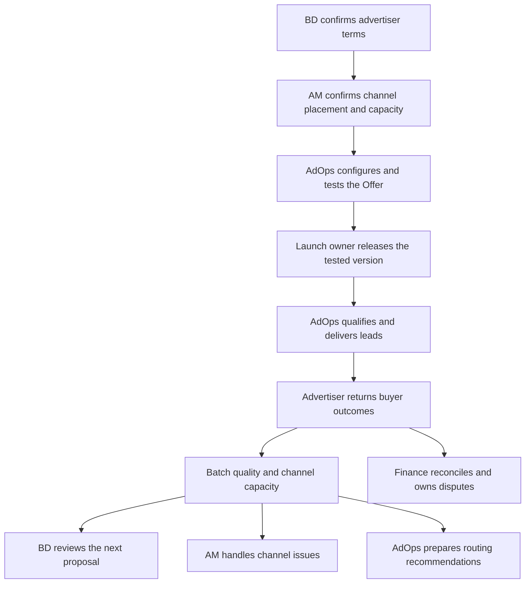
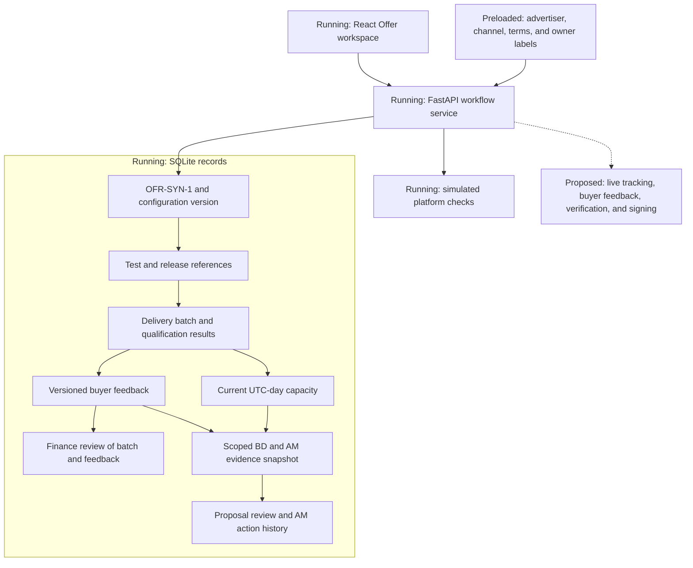
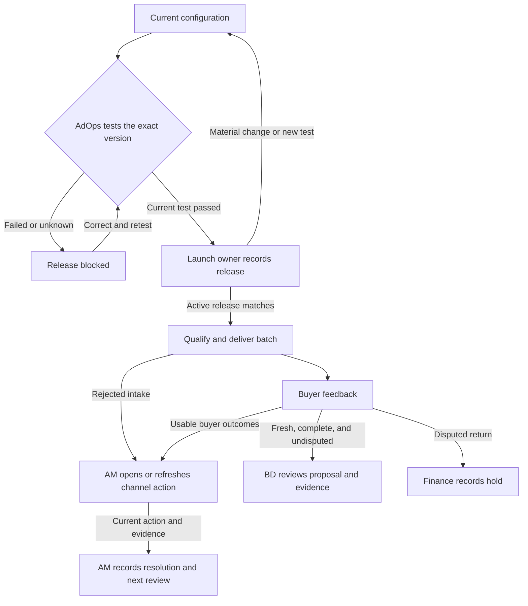

# Offer cycle architecture

## Level 1 — Business Capability & System Overview

A cost-per-lead (CPL) Offer connects what an advertiser will buy with what a channel can supply. Business development (BD) establishes the advertiser's commercial terms. Account management (AM) confirms the channel's eligibility and capacity. Ad operations (AdOps) configures and tests the placement, and the launch owner decides whether to release the tested version. AdOps then qualifies and delivers leads. The advertiser returns buyer outcomes, which inform BD's next proposal, AM's channel follow-through, and Finance's reconciliation.

The same synthetic advertiser `ADV-SYN-1`, Offer `OFR-SYN-1`, channel `CH-SYN-1`, and tracking Sub-ID `SUB-SYN-1` appear throughout this page. The fixture starts with **$40 advertiser revenue and $25 channel payout per qualified lead**, a **20-lead daily Offer cap**, and **30-lead daily channel capacity**. These values and the initial approvals are preloaded.

| Handoff | Accountable role and decision | What the system supports | Demo and live boundary |
| --- | --- | --- | --- |
| Advertiser intake to Offer | BD confirms the purchase criteria, price, and volume limit using approved terms. | Keeps advertiser identity and versioned terms with the Offer. | **Preloaded.** Live commercial approval and signing need an authorized owner and a confirmed process. |
| Offer to channel placement | AM confirms that the channel can supply eligible leads and sets the available volume. | Links the placement to its channel, Sub-ID, approval, and capacity. | **Preloaded.** Channel verification and live capacity sources need integration. |
| Placement to test | AdOps chooses the tracking mapping and checks whether the configuration is ready. | Records the mapping, configuration version, and test outcome. | **Demonstrated.** Platform mapping and postback checks are simulated. |
| Test to release | The launch owner reviews readiness and the passing test for the current configuration, then records release. | Binds the decision and owner note to the tested version. | **Demonstrated.** Production approver identity, account scope, and readback require confirmation. |
| Intake to buyer delivery | AdOps owns qualification and delivery. The service applies qualification and volume rules under the active release. | Records accepted and rejected leads with reasons in the delivery batch. | **Demonstrated.** A mixed batch delivers two synthetic leads and rejects two. Real consent and phone verification need providers. |
| Delivery to buyer outcomes | The advertiser, acting as buyer, supplies contact, appointment, sale, and return outcomes. | Ties buyer feedback to delivered leads and their batch. | **Demonstrated.** Feedback is entered through a synthetic scenario. Live buyer feedback requires an authorized source. |
| Outcomes to proposal review | BD uses current buyer outcomes and channel capacity to review commercial requests. | Provides a read-only margin preview and separates requested terms from approved clauses. | **Demonstrated.** BD reviews an unsent proposal. Commercial changes require their own approval. |
| Rejections or outcomes to channel follow-through | AM reviews the evidence, owns the next step, and records resolution. | Keeps the scoped action, resolution note, and next review time. | **Demonstrated.** The review is scheduled on the synthetic clock. Production ownership and cadence need confirmation. |
| Outcomes to routing recommendations | AdOps uses batch quality and remaining capacity to assess routing options. | Shows the evidence behind a routing recommendation. | **Demonstrated as a recommendation.** Live routing needs an authorized platform operation. |
| Outcomes to reconciliation | Finance reviews the batch and the buyer feedback used for billing. Finance owns a disputed return. | Shows provisional receivables and channel cost, or records a hold with amounts pending. | **Demonstrated.** Production billing, deductions, and settlement require confirmed rules and authority. |

Everflow is the platform in scope for CPL tracking and attribution. A separate Ringba adapter would handle numbers, targets, duration qualification, and outcomes for call-based Offers. Buyer feedback, verification, and signing services would supply the corresponding evidence for live operations. Confirm the company's platform accounts, responsibilities across AM teams, release authority, and sources of record before live use.

The [Offer demo guide](docs/offer-demo.md) contains the click-by-click walkthrough and setup commands.

## Level 2 — Technical Component & Data-Flow Architecture

React presents `OFR-SYN-1` and sends workflow requests to FastAPI. FastAPI checks versions, evidence, and eligibility, then records changes in SQLite transactions. The service runs on loopback with one worker and uses fixture-backed platform behavior in the same process.

- **Configuration and delivery.** The configuration has a version and fingerprint. The release binds that configuration to a passing test and its adapter rule version. Each delivery batch retains the release, channel scope, qualification facts, and simulated results. The service enforces the Offer cap and channel capacity across batches. [Offer records and workflow implementation at `49eb119`](https://github.com/ShenghangWang/Everflow-Affiliate-Network-Automation/blob/49eb1193d214a4b5171f8b43ecfbdebfcea1292f/backend/offer_v2.py#L37-L76)
- **Evidence and downstream records.** Buyer feedback links to the delivered batch and its lead IDs. BD and AM use a versioned reference scoped to advertiser, Offer, channel, and Sub-ID, with the active release, batch, matching feedback, and current UTC-day capacity. Quality describes the batch. Remaining capacity uses the configured daily ceiling and server-counted deliveries. Finance records the selected batch and exact feedback ID. [Evidence assembly at `49eb119`](https://github.com/ShenghangWang/Everflow-Affiliate-Network-Automation/blob/49eb1193d214a4b5171f8b43ecfbdebfcea1292f/backend/offer_followthrough.py#L93-L150)
- **Pricing preview.** A read-only request uses the current stored configuration's payout and floor. At a $25 payout and 20% floor, a hypothetical $50 price clears the floor at 50.00% base margin, while $30 falls below it at 16.67%. The result shows the configuration version and stays separate from both requested terms and approved clauses. Full cost, bonus, reserve, and return accounting need adopted definitions. [Pricing calculation at `49eb119`](https://github.com/ShenghangWang/Everflow-Affiliate-Network-Automation/blob/49eb1193d214a4b5171f8b43ecfbdebfcea1292f/backend/offer_v2.py#L137-L156)
- **Platform boundary.** The current service simulates Everflow mapping and postback verification. Live Everflow or Ringba operations need confirmed account access, tested request and readback contracts, and authorized operators. Real pricing, routing, billing, and payout follow their approved rules and authority.

## Level 3 — Workflow, State Machine & Execution Design

| Transition or control | Conditions and result |
| --- | --- |
| Configure, test, and release | A material edit creates a new configuration version and clears the current test and release. Running a new test clears the active release even if the configuration stays the same. A failed, unknown, or superseded test blocks release. The launch owner records release against the latest passing test for the current configuration after readiness checks. [Release and retest logic at `49eb119`](https://github.com/ShenghangWang/Everflow-Affiliate-Network-Automation/blob/49eb1193d214a4b5171f8b43ecfbdebfcea1292f/backend/offer_v2.py#L180-L269) |
| Deliver and replay | Delivery requires the active release for the current configuration. Reusing the same event ID and request returns current state with the original operation retained once. Reusing the ID with a different request produces a conflict. [Replay guard at `49eb119`](https://github.com/ShenghangWang/Everflow-Affiliate-Network-Automation/blob/49eb1193d214a4b5171f8b43ecfbdebfcea1292f/backend/offer_v2.py#L162-L170) and [release and delivery browser checks](https://github.com/ShenghangWang/Everflow-Affiliate-Network-Automation/blob/49eb1193d214a4b5171f8b43ecfbdebfcea1292f/scripts/check_v2_ui.mjs#L76-L93) |
| Prepare and review a BD proposal | Buyer outcomes stay unknown until feedback arrives. BD preparation requires complete and undisputed outcomes within the demo's 24-hour evidence limit. The server binds approved clauses from the current configuration separately from requested terms. Review checks the current evidence and proposal version. Changed evidence retains prior reviews in history and requires a fresh proposal and review. [Proposal and pricing checks at `49eb119`](https://github.com/ShenghangWang/Everflow-Affiliate-Network-Automation/blob/49eb1193d214a4b5171f8b43ecfbdebfcea1292f/scripts/check_v2_followthrough_ui.mjs#L151-L238) |
| Open and resolve an AM action | Rejected intake can prompt action before feedback. The service keeps one action for the batch and issue kind and refreshes its evidence when the open action changes. Resolution records the owner's note against current evidence and sets the next review 24 elapsed hours later on the synthetic clock. [AM action and resolution at `49eb119`](https://github.com/ShenghangWang/Everflow-Affiliate-Network-Automation/blob/49eb1193d214a4b5171f8b43ecfbdebfcea1292f/backend/offer_followthrough.py#L203-L301) |
| Review or hold a Finance outcome | Finance reviews the selected batch and exact current feedback for that batch. Superseded conclusions remain in history. A disputed return holds both provisional amounts and blocks BD and AM decisions on that evidence. Ordinary buyer feedback cannot clear the hold. Finance can return to the original disputed batch after newer deliveries. [Finance hold checks at `49eb119`](https://github.com/ShenghangWang/Everflow-Affiliate-Network-Automation/blob/49eb1193d214a4b5171f8b43ecfbdebfcea1292f/scripts/check_v2_followthrough_ui.mjs#L249-L280) |

BD and AM decisions check the exact active release ID. After retesting and releasing the same configuration, the quality overview can still show an earlier batch. Run a new batch to produce evidence for the new release. [Decision gate at `49eb119`](https://github.com/ShenghangWang/Everflow-Affiliate-Network-Automation/blob/49eb1193d214a4b5171f8b43ecfbdebfcea1292f/backend/offer_followthrough.py#L104-L109)

### Open business decisions

| Decision | Treatment in the demo |
| --- | --- |
| Does the 72-hour return window start at lead generation or delivery? | Retain event times and hold disputed returns for Finance while the start event and boundary are confirmed. The earlier BD no-response timer is separate. |
| Does Tier 1 require both volume and quality, or either condition? | Retain qualification and outcome evidence. The pricing preview evaluates base CPL margin and the configured floor. Tier eligibility and repricing need a commercial decision. |
| Can an above-cap upstream return create a supplier deduction? | Keep upstream billing and downstream deduction decisions separate. A disputed return holds both provisional totals with Finance. |

### Historical architecture

The [Day 1 architecture at `033795f`](https://github.com/ShenghangWang/Everflow-Affiliate-Network-Automation/blob/033795f9be852c46ed34f87f3504d21dfa759bee/architecture.md) describes the earlier roles, source mapping, proposal review, recurring AM, and reconciliation workflows. The [verified Offer walkthrough at `49eb119`](https://github.com/ShenghangWang/Everflow-Affiliate-Network-Automation/blob/49eb1193d214a4b5171f8b43ecfbdebfcea1292f/docs/offer-demo.md) records the current demonstration sequence and verification commands.
