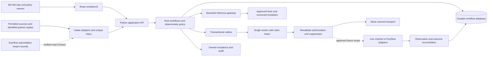
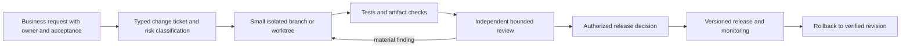

# Affiliate network automation foundation architecture

Day 1 HLD · 2026-11-04 · work instruction: delivery brief v1.3. **SPONSOR DIRECTION:** deliver complete system architecture, retain accountable human owners, use React + Python, and challenge the same frozen packet independently with Codex/Gemini. The user has adopted the minimum baseline; package acceptance remains pending with the employer/business sponsor, checkpoint time TBC. Handover follows the existing written engagement agreement, which has not been supplied; unspecified obligations remain unresolved. **SOURCE REQUIREMENT:** the business mandate is overseas affiliate BD, negotiation, onboarding, AM and Ops (business original P003–P038; roles original pp.1–4). Requirements and source dispositions are in [requirements.md](requirements.md). All architecture choices below are **PROPOSED DESIGN / designed-only** unless delivery evidence separately marks an implementation tested. A diagram is not proof of implementation, access or acceptance.

Insurance is an optional **ILLUSTRATIVE USE CASE**, omitted from this baseline. A B2B partner prospect is not a consumer enquiry. No industry-specific field, buyer rule or insurance integration is mandatory. Actual tenant, channel permissions, approved offers and company acquisition mix are **UNRESOLVED DEPENDENCY** items. Public-document checks are **VERIFIED CAPABILITY (documentation only)**, not tenant execution. Exact evidence and retrieval limitations: [research record](evidence/research/checked-2026-11-04.md).

## 1 Context components and deployment M01



Choose a modular FastAPI application rather than six communicating runtime agents: intake/conversations; terms/onboarding; integration assistance; AM/issues; reporting/reconciliation; policy/execution; inference/usage. One common data contract, policy gate and audit applies across all six business roles. SQL/curated records suffice for approved-fact lookup initially. No broker, vector database, autonomous runtime swarm or multiple model providers is justified by the local slice.

Local deployment: React assets served with the Python application or a loopback development server; API bound to `127.0.0.1`; SQLite on local disk; **one application worker**; UTC instants and injected demo clock; fixture transport; no secrets in frontend. A local single-user demo does not implement production identity or tenant isolation. SQLite serializes writes and is unsuitable here for multi-host workers; backup uses SQLite's consistent backup API after pausing the worker, with a restore rehearsal. Do not copy a live database file mid-write as a backup. Retain pending/unknown actions across application restart.

Feasibility update: isolated `.venv` FastAPI 0.115.12 / uvicorn 0.34.3 and React dependencies are now installed, as reported by root launch evidence. Primary demo target is one loopback FastAPI port serving built React; a standard-library fallback may preserve independent local work but does not substitute for the agreed React + Python minimum. Installation is not a passed launch/UI test; use actual evidence in delivery.md.

Deployed design: TLS/reverse proxy → authenticated API → PostgreSQL, scoped worker and approved adapters; secret manager; role/tenant enforcement; migrations; backup/PITR and restore tests; central redacted logs, metrics and on-call alerts. Multi-worker claims use database row locking/leases and atomic financial reservations. Shared/public release is blocked until authentication, cross-tenant tests, origin/CSRF protection, retention, backup and operational ownership are verified. No infrastructure purchase or deployment follows from this HLD.

## 2 Six workflow contracts M02–M06 and A01–A06

Every external-text input is untrusted data. Owners below are proposed business roles, not invented named employees; the sponsor assigns people and backup owners before live operation. Business stages and action execution states are separate.

### A01 Outbound Hunter M02 M03 M04

- **Actor / trigger / input:** BD owner; a permitted form, import or authorized source feed supplies organization/contact, source evidence, collection time and contact eligibility. Multiple permitted sources use the same intake contract (business P011–P013; roles p.1).
- **Authoritative facts:** provenance record, verified contact attributes, permission/suppression records, approved offer/fact version. Unknown traffic or vertical remains unknown; public availability alone is not outreach authority.
- **State transitions:** received → deduplicated → eligible/needs-review/rejected → drafted → policy-authorized or awaiting-approval → contacted → replied → standard-response or owned BD handoff; suppression terminates pending follow-up. Negotiation substate discovery → approved-facts lookup → bounded proposal/counterproposal → objection/escalation → agreed-terms intake or closed.
- **Rule / LLM boundary:** normalize IDs/email, dedupe, eligibility weights, round budget and scheduling in code; optional model extracts evidence-backed profile, reply intent and English wording. Known FAQs retrieve approved payout/traffic/settlement facts; binding/numeric terms render from approved structured fields. Never let free-text prose smuggle a new term. Two standard reply rounds proposed within the original 2–3 range (P020); missing/ambiguous terms or difficult final negotiation escalates.
- **Permitted effects / human exception:** labeled template draft and durable mock send under synthetic policy. Live dispatch only under an approved envelope or action approval. Clear interest, requested human, ambiguous/negated consent, out-of-policy concession or model validation failure creates an owned handoff. Notify via an approved internal channel; otherwise dashboard task persists. No automatic contract acceptance.
- **Output / owner / recovery:** qualified prospect and provenance, conversation, terms history, action IDs, next due time and named BD assignee; duplicate events reuse inbox keys, transient pre-acceptance failure retries finitely, uncertain acceptance quarantines. Opt-out stops future sending. Unclaimed handoff ages to the BD supervisor.
- **Acceptance:** T01–T10 cover generic lead → English draft → authorized mock dispatch → payout question with exact approved answer → clear-interest handoff. At 72 elapsed hours without ingested reply, exactly one eligible follow-up is due; reply/opt-out/handoff cancels it (business P018–P022).

### A02 Onboarding AM M02 M03 M06

- **Actor / trigger / input:** BD hands off an approved terms version and meeting notes to onboarding AM; intake checklist contains legal entity/contact, offer reference, required documents, signatory and activation owner (roles p.1; business P027).
- **Authoritative facts:** signed/approved commercial record and approved IO/contract template; partner-confirmed intake information. Meeting-note extraction is a proposal, never authoritative price or signature.
- **State transitions:** terms-pending → intake-incomplete → draft-IO/proposal/payout-strategy → commercial/legal approval → signature-pending → signature-verified/account-created-pending-activation → technical-ready → activation-approved → AM-owned active account → first-outcome-verified. Every material revision produces a new terms version and invalidates old action authority.
- **Rule / LLM boundary:** required-field validation, template selection, deadline and signature-status verification are deterministic; model may summarize notes and draft English passages with evidence IDs. Missing tax/legal/commercial fields remain explicit gaps; no invented payout, billable event or settlement period.
- **Permitted effects / human exception:** local checklist and drafts; future signature requests/group creation require approved recipients, document hash and adapter access. Commercial owner approves final terms, signatory signs; ambiguous identity, disputed terms or unsigned contract blocks activation rather than being inferred from an email.
- **Output / owner / recovery:** versioned partner record with activation owner and handoff receipt; onboarding AM owns completion, BD owns commercial exceptions. Idempotent case creation; expired link or signature webhook gap reconciles through provider status/manual evidence; partially completed tasks resume without duplicate signature request/group.
- **Acceptance:** approved synthetic terms create a complete draft/checklist; missing signatory blocks release; duplicate/out-of-order signature fixtures create exactly one account **pending activation**, not an operationally active account. Shared readiness predicate: approved signed terms/checklist, matching current integration release/test version (or an explicit owner-approved not-applicable integration gate), and accountable activation-owner approval. Missing mapping/failed tests block activation; completing matching gates permits activation once and creates a dated AM follow-through task. First agreed outcome verification is a subsequent AM milestone; a material mapping/test regression reopens readiness and an owned issue. Original “2分钟以内” remains a measured aspiration, not a three-day guarantee.

### A03 Integration Bot M02 M05

- **Actor / trigger / input:** integration owner receives authorized partner docs, approved offer reference, allowed sandbox target, credentials supplied separately and example payloads (roles p.2).
- **Authoritative facts:** approved partner API contract and verified selected platform schemas; mapping version, required fields/units and actual tenant access. Neither generated mapping nor observed HAR is a recovered internal database schema.
- **State transitions:** docs-received → schema/mapping-proposed → reviewed → sandbox-configured → positive/negative contract-tests → release-approved → activated → monitored; any contract/version change returns to validation.
- **Rule / LLM boundary:** model interprets prose/PDF and proposes ping-post/postback mappings; code validates fields, auth placement, currency/units, allowed URLs and response semantics. No arbitrary generated code, shell, SQL or URL fetch executes. Documentation text cannot change allowed operations or reach credentials.
- **Permitted effects / human exception:** mapping/config drafts and local sandbox fixtures. Live configuration, ping-post calls or test leads/calls require explicit sandbox scope and release authority; uncertain required field/auth/timeout semantics goes to integration engineer. Distinguish management webhook events from conversion/S2S postbacks.
- **Output / owner / recovery:** versioned mapping, test evidence, release/rollback plan, business activation acknowledgment; integration owner handles auth/schema failures, reverts verified prior config and keeps failed work queued. A failed technical setup never silently marks onboarding complete.
- **Acceptance:** synthetic required-field omission fails; valid mapping passes fixture contract tests; expired release authorization blocks apply; retry/restart never duplicates configuration. “80%/15分钟” stays in the KPI register pending real contract variety and sample denominator.

### A04 Customer AM M03 M06

- **Actor / trigger / input:** identified existing partner asks a question, requests a change or reaches a scheduled health/activation review (roles pp.2,4; recurring AM mandate). Input is bound to tenant, account and requester identity; an asserted assistant identity is insufficient.
- **Authoritative facts:** current approved terms, verified permitted account snapshot, policy envelope, issue ownership and freshness. Source data timestamps travel with answers.
- **State transitions:** request/review-due → identified → facts-current or stale → classify/qualify → routine answer/allowed-action proposal → authorization → execution → readback/verification → follow-through → closed, or owned escalation with due time. Activation remains open until the first agreed outcome is checked; health/opportunity cases recur on proposed weekly cadence, configurable by owner.
- **Rule / LLM boundary:** deterministic role checks, health thresholds, exact cap/status bounds and verification; model understands English requests, summarizes account health and drafts a response/opportunity from approved facts. Negotiation uses the same terms/version rules as A01; never infer authority from model confidence.
- **Permitted effects / human exception:** routine exact-fact responses and mocked commands under synthetic envelope; live cap/pause/payout actions require separately approved scope. Out-of-policy or stale-data request, commercial finalization, contradictory instruction or complaint goes to AM/BD/Ops owner. An emergency stop needs pre-authorized tested bounds.
- **Output / owner / recovery:** answer/action receipt, issue or opportunity, next due task and account-health history; account AM owns outcome, supervisor catches overdue tasks. Unknown provider outcome triggers lookup/readback; absence of confirmation remains open, never a success message.
- **Acceptance and concrete cycle:** synthetic account activated Monday → weekly freshness check finds low activation → AM drafts exact-fact check-in → partner reports tracking problem → integration owner receives issue → sandbox evidence/readback confirms fix → AM verifies first accepted outcome and closes issue → next health review scheduled. A stale snapshot blocks automatic cap increase; unresolved issue remains owned. No claim that 5-second/90% source target has been measured.

### A05 Reconciliation M05 M06

- **Actor / trigger / input:** finance/Ops scheduled daily/weekly close or overdue receivable; supplier and buyer reports plus approved terms, event IDs and settlement evidence (business P038; roles p.2).
- **Authoritative facts:** original report versions and windows, approved billable-event definition, currency/units, actual payment ledger. An Everflow conversion is not automatically a billable sale or a cash receipt.
- **State transitions:** awaiting-aligned-data → compared → matched/discrepant/incomplete → evidence assembled → dispute/collection draft → human decision → verified adjustment/payment → closed or next follow-up. Corrections reopen the affected period with version history.
- **Rule / LLM boundary:** Decimal/integer arithmetic and deterministic joins by authoritative IDs, zero/unknown denominator handling, no cross-currency sum without approved FX basis. Model may explain already-computed variance and draft English appeal/reminder; it neither calculates balances nor declares fraud or agrees settlement.
- **Permitted effects / human exception:** local comparison, evidence report and drafts. Finance approves dispute, settlement and collection dispatch; no autonomous payment. Missing IDs, conflicting windows/FX or unreconciled adjustments create an incomplete-data case rather than a fictitious zero variance.
- **Output / owner / recovery:** variance per item/period, source hashes and counts, overdue record, evidence links, named finance/AM decision owner. Checkpointed reads re-fetch overlap; report failure preserves last complete snapshot visibly stale; retry doesn't create duplicate receivables or appeals.
- **Acceptance:** aligned synthetic USD reports show an exact difference and denominator; >5% source-proposed variance produces evidence and draft; late correction recomputes and versions result; missing currency blocks aggregation. Finance marks payment only from synthetic receipt evidence. Monday 09:00 timezone is an owner decision, not silently Beijing or tenant time.

### A06 Traffic Guard M05

- **Actor / trigger / input:** Ops consumes validated clicks/conversions/rejections and health signals or a scheduled check (business P035; roles pp.2–3).
- **Authoritative facts:** source/window/counts/ingestion time, approved baseline and configured thresholds; traffic and billing denominators are separate. A spike is an observation, not proof of fraud.
- **State transitions:** data-arrived → quality/freshness checked → normal/anomaly/stale → evidence/issue → alert or authorized bounded mitigation → outcome readback → recovery/rollback → case closed; repeated alert keys deduplicate the same incident.
- **Rule / LLM boundary:** deterministic completeness/freshness checks, minimum sample, baseline comparison and spend-with-no-outcome rule; model optionally summarizes evidence and labels competing diagnostic hypotheses. No model-driven financial calculation or ad/routing command.
- **Permitted effects / human exception:** alert/evidence and mock mitigation only. Routing/cap/pause writes require verified adapter, pre-authorized targets/limits, expiry and rollback. Without them alert the Ops owner; stale/late data disables automated mitigation and raises data-health incident.
- **Output / owner / recovery:** incident with source evidence, response owner and outcome check; integration owner handles feed failure; Ops owns mitigation decision and AM partner communication. If mitigation outcome is unknown, quarantine command and reconcile observed state before retry/revert.
- **Acceptance and concrete Ops exception:** two fixture windows show a conversion spike → counts/window checked → anomaly evidence created → no live routing authority means alert-only → Ops assigns integration owner → late conversions explain apparent spike → corrected snapshot clears incident with reason and AM follow-through. A timed-out mock pause is marked unknown until readback. The source's 10-minute polling and ≤3-minute response cannot guarantee detection within 3 minutes of occurrence. Measure occurrence→provider availability (feed latency), availability→ingestion, ingestion→rule decision, decision→alert/authorized command, and command→verified effect separately; include worst-case poll wait and missing/late events. Ops/integration owner must define the response start/end and approve a measured feed/cadence before adopting a KPI; do not promise an end-to-end source SLA.

## 3 Data ownership and contracts

| Entity / key | Authoritative owner | Automation-owned fields and invariants |
|---|---|---|
| Organization/contact / stable tenant-scoped ID | Verified intake/partner record; Everflow only after tenant mapping confirmed | Source records, normalized contact and suppression; preserve multiple provenance records after dedupe. Contacts are B2B, no consumer-data assumption. |
| Lead / source-event ID | Intake evidence | Qualification explanation, stage, assignee, next action; unique `(tenant, source, event_id)`; repeated source receipt cannot resend. |
| Conversation/message / provider ID | Provider acceptance/reply evidence | Immutable content version, received/accepted UTC instants, round count and reply cursor; unique inbox key. |
| Negotiation / terms version | Approved commercial owner | Requests vs allowed offers separated; exact currency, amount/unit, billing criteria, settlement period, effective/expiry dates and approval reference. Never overwrite old terms. |
| Onboarding case / account ID | Approved intake/signature evidence | Checklist, signature status, activation and AM owner; IO is a draft until signed and verified. |
| Mapping/offer reference / external ID | Confirmed Everflow/partner platform | External IDs and schema/config versions; no duplicated editable financial master. |
| Performance snapshot / source+window+revision | Confirmed platform reports | Observed/ingested times, requested timezone/currency, units, completeness, source hash and lateness/correction history. |
| Issue/recommendation / case ID | Application and assigned business owner | Evidence, severity, hypotheses, decision, next check, due date and verified closure. |
| Authorization / binding hash | Policy owner or authorized human approver | Distinct `human_approval` / `delegated_policy_authorization`; target, recipient, action/content/terms/policy version, expiry, limits and revocation. Models have no write access. |
| Outbox action / stable action ID | Application | Business stage separate from scheduled/authorized/executing/succeeded/cancelled/failed/unknown outcome; unique intent key, attempt count, claim token/lease, provider receipt. |
| Audit / immutable event ID | Application | Actor, UTC time, source/version references, policy result/reason, mode, owner, attempt and redacted outcome. No credentials or unnecessary raw personal text. |

Common intake contract: `schema_version, tenant_id, source_type, source_event_id, observed_at, received_at, organization/contact, eligibility_evidence, source/campaign_evidence, attribution_method, source_version`. Unknown source/attribution remains `unknown`; do not infer AI origin from user agent or polished wording. Future consumer enquiry adapters must use a distinct entity/contract and are not required by this baseline.

Reporting contract: explicit `[from,to)` instants for local normalized windows; selected vendor boundary inclusivity tested before translation; reporting timezone, currency, event status and unit; `observed_at`, `ingested_at`, complete/partial and correction watermark. Proposed incremental polling uses saved high watermark plus overlap (initial 24 hours, owner-confirmed lateness), deduplication and periodic closed-window reconciliation. Advance watermark only after all pages are committed. DST/month-boundary, late rejection and corrected revenue fixtures must not silently change denominators. “流水消耗” remains undefined until employer selects its financial meaning.

**Mutable report consistency (CR-03):** reaching the final page is necessary but never sufficient to call a report complete. Record each fetch attempt's fixed window/as-of point, requested ordering/cursor, snapshot token if supported, page boundaries, unique IDs, response versions and available authoritative counts/totals. Compare IDs/counts/totals against that immutable contract. Tenant verification must establish whether the operation offers stable ordering/snapshot isolation and how inserts/rejections/corrections affect paging. If it does not, use a bounded, owner-approved settling/re-fetch/reconciliation procedure and label the result `observed-stable` or `partial/uncertain`, not a proven immutable snapshot. No automatic mitigation or final automatic financial conclusion may consume an unproven snapshot; retain an owned data-health case and permit clearly labeled alert-only observations. Later corrections create a new snapshot revision, invalidate/reopen dependent comparisons/incidents, and reconcile affected decisions without double-counting. Verify with a fake source inserting/removing/correcting records between pages, including beyond overlap: either match an authoritative immutable snapshot/control total or remain uncertain and block the affected effect. This is a designed release check, not an executed tenant test.


## 4 Authority and reliable execution

| Action class | Default / authorized automatic envelope | Exception owner and verification |
|---|---|---|
| Intake, dedupe, draft, calculate | Local deterministic processing of permitted data | Data/source owner resolves missing provenance or definitions. |
| Outreach, standard reply, follow-up | Mock only initially. Live envelope enumerates eligible accounts/offers/channel/recipients; content/terms policy; per-contact/day frequency; two reply rounds; expiry; opt-out and owner. | BD owns policy; clear interest, unknown intent or negotiation outside exact terms creates owned handoff. Provider receipt confirms acceptance, not human delivery. |
| IO/signature/group creation | Draft until exact parties/content/template and action approved | Commercial/legal/onboarding owner; verify external signature/provider status before activation. |
| Cap, pause, reroute, emergency stop | No live authority initially; future bounded target/action range, cooldown, expiry, preconditions and tested rollback required | Ops policy owner and appropriate account authority; readback and follow-through required. |
| Dispute, collections, payout/settlement | Calculation/evidence/draft only; each live effect needs its actual authority | Finance/commercial owner; cash receipt and agreed settlement kept separate. |

Authorization is evaluated at creation, claim and immediately before transport. A material recipient/content/terms/policy/target change, expiry, revocation or exhausted quota invalidates the binding. Model confidence never supplies authority. Emergency kill switch cancels eligible pending effects; it does not claim to recall accepted messages or undo provider actions.

**Shared-target command ordering (CR-01):** consequential AM and Ops commands share one target-control record `(tenant, account/campaign/route, control_epoch, observed_state_version, incident_hold, winning_decision)`. Serialize dispatch per controlled target. Authorization binds the epoch, expected observed preconditions and compatible action; check these again at claim and immediately before execution. A Guard mitigation decision advances the epoch, places an incident hold and supersedes incompatible queued AM resume/cap/reroute commands, including actions/leases recovered after restart. An open hold can be cleared only by an explicitly authorized Ops recovery owner under account authority, using fresh readback and a new recovery decision/epoch; never revive a superseded intent. Manual/provider changes reconcile into a new epoch and block stale commands. Late receipts attach to their original decision and trigger observation/reconciliation; they cannot overwrite the newer winning target state. Proposed verification: queue AM resume → newer Guard pause → run/restart old intent; target must remain paused/old command superseded; separately race actors, inject manual change and test newly approved recovery. Target control is designed-only because the current mock BD slice implements no shared campaign controls. These rules add no live authority or extra mechanism to harmless drafts.


```mermaid
sequenceDiagram
  participant S as Source/reply adapter
  participant A as Application
  participant D as Database
  participant W as Worker
  participant P as Mock/provider
  S->>A: Lead event + provenance
  A->>D: Transaction: unique inbox, qualified lead, draft, audit
  A->>D: Validate policy and binding; outbox intent
  W->>D: Atomically claim due action, lease and current policy
  W->>D: Final reply/suppression/handoff and binding recheck
  W->>P: Validated application command and stable action ID
  alt confirmed acceptance
    P-->>W: receipt and acceptance time
    W->>D: Succeeded; create follow-up only if no reply/suppression/handoff
  else timeout after possible acceptance
    W->>D: Unknown outcome; no blind resend
    W->>D: Enqueue bounded reconciliation job; release dispatch worker
  end
  S->>A: Ingest reply with unique provider ID
  A->>D: Transaction: reply + cancel follow-up + owned next state
```

Use transactional inbox/outbox updates and conditional claim updates/leases. After crash, recover expired pre-dispatch leases; a crash/timeout after possible transport acceptance becomes `unknown_outcome`, not a fresh ready action. No local ID alone provides exactly-once external delivery. A verified provider idempotency key or status lookup is required to retry an ambiguous write; otherwise quarantine for operator resolution. Mock deduplication proves local logic only.

The adopted minimum includes a configurable **demo rule of 72 elapsed hours from initial provider acceptance in UTC**; calendar/business-day semantics remain business-unconfirmed. This is separate from the engagement's three working days. Persist reply, suppression and handoff cancellation with the reply transaction. Recheck them when claiming and directly before sending under the application's serialization/lock protocol. Test reply arriving between claim and transport. There is still an unavoidable external gap: a reply not yet ingested, or arriving after final check, can race with sending. For live release require documented reply-ingestion lag, pre-send channel resynchronization when supported, and a proposed 60-second grace/recheck; measure it rather than claiming zero races. Quarantine when channel health/freshness is unknown. Do not hold a database transaction over a slow network call in the deployed design; use fenced claim/dispatch intent and explicit unresolved-outcome handling.

Known provider rejection before acceptance: finite retry only for a classified transient error, same logical action, backoff/jitter and attempt cap. Validation/auth errors fail to owner. Retry queue and dead-letter/unknown queue remain visible. Metrics: queue age, failed/unknown actions, lease expiry, reply lag, snapshot freshness and overdue issue ownership. Alert owners when recovery needs a decision; a silent draft is not successful dispatch.

## 5 Integration evidence and channel capability

Public checks below dated **2026-11-04**; actual tenant access for every operation is **UNRESOLVED DEPENDENCY**. Official docs describe different API realms and US/EU hosts. Keys stay server-side. The [authentication guide](https://developers.everflow.io/user-guide/authentication) documents wrong-realm 403 and key scopes; knowing a URL does not establish a permission.

| Selected operation | Documentation / method and path status | Class / ownership / auth | Paging, limits, errors, freshness | Verification and fallback |
|---|---|---|---|---|
| `fetch_performance` | [Conversion report](https://developers.everflow.io/api-reference/post-networksreportingconversions): documented candidate POST `/v1/networks/reporting/conversions`; selected only if Network realm confirmed | Read-class POST; tenant report is authoritative; HTTPS API key, correct region/scopes | [Paging](https://developers.everflow.io/user-guide/paging): query-string page/page_size, 1-based; [limits](https://developers.everflow.io/user-guide/rate-limiting) network-wide shared quotas, Network 30/s; reporting concurrency 10; parse `error` and `Error`; explicit [timezone](https://developers.everflow.io/user-guide/timezones) and currency. Actual freshness unknown. | Integration owner checks tenant role and sample authorized read, pages/counts/window/status, 401/403/429/timeout and lateness. Fixture snapshot until verified. If Affiliate/Advertiser realm, select its documented operation before coding adapter. |
| `fetch_offer_reference` / partner sync | Abstract operation until tenant-selected resource/schema confirmed; [API families](https://developers.everflow.io/) documented | Read; confirmed tenant platform fields authoritative; scoped key | Check endpoint pagination and update timestamps; overlap/reconcile; no claimed universal freshness | Integration owner validates actual field ownership/IDs and current terms source; fixture refs. |
| `ingest_platform_event` | [Management webhooks](https://developers.everflow.io/webhooks/overview), [conversion/event notifications](https://developers.everflow.io/webhooks/conversion-webhooks) are documented; no application callback deployed | Inbound event; configured by Network admin; verify payload/tenant and actual origin/auth mechanism before trust | Unique event key; webhook retry/order/completeness/signing not verified. Conversion notification uses simplified payload; reconcile against reports. | Tenant admin confirms enabled events and secure receiver contract. Checkpointed polling/fixture fallback. Conversion S2S postbacks are a distinct integration. |
| `dispatch_message` / `ingest_reply` | Mock transport selected; live channel method/path not selected | External write/inbound; approved sender identity/recipient and server credential required | Provider acceptance vs delivery, idempotency/status lookup, ingestion lag, rate limits/429 and suppression must be contract-tested | Channel owner supplies approved channel/test recipients and permissions. No cold send authorized by work brief. |
| `draft_language` / `classify_reply` | Replaceable inference interface; no provider/model/pricing/access selected | Runtime inference disabled without configured authority, prices and budgets; curated facts only | Max two attempts, input/output/deadline and monetary limits below; timeout usage uncertain | Engineering owner verifies provider-supported limits and held-out eval. Labeled template/fixture fallback. |
| `request_signature` / `apply_integration` / `apply_cap_or_route` | Abstract future adapters; document-3 tool names are candidates | Consequential writes; human/delegated authorization as above | Verify provider schema, idempotency/readback and rollback; no invented endpoint | Commercial/integration/Ops owners supply access; drafts and mock commands continue. |

| Channel | Who may initiate / recipient eligibility | Replies and sender identity | Suppression / limits / access |
|---|---|---|---|
| Mock baseline | Synthetic allowed contacts under synthetic policy | Synthetic reply injection; clearly mock sender | Persistent opt-out/cancel rules; local configurable limits; no real recipient or network effect. |
| Email candidate | Only after business owner approves lawful/contractually permitted recipient scope and sender account; source discovery is separate permission | Mailbox/provider contract and reply correlation not verified | Local suppression plus unsubscribe/bounce handling; provider quota unknown; no account configured. |
| Telegram standard bot candidate | [Official bot guide](https://core.telegram.org/bots) requires user initiation or group addition; no arbitrary cold-DM assumption | Bot identity; group privacy mode limits received messages | Persistent opt-out; [FAQ](https://core.telegram.org/bots/faq) advises 1/chat/sec, 20/group/min, roughly 30/sec free bulk and 429 handling; actual bot/access absent. Business features separately scoped. |
| Teams/Slack/WhatsApp/WeCom candidates | Tenant/app membership, recipient eligibility and proactive-message rules require selected official contract | Sender/app identity and reply subscriptions unverified | No assumed quota, permission or installed app. Internal handoff remains a durable dashboard task. |
| Consumer Skype | Retired; no new baseline adapter | [Microsoft notice](https://support.microsoft.com/en-us/skype/skype-is-retiring-in-may-2025-what-you-need-to-know) confirms 2025-05-05 retirement; excludes Skype for Business | Teams is not presumed an API-compatible replacement. |

## 6 Rules AI quality cost and security

| Responsibility | Mechanism and reason | Rejection / degraded behavior |
|---|---|---|
| Identity, dedupe, eligibility weights, round limits, 72h scheduling, ownership, authorization and execution | Deterministic state/constraints; facts and known workflows are explicit | Unknown fields or missing authority block the relevant effect and retain owned work. |
| Money, reconciliation, payout/billing/report denominators, thresholds | Decimal/integer computation with currency/unit/window versions | Missing cost ≠ zero; no cross-currency arithmetic or model arithmetic. |
| Profiles, free English replies/objections, meeting notes and authorized API prose | One focused bounded model call can add language interpretation/drafting | Evidence IDs and task schema checked; unsupported facts, hostile instructions, negation/ambiguous terms route to human. Template fallback visibly labeled. |
| Approved FAQ and numeric/binding terms | SQL/curated facts and deterministic rendering | Free text containing unverified commercial terms requires human review; valid JSON alone is insufficient. |
| Diagnostics | Rule detects anomaly; model may summarize evidence/hypotheses | Never infer fraud, root cause, consent or execution permission from model confidence. |

The rules-first recommendation is specific to this workload. [Anthropic's effective-agents guidance](https://www.anthropic.com/research/building-effective-agents) supports starting with suitable simple patterns. Its [research-system account](https://www.anthropic.com/research/multi-agent-research-system) reports cost and quality tradeoffs for that workload, not a universal 15× forecast. Jev is a learned provider candidate: [Noul](https://docs.typesafe.ai/primitives/noul) judges a yes/no proposition; [Choice/Score confidence](https://docs.typesafe.ai/confidence) describes distributions. A universal 0.90 threshold certifies neither task correctness nor commercial authority.

The adopted minimum includes a replaceable inference adapter, schema/fact/terms output validation and a visibly labeled offline template fallback. Actual model calls require approved runtime access, pricing and budget; current live credentials are absent. Proposed runtime contract: known deterministic events use **zero model calls**. Each language event has at most **two total provider attempts**, including retries/escalation/switch; no recursive agents/fan-out. Approximately 4,000 input tokens, 800 output tokens including any configured billable reasoning reserve, and a 30-second application deadline, refined against actual provider controls. Safely reject oversized tasks rather than silently dropping necessary facts. Retry only a classified transient error with remaining budget, never to obtain a preferred commercial answer. Provider switch requires configured approval and consumes the same event budget.

Before paid inference, approved per-workflow/daily monetary ceilings, currency and complete price schedule are mandatory. Atomically reserve worst-case configured billable usage before a call; settle actual usage including failed/retried/reasoning tokens; keep unknown/timeout usage conservatively reserved, stop when cost cannot be bounded, and reconcile billing later. Missing price/budget disables paid calls. No runtime paid calls are claimed here. Local inference also incurs capacity/operations costs. One uvicorn process can still handle concurrent API/threadpool calls. Before enabling any paid adapter, SQLite must atomically check and reserve budget in a short BEGIN IMMEDIATE transaction, then commit before making a provider call; worker count does not serialize API inference. Shared/multi-host production requires the corresponding PostgreSQL transaction/locking contract.

Usage/audit fields: provider/model, prompt/model/policy/source/terms versions, attempt, latency, cache hit, input/output/other billable tokens, actual/estimated/uncertain cost, validation failure/escalation and linked successful business outcome. Sensitive text redacted. Tenant/account-isolated cache key includes normalized input plus all relevant versions; current policy is rechecked on cached output. Budget outage/invalid model result retains work for review and preserves deterministic scheduling/calculation.

Held-out evaluation before live language automation: proposed 12–20 labeled cases including unsupported facts, invented payout, opt-out, human request, negation/ambiguity, hostile source text, malformed JSON, stale facts, model outage, attempt/deadline/token/budget bounds and version-cache invalidation. Count completion and unsafe/incorrect automatic decisions; repeat selected high-risk cases within approved evaluation budget and record actual usage/sample sizes. Fixture tests do not prove production accuracy or a claimed automation percentage.

Security design: allowlisted typed commands; model sees minimal authorized facts and no credential, SQL/shell execution, policy-edit or arbitrary tool capability. Source/API/document text cannot become instructions. Server secrets outside source/logs and frontend; least privilege by tenant/account/action; auditable approval/command distinction. PII minimization, access-controlled evidence, retention/deletion schedule and redaction require owner confirmation. Production role model: viewer; BD/AM/Ops operator; commercial/finance approver; policy administrator; integration service. Privilege and tenant checks occur in API/worker, never only in React. Separate change-of-policy authority from routine executor. Local mock boundary does not prove production RBAC.

## 7 Acquisition resilience evidence decisions and validation

The following are **external facts / limitations**, checked 2026-11-04, not employer requirements or evidence of this employer's acquisition mix. [Research record](evidence/research/checked-2026-11-04.md) preserves publication dates, locations and retrieval issues.

| Evidence | Bounded interpretation |
|---|---|
| [Alphabet Q3 release](https://www.sec.gov/Archives/edgar/data/1652044/000165204426000080/googexhibit991q32026.htm), 2026-10-28: Google advertising USD 82.012B vs 74.182B; calculated +10.55%; Search +12% | No broad advertising revenue collapse in this quarter. Aggregate platform revenue does not measure publisher referrals. |
| [Alphabet Q3 call](https://abc.xyz/investor/events/event-details/2026/2026-Q3-Earnings-Call-2026-Ujou16CTw9/default.aspx), 2026-10-28: management attributes part of Search deceleration to lower AI Mode monetization, alongside FX/vertical factors | Slower growth differs from absolute decline; management explanation is not our observed causal funnel. |
| [Pew](https://www.pewresearch.org/short-reads/2025/07/22/google-users-are-less-likely-to-click-on-links-when-an-ai-summary-appears-in-the-results/), 2025-07-22: March U.S. panel N=900, traditional clicks 8% with summaries vs 15% without | Observational query/device/period differences prevent a universal causal or employer forecast. |
| [Wang et al.](https://arxiv.org/abs/2608.18352), 2026-08-18 preprint: preregistered N=1,100 experiment, removing AI features increases publisher clicks | Experimental evidence in a bounded search setting; preprint and not an affiliate-margin estimate. |
| [Google Ads guidance](https://support.google.com/google-ads/answer/18826097?hl=en) and [2026-05-20 announcement](https://blog.google/products/ads-commerce/google-marketing-live-search-ads/) describe AI-search ads, in-ad Business Agent for Leads and aggregate placement reporting | Platform may capture more interaction. Product announcement does not establish export/API/account eligibility or AI-only attribution. |
| [Adobe](https://business.adobe.com/blog/ai-traffic-higher-revenue-per-visit-retail-holiday), 2026-10-29: September U.S. retail AI-referred conversion +90% relative, RPV +83% | Referral quality can differ. Retail observational uplift is not transferable to B2B, affiliates or insurance and does not establish causation. |

**Inference / risk hypotheses:** AI-mediated discovery may reduce some referrals, create qualified new sources, move contact inside platforms, make attribution incomplete and allow buyer/seller bypass. Better automation can adapt inputs and control cost; it cannot ensure demand, defend commodity resale margins or guarantee survival/revenue. The service's defensible value, if any, must be demonstrated through partner relationships, qualification, integration/reconciliation and accepted outcomes. B2B prospect cohorts and downstream traffic/billable-event cohorts stay separate.

| Design decision | Observable measure / trigger | Owner and falsifiable validation |
|---|---|---|
| D1 Replaceable permitted-source adapters into versioned intake; no search-engine/cookie dependency | Source share/top-source share and HHI `Σ share²`, by qualified/accepted outcomes with window and unknown category. Proposed review trigger top-source >50% is synthetic policy, not source fact. | BD + Ops obtain real permitted channel mix, replay two synthetic sources through identical dedupe/policy/audit, verify switching source cannot bypass suppression or duplicate a send; evaluate an authorized second source before reallocation. |
| D2 Preserve supplied campaign/source IDs, observation time, method and corrections; allow unknown/aggregate | Unknown-source fraction, missing-ID rate, attribution method and lag; no guessed “AI-only” bucket where vendor aggregates | Integration + analytics owners compare sample source/platform/accepted-outcome records and reconcile late corrections. Fail validation if unexplained IDs or report sums disappear. |
| D3 Versioned permissioned approved-business-data contract for future assistant channels; no automatic new platform integration | Availability/export terms, actor identity, eligible enquiry volume and source/terms age | Integration owner verifies selected official contract and data rights before live adapter; replay stale/machine-originated request and ensure normal policy/handoff applies. No platform access claim. |
| D4 Track contribution per source/outcome cohort with completeness flags; no optimization on clicks alone | Accepted/billable outcomes, rejections/refunds, actual recognized revenue and separately defined costs; buyer/account retention and concentration | Finance/AM define contract billable event and ledger mapping; reconcile counts/status/currency against evidence. Missing price/cost makes contribution unavailable. Owner evaluates bypass/loss of margin and proposed value-added service before commercial experiment. |
| D5 Bound model/provider dependence and monitor channel health | Attempt/cost/outage/quality metrics; unknown external outcomes; channel export/permission change | Engineering executes outage/budget/unknown-timeout fixtures; deterministic work continues, queued language/execution retains owner. Replace adapter only after contract/evaluation, not automatic paid escalation. |

Economics contract: source → qualification → partner acceptance → contract-defined billable event → recognized revenue → refunds/corrections → cash receipts. Costs are non-overlapping ledger categories: partner payout, media/acquisition, channel/verification, inference/serving, other fulfillment; human review/hosting separately reported. Do not subtract a media expense twice when already included in a partner invoice. Decimal values by currency/cohort and allocation method; approved FX needed for conversion. `cost_per_accepted = attributable_total_cost / accepted_count`, unavailable on zero denominator or missing components; `contribution = recognized_revenue - refunds - distinct_costs`, labeled observational, not causal. Actual cash and document-3 commission profit definition remain separate finance views.

Additional ready increment: two-source fixture cohort view plus a **hypothetical**, user-adjustable shock (e.g. source A volume −50%, acquisition cost +25%). These are stress assumptions, not copied forecast parameters from the research. Recompute accepted/billable counts and contribution only with complete data; show missing/unknown separately; validate policy/deduplication invariants before and after shock. No automatic traffic spending or commercial reallocation.

## 8 Development factory mapping and architecture decisions

The factory original pp.1–5 supplies a broader vision, distinct from business execution. Preserve its intent as an architectural roadmap, not a three-day complete-factory promise. Source proposals about unlimited free inference, 99.9% defect elimination, uniquely recovering database schemas, universal 0.90 safety and instant production change are not verified capabilities; source dispositions S02–S06 govern.



| Factory layer / source | Reusable architectural mapping | Minimum commitment and change condition |
|---|---|---|
| Human architect, p.1 | Business owner chooses scope, acceptance, authority and release | Day 1 contract/workflow review and stable revision. No inference removes owner responsibility. |
| Hybrid brain / local + cloud + Jev, pp.1,3,5 | Provider-neutral inference interface, bounded task router, usage/evaluation ledger | Runtime template/mock baseline. Add provider after actual language evaluation/access/budget; benchmark local inference including hardware/operations before capacity claim. |
| Scout/PM/Coder/QA hierarchy, pp.2–3 | Permitted source study → decomposition → isolated changes → automated tests → independent challenge | Reversible development workflow now; no six-role autonomous runtime swarm required. Add agents only when simpler approach fails a defined evaluation and benefit exceeds coordination/cost. |
| Reuse and external execution, pp.2–5 | Fit/license/permission checks, supported adapters and contract tests; authorized interface observations are evidence, not guaranteed internal schema | Reuse libraries when justified; no unapproved competitor source transfer/private-protocol bypass; necessary business code and migrations permitted under sponsor direction. |
| Conversational SDK, pp.2,4–5 | User request creates a reviewed development ticket; production data/runtime isolated from code-changing tools | Designed extension only; tests, independent review, release authority and rollback remain. Add request UI after core if useful; no immediate arbitrary source edits or live self-modification. |

| ADR | Choice / credible alternative / change condition |
|---|---|
| ADR01 | Modular React + FastAPI + SQLite/outbox single worker. Alternative: existing low-code Coda/Dify workflow matching document 3. Choose code baseline for auditable state, policy and reproducible tests; reconsider if a verified installed low-code stack meets the same recovery/authority contract and sponsor prefers it. PostgreSQL before shared/multi-worker deployment. |
| ADR02 | Deterministic rules plus one bounded inference gateway. Alternative: autonomous role-agent orchestration. Adopt only after held-out task evidence shows a concrete unmet language/planning need with acceptable cost/latency/error tradeoff; no universal model confidence authority. |
| ADR03 | Mock channel and platform boundaries until tenant/recipient scope verified. Alternative: immediate live integration. Move only the approved operation to live after least-privilege access, contract/error/idempotency/freshness tests and owner envelope; other reversible local work continues independently. |
| ADR04 | Cohort provenance, unknown attribution and non-overlapping economics from intake. Alternative: click-centric channel dashboard. Change thresholds/experiments using actual accepted outcomes and contract definitions; no architectural claim of AI-proof revenue. |
| ADR05 | One common frozen independent-review packet; preserve original reviews and adjudicate ranked findings. Alternative: recursive model debate until agreement. Use bounded follow-up only for material change/unresolved critical issue; Gemini absence is pending, never substituted by another Codex response. |

## 9 Screen sketches and staged coverage

```text
Affiliate foundation | Generic synthetic data | Template mode | Mock dispatch
Lead/source list     Conversation and approved fact references    Next action / owner
qualified + reason   English draft; terms v; standard rounds      Send to mock / handoff
source provenance    Inbound reply + suppression/handoff state    Due time / policy result
--------------------- Action result, immutable audit, usage/cost and data freshness --------
AM cases: activation → health → owned issue/opportunity → verified follow-through
Ops: fresh/partial report → exact discrepancy/anomaly evidence → draft/decision → outcome
Sources: qualified / accepted / billable counts; unknown attribution; cost completeness
```

Labels distinguish deterministic, template-fixture, mock adapter and any future verified live mode. The operator sees why action is allowed/blocked, responsible person, exact data freshness and pending/unknown outcome. No fake live-AI badge or invented revenue. Architecture covers M01–M06/A01–A06; implementation begins with the connected generic BD slice, then dependency-ready AM/Ops/source-cohort increments. Current implemented depth and actual checks belong to [delivery.md](delivery.md); sponsor acceptance and Codex/Gemini completion are separate from design coverage.


Revision note — D1-HLD-R2: accepts independent Codex findings CR-01 (shared target ordering), CR-02 (activation readiness) and CR-03 (mutable-report consistency). Proposed falsifiable checks above are release prerequisites for those future capabilities, not claims they ran in the BD-only implementation. Original D1-HLD-R1 packet/review remain unchanged; adjudication and focused-review result belong in `reviews/`.


Implementation note — resumed fixture reconciliation: the current A05 slice uses separately configured immutable synthetic reports, complete-snapshot/control-total and alignment gates, exact Decimal comparison, hashed retained report/terms/rule payloads, unsent English drafts, optimistic run/version-bound local finance decisions and correction history. Source provider reads and production finance authority remain absent. This implements a bounded portion of the A05 contract; mutable live-source consistency still requires CR-03 verification. Current implementation evidence and actual modes are in delivery.md; frozen R1/R2 review packets are unchanged and do not certify this new code.


Implementation note — finance correction follow-through: requesting a correction creates one version-bound persisted in-app task with a finance owner and configurable assumed cadence (default 24 elapsed hours). The existing simulated-clock scheduler marks it due once, without dispatching a draft. Corrected evidence completes/supersedes the prior task and requires a fresh evidence-bound decision; actual process-restart checks preserve both task and resolution. Pending decisions revalidate current fixture facts, terms and rule hashes. This local A05 implementation does not establish production identity, live-report consistency or settlement authority. Current verification/mode evidence is in delivery.md §11 and evidence/tests/reconciliation-v2/.


Implementation note — activation/recurring AM: the bounded A02/A04 slice now persists eligible BD handoff → readiness → explicit version-bound activation → first-outcome/recurring check → owned data/activation/tracking issue → evidence-bound outcome verification → next review. Deterministic rules require current complete approved terms/checklist/signature fixture, matching tested/released mapping and onboarding-owner approval; signing alone cannot activate. Health evidence binds the same activation epoch and observation window. Missing/stale/partial/future or earlier-epoch facts remain unknown with an integration refresh owner; low activation goes to AM, tracking repair to integration. Counts cannot close an unresolved tracking issue without current repair evidence. Fresh verification resolves owned work and schedules one next review; repeated proof cannot postpone it. Opt-out/cancel stops tasks; material changes reopen readiness and cancel obsolete work. Source/evidence hashes, concurrent-event/approval/tick deduplication and process-restart persistence are tested locally. Assumed cadences live separately in backend/fixtures/account_management.json (24-hour freshness/first check/issue check, 168-hour recurring review), distinct from the BD72-hour default. This bounded CR-02 check is synthetic, not real signature/provider/production identity evidence; it grants no live account, payout, cap, routing or dispatch authority. See delivery.md §12 and evidence/tests/am-v1/ for current verification; frozen HLD snapshots remain historical and unchanged.


## 10 Working specification amendments after Gemini R1 receipt

These are working-tree design amendments informed by the user-supplied review of historical D1-HLD-R1. They are outside both frozen R1/R2 snapshots, which remain unchanged. Gemini has not reviewed these amendments, R2 or current source. Original response/receipt and separate finding dispositions are in reviews/gemini-original-D1-HLD-R1.md, its receipt JSON and reviews/gemini-adjudication-D1-HLD-R1.md. None of these design statements enables a live operation.

- **F01 — bounded, fenced unknown-outcome recovery.** An ambiguous action is quarantined and releases the dispatch worker. A separate due reconciliation job performs a supported status lookup with a bounded request deadline, attempt budget and backoff; it never waits indefinitely or holds a database transaction over network I/O. Unknown status does not authorize re-dispatch. Automated lookup and evidence-backed operator resolution both bind the same action/reconciliation version and current status. Use a new reconcile lease/fencing token for each claim; condition completion on token, version and status, reject stale/expired results and advance the version in the transaction. Only one winning transition may record the accepted receipt and create a follow-up; late results attach as evidence without overwriting a newer resolution. Independent ready leads continue. The current local implementation performs only an immediate SQLite mock-receipt read in a serialized transaction, with a status check; no background network poll/manual arbitrary status override exists. Local tests cover ten competing reconciliations and another lead's dispatch while one action is unknown. Live asynchronous fencing/lookup remains a release prerequisite, not an implementation claim.

- **F02 — meeting notes cannot supply binding draft clauses.** Meeting notes and extracted proposed prices/periods remain untrusted proposals, separate from approved structured terms and approval/version references. Detect conflict and assign the commercial owner; do not silently elevate the note into approved terms. Render all price, currency, unit, tier, billing, settlement, exception and obligation clauses deterministically from the bound approved record in the body as well as the header. For the conservative baseline, model wording is excluded from binding sections and accepted output must match the approved rendering; raw notes cannot flow into those clauses. Any future free narrative needs task-specific claim/obligation validation against the same fact pack, including spelled-out or implied terms, not only a numeric-token regex. Conflicting notes must yield an explicitly blocked draft/proposed-change review, not a contradictory ready-to-send legal draft. Proposed acceptance: approved USD30/Net30 versus note USD50/Net7, spelled-out values and concession clauses must not appear as approved terms in the rendered proposal/IO. A02 document generation is not currently implemented; existing exact-template output validation is not proof of that future workflow.

- **F03 — dynamic evidence and cache freshness.** Disable response caching by default for stateful AM/finance/Ops answers. If later enabled, key by tenant/account, normalized task, model/prompt/policy/terms versions, conversation turn, account state/control/activation epoch and hashes of every exact referenced snapshot/reconciliation revision, window and completeness status. A new revision invalidates the prior response even for an identical question. On retrieval recheck age, suppression, authority and evidence versions against current time; a cache hit cannot make stale evidence fresh. The present AM/reconciliation screens render directly from current state with no model-response cache. Future T10 must repeat a question across revision1→revision2 and across the freshness boundary and show changed output or unknown/review, never a stale answer.

- **F04 — explicit organization identity and suppression scope.** Before multi-contact live acquisition, use verified tenant-scoped organization and contact IDs, not an unverified display-name/domain guess. Policy checks contact suppression plus explicit organization-wide suppression/active-conversation hold and configured contact/organization frequency bounds at authorization, claim and pre-dispatch. Organization-wide opt-out or an organization-owned negotiation/handoff cancels incompatible sibling-contact outreach. Contact-only opt-out scope must not silently become a permanent organization opt-out; ambiguous scope creates an owned temporary review hold under an approved policy. Sponsor/channel owner must adopt the scope/cooldown rules before enabling multi-contact live sends. Domain evidence may assist reviewed linkage; public/shared email domains cannot merge independent businesses. The current fixture slice has contact-level controls and no verified organization-ID policy; this broader capability remains pending, with same-organization sibling cancellation and unrelated-webmail separation tests required before release.

- **F05 — acceptance completion must honor newer replies.** In the same transaction that records success and considers a follow-up, reload current conversation/lead state and skip creation when a reply, suppression or human/review handoff has persisted. Never regress that newer business stage to contacted. Reply ingestion and completion use the same serialization protocol: if completion wins first, ingestion cancels its follow-up; if ingestion wins first, completion creates none. Current mock success/reconciliation share _succeed and BEGIN IMMEDIATE; the existing reply guard was present before this review. An additional regression exposed a stage overwrite on delayed acceptance after an answered FAQ; it is now corrected and tested along with interest/opt-out and competing reconciliations. This is a local committed-reply ordering guarantee, not a claim to eliminate provider ingestion lag or a reply arriving after a live pre-send check.

- **F06 — authoritative billing timezone and event-window normalization.** Before a live report adapter can normalize different source timezones, finance chooses an explicit IANA billing timezone and local start/exclusive-end dates (or explicit authorized UTC bounds). Convert each boundary separately using that zone, retaining the resulting UTC instants; a billing day across DST may have 23 or 25 hours. Never add a fixed 24 hours or translate inclusive 23:59:59 summaries by guess. Map authoritative event UTC instants from the selected provider's verified schema, retain original records and native query settings, then filter locally using [from_utc,to_utc). Require proven complete coverage of that window, pagination/consistency/control evidence and reproducible normalized totals. An owner-approved buffer (24 hours is a candidate) is an acquisition margin, not proof of completeness or protection from all late corrections. If raw timestamps/coverage/timezone semantics cannot be established, block final comparison and keep an owned mapping/data issue; do not invent event precision from daily aggregates. Test New York 2026-11-01 (including 03:30Z outside that local day), both fallback 01:30 instants, exclusive end, adjacent windows and spring-forward. The current fixture comparison blocks mismatched timezones and already uses qualified half-open instants, but cross-timezone normalization/DST adapter contract checks are still pending. No Everflow timestamp field or tenant permission is inferred from the review.

- **F07 — API concurrency is budget concurrency.** A single application process/dispatch worker does not serialize concurrent HTTP handlers. Any paid inference entry point must use the same persistent event/workflow/day worst-case reservation gate. SQLite BEGIN IMMEDIATE (or production PostgreSQL atomic transaction) performs check-and-reserve plus stable attempt identity before the external call, commits, then settles observed usage separately. Never hold the write lock during provider HTTP; never release uncertain timeout spend as zero. A second concurrent request with capacity for one reserve must be denied/fall back without a provider call. This remains an unexecuted live-adapter release test; current paid_call raises and unapproved adapters are never invoked.
