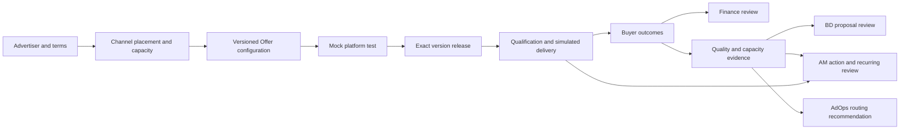

# Offer cycle architecture

The Offer brings the advertiser's terms, the channel's capacity, the delivery configuration and the buyer's evidence into one operating record. This local demonstration exercises a single cost-per-lead Offer and shows where owners decide what happens next.

| Handoff | Accountable role | Evidence used for the decision |
| --- | --- | --- |
| Advertiser intake to Offer | BD | Advertiser identity and versioned commercial terms, including currency, revenue per lead and cap |
| Offer to channel placement | AM | Channel and Sub-ID, placement approval and configured capacity for the current UTC day |
| Channel placement to test | AdOps | Configuration version and fingerprint, exact platform mapping and mock test record with adapter rule version |
| Passing test to release | Launch owner | Latest passing test of the current configuration, readiness checks and owner verification note |
| Lead receipt to buyer delivery | AdOps | Qualification facts, rejection reasons and mock delivery outcome bound to the release and channel |
| Delivery to outcomes | Buyer feedback owner | Outcome rows tied to the delivered batch, with a versioned feedback ID for corrections |
| Outcomes to Finance | Finance | Retained delivery and feedback references, provisional totals for the normal fixture or an owned hold for disputed returns |
| Outcomes and capacity to proposal review | BD | Current Offer evidence with complete buyer outcomes and approved clauses from the active configuration |
| Rejections or outcomes to channel follow-through | AM | Scoped delivery evidence, owned action, resolution note and next review time |
| Outcomes and capacity to routing recommendations | AdOps | Exact batch quality and current day capacity |

## State and authority

React presents the Offer workflow and sends typed actions to FastAPI. The service checks expected configuration versions and records changes in a SQLite transaction. Configuration, test, release, batch, feedback and reconciliation records retain their references. A material configuration change or a new test requires fresh release evidence. Delivery requires the current exact release and consumes the daily cap and channel capacity across batches.

A repeated event ID with the same request reuses the recorded operation. A changed request under that ID conflicts. A failed, unknown or superseded test cannot release a configuration. Buyer outcomes stay unknown until the relevant feedback arrives. A Finance preview requires the latest reviewed feedback ID for its batch. Later feedback supersedes the previous conclusion and retains its history. An ordinary buyer outcome cannot clear a Finance-owned return hold. Finance can select a retained batch and review its exact feedback after newer deliveries arrive.

Quality is measured on the exact synthetic batch. Capacity is the configured channel ceiling minus server-counted deliveries for the current UTC day. They have separate time windows. AdOps can use the retained facts for a routing recommendation. Owner labels come from the fixture.

## BD proposal review and AM follow-through

The service assembles a versioned evidence reference from the active release, current delivery batch, latest matching buyer feedback and the current UTC day capacity snapshot. The reference carries the advertiser, Offer, channel and Sub-ID. The server checks the submitted evidence reference against its current records before applying a decision. The demo uses a 24-hour freshness limit for batch and feedback evidence.

- **BD review.** Preparing a proposal requires fresh, complete buyer outcomes with no return dispute. Approved clauses come from the current configuration. Requested terms are stored separately for the owner to review. The decision binds the proposal and evidence versions. Material changes, including a corrected buyer outcome, require a fresh proposal review and keep the previous decision in history.
- **AM action.** A delivery rejection can prompt action before buyer feedback arrives. Complete buyer outcomes can also prompt a channel review. The action carries its owner, supporting evidence and next step. The service reuses the same action for its batch and issue kind, with a refreshed evidence reference if the open action's evidence changes. Resolution records the owner's note against the current evidence and sets the next review 24 elapsed hours later on the synthetic clock.
- **Finance hold.** A disputed return routes to Finance. The evidence gate blocks BD and AM decisions on the disputed version. A current Finance review can record the owned hold while the billing rules remain open.

## Integration boundaries

The application owns version checks, eligibility, release and provisional arithmetic. The Everflow adapter in this demo simulates mapping and postback verification for the cost-per-lead path. A live adapter would require confirmed account scope, tested request and readback contracts and real operator authority. Ringba number and target mapping, duration qualification and call outcomes would use a separate adapter. The demo keeps platform actions, qualification checks and buyer outcomes simulated.

The server binds to loopback and runs one worker against a local database. The fixture approximates base margin using revenue and base channel cost. Full cost, bonus, reserve and return accounting require approved definitions. Real pricing, routing, billing and payout actions require confirmed rules and authorized access.

## Open employer decisions

| Decision | Treatment in the demo |
| --- | --- |
| Does the 72-hour return window start at lead generation or delivery? | Keep event times and hold disputed returns for Finance until the start event and boundary are confirmed. This is distinct from the historical BD no-response timer. |
| Does Tier 1 require volume and quality or either condition? | Keep qualification and outcome evidence available for review. Tier repricing remains a commercial decision. |
| Can an above-cap upstream return create a supplier deduction? | Keep upstream billing and downstream deduction decisions separate. A disputed return holds both provisional totals and stays with Finance. |

## Historical architecture

The [Day 1 architecture at `033795f`](https://github.com/ShenghangWang/Everflow-Affiliate-Network-Automation/blob/033795f9be852c46ed34f87f3504d21dfa759bee/architecture.md) describes the earlier roles, source mapping, proposal review, recurring AM and reconciliation workflows. See the [Offer demo guide](docs/offer-demo.md) for the current entry points and verification commands.
