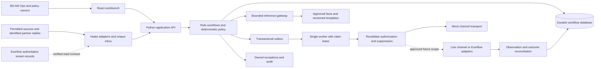
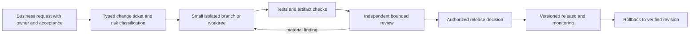

# D1-HLD-R2 architecture-review snapshot

This is a consolidated export of the complete frozen text inputs below, with original packet-relative path labels. It is an architecture-review snapshot, not current implementation/test evidence. Historical implementation statuses inside these inputs may differ from the current prototype. The three original assignment PDF/DOCX files are supplied separately with unchanged bytes. No later working-tree file or review response is appended.

## Original input path: `review-prompt.txt`

Source bytes: 1849; SHA-256: `0141d5b727be962a6b4978c186a13a49555848868bfac7b340a2f06fe5e4c7a0`

````text
Independently review the attached frozen architecture and original sources. Check M01–M06 and A01–A06 coverage, including negotiation, dispatch, recurring AM, integration assistance, reconciliation and Traffic Guard. Trace one BD action, one AM cycle and one Ops failure to an owned outcome.

Check that the three assignment documents and explicit employer instructions define mandatory scope. Insurance must remain a labeled optional example, with assumptions and configuration separated from core requirements. Flag any inferred employer business fact, insurance-only core dependency, or example that displaces required scope.

Evaluate the daily minimums as floors, identify additional achievable work and flag artificial calendar barriers. Review acquisition-channel concentration, AI-mediated discovery, attribution gaps, provider dependence and platform bypass. Separate verified evidence, industry-specific observations, hypotheses and proposed design responses. Test whether the system adapts its inputs and measures accepted business outcomes without claiming that architecture guarantees business survival.

Challenge source interpretations, API/tenant assumptions, rule-versus-model boundaries, financial/terms authority, inbox/outbox concurrency, approval edits, duplicate sends, reply/follow-up races, unknown external-write outcomes, stale data, model outages, prompt injection, token/cost limits and three-day feasibility.

Return ranked findings: ID, severity, exact artifact/source location, concrete failure scenario, evidence or explicit uncertainty, minimal remedy, tradeoff and falsifiable verification. Identify important strengths and a credible simpler alternative. Distinguish a defect from a preference. Do not infer correctness from model agreement. Do not claim a test or vendor action was executed without evidence.

````

## Original input path: `manifest.json`

Source bytes: 3477; SHA-256: `14e0f0d2a54b78e42a0fd37030cd38e461f5a2eca179e241c5508f1545582e65`

````text
{
  "revision": "D1-HLD-R2",
  "frozen_at": "2026-11-04T03:17:07.234536+00:00",
  "scope": "Common architecture/source/acceptance packet for both reviewers. R1 remains retained. Original review/adjudication are not included in the shared blind packet. R2 refines target ordering, activation readiness and report consistency; current implementation status is separately scoped.",
  "files": [
    {
      "path": "README.md",
      "bytes": 9347,
      "sha256": "11421430a86d4e71d94323b0d758a7a326b31f90fdfcfb94abcbb5a29d7cbcdc"
    },
    {
      "path": "architecture.md",
      "bytes": 53379,
      "sha256": "2578c729807eb3461462a737a323d21fd80cee99b5bd434222e47867fe756658"
    },
    {
      "path": "delivery.md",
      "bytes": 18535,
      "sha256": "9d52114702a0ff276eda90fef096e64d24db07b9051841cc6b34c7bc877e40dc"
    },
    {
      "path": "evidence/intake/business-original.txt",
      "bytes": 3304,
      "sha256": "4397925f511c53b6a6eb79f5f78b1deb2f714d7b80140d601783a445b868d8ee"
    },
    {
      "path": "evidence/intake/delivery-brief-v1.3.md",
      "bytes": 50914,
      "sha256": "43a339af6db9e7c5aa68fa44b877e7e3e10be852e800b23991abab6baa1ae77f"
    },
    {
      "path": "evidence/intake/dependency-results.json",
      "bytes": 1944,
      "sha256": "6f32148c2e52a37a5f1cb2ab94a47b492e6b34b009431bca2f615a3d949ac6e8"
    },
    {
      "path": "evidence/intake/factory-original.txt",
      "bytes": 18266,
      "sha256": "2686d612b71dfdd9f74def8951d7326b67521dbf531a85d1ec33853eaad871fd"
    },
    {
      "path": "evidence/intake/launch-probes.json",
      "bytes": 2049,
      "sha256": "8bf521a1313c2e4dbbe544ce840ef429cd045bc3cc1969e5a501e651a045424b"
    },
    {
      "path": "evidence/intake/originals/Everflow-Engineering-Delivery-Brief.md",
      "bytes": 50914,
      "sha256": "43a339af6db9e7c5aa68fa44b877e7e3e10be852e800b23991abab6baa1ae77f"
    },
    {
      "path": "evidence/intake/originals/数字王国开发-第三版(1).pdf",
      "bytes": 313444,
      "sha256": "8c2d1437dedb7951d8e2c79b0b64a677d912b398e3f929e56079e4fbda44b3a3"
    },
    {
      "path": "evidence/intake/originals/网盟自动系统需求文档.docx",
      "bytes": 13155,
      "sha256": "de3337d5c48e58274d9c95f2d904cc675f9fc0e9052e51d1f0cd59a73827f446"
    },
    {
      "path": "evidence/intake/originals/青蓝绩效文档-2.pdf",
      "bytes": 424259,
      "sha256": "32581f425301ddce32a7c509cb017c7c69f425f2cb8e43c550c92dbaefd88ced"
    },
    {
      "path": "evidence/intake/roles-original.txt",
      "bytes": 24841,
      "sha256": "1545b317623e76cdc20622a668e2c900c68fb2fd301b3007819cbac5f58b9849"
    },
    {
      "path": "evidence/intake/sources.json",
      "bytes": 2236,
      "sha256": "d670180d7fa1fa98da922adb8a5f968dcdffe1bc5517ad646d3724777b4aa0f2"
    },
    {
      "path": "evidence/intake/sponsor-clarification-2026-11-04.md",
      "bytes": 2497,
      "sha256": "1d5d35679304cbb4791391ad1cda5a83665f0fa731525c83d7b879e60b76bc49"
    },
    {
      "path": "evidence/research/checked-2026-11-04.md",
      "bytes": 9082,
      "sha256": "c6d7e13eec253e15e4afa0c9416ff22a470775c996d9d8a476ad8c7f29bc02bd"
    },
    {
      "path": "requirements.md",
      "bytes": 39544,
      "sha256": "506cf1c1be0a77a348c45219a944e8ced9cfcbf98c5080737de3298bf56e8297"
    },
    {
      "path": "review-prompt.txt",
      "bytes": 1849,
      "sha256": "0141d5b727be962a6b4978c186a13a49555848868bfac7b340a2f06fe5e4c7a0"
    }
  ]
}
````

## Original input path: `README.md`

Source bytes: 9347; SHA-256: `11421430a86d4e71d94323b0d758a7a326b31f90fdfcfb94abcbb5a29d7cbcdc`

````text
# Everflow affiliate-network automation foundation

Day 1 delivery candidate · 2026-11-04 · adopted work instruction: Engineering Delivery Brief v1.3. This engagement builds reusable BD, negotiation, onboarding, recurring AM and Ops capabilities. Insurance is an optional illustration, not the project target or a confirmed employer business model. The baseline uses synthetic B2B affiliate prospects; no consumer insurance workflow is required or included.

## Proposed acceptance card

**Minimum scope baseline adopted by the user on 2026-11-04; deliverable acceptance is pending.** Internal checks, independent review and boss/business-sponsor acceptance are separate records. The user’s written clarification is retained in `evidence/intake/sponsor-clarification-2026-11-04.md`.

| Item | Proposed agreement |
|---|---|
| Day 1 scope | Complete system HLD and original-source traceability for M01–M06 / A01–A06; source/access register; acquisition-resilience decisions; independent review records or explicit pending packet; launch baseline and walkthrough |
| Minimum prototype outcome | React + Python local B2B BD path: sourced synthetic leads → explainable qualification → English draft with replaceable inference adapter and output validation → deterministic authorization → durable mock send → approved standard reply or owned handoff; 72-hour follow-up, suppression, recovery and audit |
| Daily floors | D1 architecture/evidence/launch baseline; D2 connected durable business path and principal checks; D3 reproducible setup/demo, relevant T01–T12 results, defect disposition and handover. Pull later work forward as dependencies clear. |
| Effects and authority | Current local mode: mock transport and labeled offline template fallback. Include a replaceable inference adapter and output validation; demonstrate genuine model calls when approved runtime credentials and budget are available. Synthetic terms/policies cannot authorize real messages, contracts, payments or campaign changes. Paid inference and live adapters need their applicable approved scope and budgets. |
| Hard checks | All 12 mandates/roles have substantive design; no inferred original content; invalid/expired authorization blocks effects; duplicate/race/restart behavior evidenced; unknown provider outcome never blindly resent; mode/cost labels visible; no fabricated live AI or integration evidence |
| Access needed | Actual Everflow role/region/enabled products and read-only sandbox docs/access; permitted channel/sender/recipients; current commercial terms and authority owner; approved model/evaluation budget; approved Gemini review route |
| Evaluation/checkpoint | Intended evaluator: boss/business sponsor. Exact checkpoint time: TBC. Plan readiness by the end of Day 1’s working window; this is a planning target, not a confirmed meeting. Exact working window is unresolved. Record PASS / FAIL / CONDITIONAL per gate; no deliverable acceptance is claimed. |
| Handover | Follow the existing written engagement agreement. That agreement has not been supplied/read in this workspace; final destination, transfer mechanism, ownership/retention and other unspecified handover items remain unresolved. The local review package contains source, core documents, evidence, review records and reproducibility instructions; this describes current contents, not additional contractual commitments. |
| Material defaults to confirm | No-response follow-up = configurable 72 elapsed hours after initial dispatch acceptance (UTC), an unconfirmed business rule shown with a simulated clock and reply/opt-out/handoff cancellation. This interval is separate from the engagement’s three working days. Two standard response rounds, named role owners and commercial definitions including “流水消耗” remain unresolved/defaults. |

## Daily minimum commitments and ranked continuation

The original repository contains only `.git` and no commits/code/instructions. All three supplied originals are readable and hashed. React and Python dependencies are installed. The local application launches, the frontend builds, 28 backend/API tests pass and 12 browser checks pass. Fresh independent setup verification is in progress. No employer working window has been supplied: these floors are based on the inspected local environment, not a promise about unverified tenant delivery.

| Day | Evidence-based minimum floor | Dependencies and extension |
|---|---|---|
| 1 | Complete compact M01–M06/A01–A06 HLD, traceability, source dispositions, risks, review packet/status, walkthrough and environment/launch result | All source texts accessible. Tenant/Gemini gaps stay explicit. Start core implementation immediately. |
| 2 | Connected React/Python fixture path with persisted state, deterministic authorization, reply/follow-up/handoff and tested failure handling | Local dependency installation/loopback launch must pass. Live credentials are not required for the mock path. Resolve principal checks before adding depth. |
| 3 | Reproducible setup, relevant T01–T12 actual evidence, material defect resolution or explicit failure, capability/mode matrix and operating handover | Real provider contract/usage tests conditional on approved access. Shared production deployment is not promised by a local demo. |

Ranked next-value queue (pull whenever ready): (1) verified generic BD path and recovery; (2) synthetic source/outcome cohorts and channel stress; (3) fixture reconciliation discrepancy → owned issue → closure; (4) recurring AM activation/health follow-through; (5) authorized read-only Everflow snapshot; (6) validated integration configuration assistance; (7) genuine approved runtime language evaluation. Missing credentials do not block independent items. Optional example configuration is lower priority and adds no mandatory scope. Preserve the last verified revision while each additional increment is checked.

## Package index

- [requirements.md](requirements.md): source inventory, source locators, all mandates/roles, source issues, proposed KPI definitions and scope boundaries.
- [architecture.md](architecture.md): workflow contracts, diagrams, data/authority/integrations, reliability, bounded AI, acquisition resilience and decisions.
- [delivery.md](delivery.md): actual outcomes, launch/test evidence, Day 1 gates, walkthrough, capability/mode status and unresolved dependencies.
- [reviews/](reviews/): frozen input manifest/prompt, genuine original review and adjudication; Gemini status is explicit.
- [evidence/intake/sources.json](evidence/intake/sources.json): exact original paths, hashes and access evidence. Full original text extracts have paragraph/page locators; DOCX page numbering is not guessed.

## Working location

The supplied project at `/Users/shenghangwang/Documents/ChatGPT/Everflow Affiliate Network Automation` is readable but a write probe failed with `PermissionError: [Errno 1] Operation not permitted`. This complete candidate is built in this session's permitted `everflow-foundation` directory; no files were changed in the original project. Final transfer/destination follows the written engagement agreement once its relevant terms and access are available. This access failure is distinct from an automatic approval rejection; no such rejection has been received.

## Run and verify

Verified on Python 3.12.14 (bundled), Node 26.0.0/npm 11.12.1 (build), and Chromium 149.0.7827.55 (browser check via bundled Node 24.22.1). Exact installed versions are in evidence. Choose an installed Python 3.10+ interpreter; this machine’s system Python 3.9 is insufficient for the setup script.

```sh
# On this inspected machine; on another machine select its Python 3.10+ interpreter.
EVERFLOW_PYTHON=/Users/shenghangwang/.cache/codex-runtimes/codex-primary-runtime/dependencies/python/bin/python3 ./scripts/setup.sh
./scripts/run.sh
```

Open [local demo](http://127.0.0.1:8000). Use **Reset demo** to reimport the generic synthetic fixtures and reset the simulated clock. Draft → Run policy & mock send → +71h / +1h, or inject a payout FAQ, clear interest, opt-out or ambiguous reply. **Source & outcomes** shows provenance/cohorts and owned cases; **Six-role coverage** separates full design from implemented depth. Stop the server with **Ctrl+C** in its terminal. State persists in `data/demo.sqlite3` across restart; reset is an explicit destructive operation on synthetic demo data only.

```sh
.venv/bin/python scripts/check_backend.py
npm --prefix frontend run build
```

Optional browser check uses a Playwright installation plus its compatible Chromium (`PLAYWRIGHT_PACKAGE` and `CHROMIUM_EXECUTABLE` can select them): `node scripts/check_ui.mjs`. It resets synthetic demo data and requires the server on port 8000. Actual commands and results, including initial failures and recovered prerequisites, are in `delivery.md` and `evidence/tests/`.

Keep the demo on `127.0.0.1` with one worker. Do not publish this local unauthenticated prototype as a shared service. Paid inference is disabled: the replacement interface and output validation are present, template output is explicitly offline fallback, and genuine model/usage evaluation awaits approved credentials/data/prices/budget. Full HLD coverage does not imply all-six-role production implementation.

````

## Original input path: `architecture.md`

Source bytes: 53379; SHA-256: `2578c729807eb3461462a737a323d21fd80cee99b5bd434222e47867fe756658`

````text
# Affiliate network automation foundation architecture

Day 1 HLD · 2026-11-04 · work instruction: delivery brief v1.3. **SPONSOR DIRECTION:** deliver complete system architecture, retain accountable human owners, use React + Python, and challenge the same frozen packet independently with Codex/Gemini. The user has adopted the minimum baseline; package acceptance remains pending with the employer/business sponsor, checkpoint time TBC. Handover follows the existing written engagement agreement, which has not been supplied; unspecified obligations remain unresolved. **SOURCE REQUIREMENT:** the business mandate is overseas affiliate BD, negotiation, onboarding, AM and Ops (business original P003–P038; roles original pp.1–4). Requirements and source dispositions are in [requirements.md](requirements.md). All architecture choices below are **PROPOSED DESIGN / designed-only** unless delivery evidence separately marks an implementation tested. A diagram is not proof of implementation, access or acceptance.

Insurance is an optional **ILLUSTRATIVE USE CASE**, omitted from this baseline. A B2B partner prospect is not a consumer enquiry. No industry-specific field, buyer rule or insurance integration is mandatory. Actual tenant, channel permissions, approved offers and company acquisition mix are **UNRESOLVED DEPENDENCY** items. Public-document checks are **VERIFIED CAPABILITY (documentation only)**, not tenant execution. Exact evidence and retrieval limitations: [research record](evidence/research/checked-2026-11-04.md).

## 1 Context components and deployment M01



Choose a modular FastAPI application rather than six communicating runtime agents: intake/conversations; terms/onboarding; integration assistance; AM/issues; reporting/reconciliation; policy/execution; inference/usage. One common data contract, policy gate and audit applies across all six business roles. SQL/curated records suffice for approved-fact lookup initially. No broker, vector database, autonomous runtime swarm or multiple model providers is justified by the local slice.

Local deployment: React assets served with the Python application or a loopback development server; API bound to `127.0.0.1`; SQLite on local disk; **one application worker**; UTC instants and injected demo clock; fixture transport; no secrets in frontend. A local single-user demo does not implement production identity or tenant isolation. SQLite serializes writes and is unsuitable here for multi-host workers; backup uses SQLite's consistent backup API after pausing the worker, with a restore rehearsal. Do not copy a live database file mid-write as a backup. Retain pending/unknown actions across application restart.

Feasibility update: isolated `.venv` FastAPI 0.115.12 / uvicorn 0.34.3 and React dependencies are now installed, as reported by root launch evidence. Primary demo target is one loopback FastAPI port serving built React; a standard-library fallback may preserve independent local work but does not substitute for the agreed React + Python minimum. Installation is not a passed launch/UI test; use actual evidence in delivery.md.

Deployed design: TLS/reverse proxy → authenticated API → PostgreSQL, scoped worker and approved adapters; secret manager; role/tenant enforcement; migrations; backup/PITR and restore tests; central redacted logs, metrics and on-call alerts. Multi-worker claims use database row locking/leases and atomic financial reservations. Shared/public release is blocked until authentication, cross-tenant tests, origin/CSRF protection, retention, backup and operational ownership are verified. No infrastructure purchase or deployment follows from this HLD.

## 2 Six workflow contracts M02–M06 and A01–A06

Every external-text input is untrusted data. Owners below are proposed business roles, not invented named employees; the sponsor assigns people and backup owners before live operation. Business stages and action execution states are separate.

### A01 Outbound Hunter M02 M03 M04

- **Actor / trigger / input:** BD owner; a permitted form, import or authorized source feed supplies organization/contact, source evidence, collection time and contact eligibility. Multiple permitted sources use the same intake contract (business P011–P013; roles p.1).
- **Authoritative facts:** provenance record, verified contact attributes, permission/suppression records, approved offer/fact version. Unknown traffic or vertical remains unknown; public availability alone is not outreach authority.
- **State transitions:** received → deduplicated → eligible/needs-review/rejected → drafted → policy-authorized or awaiting-approval → contacted → replied → standard-response or owned BD handoff; suppression terminates pending follow-up. Negotiation substate discovery → approved-facts lookup → bounded proposal/counterproposal → objection/escalation → agreed-terms intake or closed.
- **Rule / LLM boundary:** normalize IDs/email, dedupe, eligibility weights, round budget and scheduling in code; optional model extracts evidence-backed profile, reply intent and English wording. Known FAQs retrieve approved payout/traffic/settlement facts; binding/numeric terms render from approved structured fields. Never let free-text prose smuggle a new term. Two standard reply rounds proposed within the original 2–3 range (P020); missing/ambiguous terms or difficult final negotiation escalates.
- **Permitted effects / human exception:** labeled template draft and durable mock send under synthetic policy. Live dispatch only under an approved envelope or action approval. Clear interest, requested human, ambiguous/negated consent, out-of-policy concession or model validation failure creates an owned handoff. Notify via an approved internal channel; otherwise dashboard task persists. No automatic contract acceptance.
- **Output / owner / recovery:** qualified prospect and provenance, conversation, terms history, action IDs, next due time and named BD assignee; duplicate events reuse inbox keys, transient pre-acceptance failure retries finitely, uncertain acceptance quarantines. Opt-out stops future sending. Unclaimed handoff ages to the BD supervisor.
- **Acceptance:** T01–T10 cover generic lead → English draft → authorized mock dispatch → payout question with exact approved answer → clear-interest handoff. At 72 elapsed hours without ingested reply, exactly one eligible follow-up is due; reply/opt-out/handoff cancels it (business P018–P022).

### A02 Onboarding AM M02 M03 M06

- **Actor / trigger / input:** BD hands off an approved terms version and meeting notes to onboarding AM; intake checklist contains legal entity/contact, offer reference, required documents, signatory and activation owner (roles p.1; business P027).
- **Authoritative facts:** signed/approved commercial record and approved IO/contract template; partner-confirmed intake information. Meeting-note extraction is a proposal, never authoritative price or signature.
- **State transitions:** terms-pending → intake-incomplete → draft-IO/proposal/payout-strategy → commercial/legal approval → signature-pending → signature-verified/account-created-pending-activation → technical-ready → activation-approved → AM-owned active account → first-outcome-verified. Every material revision produces a new terms version and invalidates old action authority.
- **Rule / LLM boundary:** required-field validation, template selection, deadline and signature-status verification are deterministic; model may summarize notes and draft English passages with evidence IDs. Missing tax/legal/commercial fields remain explicit gaps; no invented payout, billable event or settlement period.
- **Permitted effects / human exception:** local checklist and drafts; future signature requests/group creation require approved recipients, document hash and adapter access. Commercial owner approves final terms, signatory signs; ambiguous identity, disputed terms or unsigned contract blocks activation rather than being inferred from an email.
- **Output / owner / recovery:** versioned partner record with activation owner and handoff receipt; onboarding AM owns completion, BD owns commercial exceptions. Idempotent case creation; expired link or signature webhook gap reconciles through provider status/manual evidence; partially completed tasks resume without duplicate signature request/group.
- **Acceptance:** approved synthetic terms create a complete draft/checklist; missing signatory blocks release; duplicate/out-of-order signature fixtures create exactly one account **pending activation**, not an operationally active account. Shared readiness predicate: approved signed terms/checklist, matching current integration release/test version (or an explicit owner-approved not-applicable integration gate), and accountable activation-owner approval. Missing mapping/failed tests block activation; completing matching gates permits activation once and creates a dated AM follow-through task. First agreed outcome verification is a subsequent AM milestone; a material mapping/test regression reopens readiness and an owned issue. Original “2分钟以内” remains a measured aspiration, not a three-day guarantee.

### A03 Integration Bot M02 M05

- **Actor / trigger / input:** integration owner receives authorized partner docs, approved offer reference, allowed sandbox target, credentials supplied separately and example payloads (roles p.2).
- **Authoritative facts:** approved partner API contract and verified selected platform schemas; mapping version, required fields/units and actual tenant access. Neither generated mapping nor observed HAR is a recovered internal database schema.
- **State transitions:** docs-received → schema/mapping-proposed → reviewed → sandbox-configured → positive/negative contract-tests → release-approved → activated → monitored; any contract/version change returns to validation.
- **Rule / LLM boundary:** model interprets prose/PDF and proposes ping-post/postback mappings; code validates fields, auth placement, currency/units, allowed URLs and response semantics. No arbitrary generated code, shell, SQL or URL fetch executes. Documentation text cannot change allowed operations or reach credentials.
- **Permitted effects / human exception:** mapping/config drafts and local sandbox fixtures. Live configuration, ping-post calls or test leads/calls require explicit sandbox scope and release authority; uncertain required field/auth/timeout semantics goes to integration engineer. Distinguish management webhook events from conversion/S2S postbacks.
- **Output / owner / recovery:** versioned mapping, test evidence, release/rollback plan, business activation acknowledgment; integration owner handles auth/schema failures, reverts verified prior config and keeps failed work queued. A failed technical setup never silently marks onboarding complete.
- **Acceptance:** synthetic required-field omission fails; valid mapping passes fixture contract tests; expired release authorization blocks apply; retry/restart never duplicates configuration. “80%/15分钟” stays in the KPI register pending real contract variety and sample denominator.

### A04 Customer AM M03 M06

- **Actor / trigger / input:** identified existing partner asks a question, requests a change or reaches a scheduled health/activation review (roles pp.2,4; recurring AM mandate). Input is bound to tenant, account and requester identity; an asserted assistant identity is insufficient.
- **Authoritative facts:** current approved terms, verified permitted account snapshot, policy envelope, issue ownership and freshness. Source data timestamps travel with answers.
- **State transitions:** request/review-due → identified → facts-current or stale → classify/qualify → routine answer/allowed-action proposal → authorization → execution → readback/verification → follow-through → closed, or owned escalation with due time. Activation remains open until the first agreed outcome is checked; health/opportunity cases recur on proposed weekly cadence, configurable by owner.
- **Rule / LLM boundary:** deterministic role checks, health thresholds, exact cap/status bounds and verification; model understands English requests, summarizes account health and drafts a response/opportunity from approved facts. Negotiation uses the same terms/version rules as A01; never infer authority from model confidence.
- **Permitted effects / human exception:** routine exact-fact responses and mocked commands under synthetic envelope; live cap/pause/payout actions require separately approved scope. Out-of-policy or stale-data request, commercial finalization, contradictory instruction or complaint goes to AM/BD/Ops owner. An emergency stop needs pre-authorized tested bounds.
- **Output / owner / recovery:** answer/action receipt, issue or opportunity, next due task and account-health history; account AM owns outcome, supervisor catches overdue tasks. Unknown provider outcome triggers lookup/readback; absence of confirmation remains open, never a success message.
- **Acceptance and concrete cycle:** synthetic account activated Monday → weekly freshness check finds low activation → AM drafts exact-fact check-in → partner reports tracking problem → integration owner receives issue → sandbox evidence/readback confirms fix → AM verifies first accepted outcome and closes issue → next health review scheduled. A stale snapshot blocks automatic cap increase; unresolved issue remains owned. No claim that 5-second/90% source target has been measured.

### A05 Reconciliation M05 M06

- **Actor / trigger / input:** finance/Ops scheduled daily/weekly close or overdue receivable; supplier and buyer reports plus approved terms, event IDs and settlement evidence (business P038; roles p.2).
- **Authoritative facts:** original report versions and windows, approved billable-event definition, currency/units, actual payment ledger. An Everflow conversion is not automatically a billable sale or a cash receipt.
- **State transitions:** awaiting-aligned-data → compared → matched/discrepant/incomplete → evidence assembled → dispute/collection draft → human decision → verified adjustment/payment → closed or next follow-up. Corrections reopen the affected period with version history.
- **Rule / LLM boundary:** Decimal/integer arithmetic and deterministic joins by authoritative IDs, zero/unknown denominator handling, no cross-currency sum without approved FX basis. Model may explain already-computed variance and draft English appeal/reminder; it neither calculates balances nor declares fraud or agrees settlement.
- **Permitted effects / human exception:** local comparison, evidence report and drafts. Finance approves dispute, settlement and collection dispatch; no autonomous payment. Missing IDs, conflicting windows/FX or unreconciled adjustments create an incomplete-data case rather than a fictitious zero variance.
- **Output / owner / recovery:** variance per item/period, source hashes and counts, overdue record, evidence links, named finance/AM decision owner. Checkpointed reads re-fetch overlap; report failure preserves last complete snapshot visibly stale; retry doesn't create duplicate receivables or appeals.
- **Acceptance:** aligned synthetic USD reports show an exact difference and denominator; >5% source-proposed variance produces evidence and draft; late correction recomputes and versions result; missing currency blocks aggregation. Finance marks payment only from synthetic receipt evidence. Monday 09:00 timezone is an owner decision, not silently Beijing or tenant time.

### A06 Traffic Guard M05

- **Actor / trigger / input:** Ops consumes validated clicks/conversions/rejections and health signals or a scheduled check (business P035; roles pp.2–3).
- **Authoritative facts:** source/window/counts/ingestion time, approved baseline and configured thresholds; traffic and billing denominators are separate. A spike is an observation, not proof of fraud.
- **State transitions:** data-arrived → quality/freshness checked → normal/anomaly/stale → evidence/issue → alert or authorized bounded mitigation → outcome readback → recovery/rollback → case closed; repeated alert keys deduplicate the same incident.
- **Rule / LLM boundary:** deterministic completeness/freshness checks, minimum sample, baseline comparison and spend-with-no-outcome rule; model optionally summarizes evidence and labels competing diagnostic hypotheses. No model-driven financial calculation or ad/routing command.
- **Permitted effects / human exception:** alert/evidence and mock mitigation only. Routing/cap/pause writes require verified adapter, pre-authorized targets/limits, expiry and rollback. Without them alert the Ops owner; stale/late data disables automated mitigation and raises data-health incident.
- **Output / owner / recovery:** incident with source evidence, response owner and outcome check; integration owner handles feed failure; Ops owns mitigation decision and AM partner communication. If mitigation outcome is unknown, quarantine command and reconcile observed state before retry/revert.
- **Acceptance and concrete Ops exception:** two fixture windows show a conversion spike → counts/window checked → anomaly evidence created → no live routing authority means alert-only → Ops assigns integration owner → late conversions explain apparent spike → corrected snapshot clears incident with reason and AM follow-through. A timed-out mock pause is marked unknown until readback. The source's 10-minute polling and ≤3-minute response cannot guarantee detection within 3 minutes of occurrence. Measure occurrence→provider availability (feed latency), availability→ingestion, ingestion→rule decision, decision→alert/authorized command, and command→verified effect separately; include worst-case poll wait and missing/late events. Ops/integration owner must define the response start/end and approve a measured feed/cadence before adopting a KPI; do not promise an end-to-end source SLA.

## 3 Data ownership and contracts

| Entity / key | Authoritative owner | Automation-owned fields and invariants |
|---|---|---|
| Organization/contact / stable tenant-scoped ID | Verified intake/partner record; Everflow only after tenant mapping confirmed | Source records, normalized contact and suppression; preserve multiple provenance records after dedupe. Contacts are B2B, no consumer-data assumption. |
| Lead / source-event ID | Intake evidence | Qualification explanation, stage, assignee, next action; unique `(tenant, source, event_id)`; repeated source receipt cannot resend. |
| Conversation/message / provider ID | Provider acceptance/reply evidence | Immutable content version, received/accepted UTC instants, round count and reply cursor; unique inbox key. |
| Negotiation / terms version | Approved commercial owner | Requests vs allowed offers separated; exact currency, amount/unit, billing criteria, settlement period, effective/expiry dates and approval reference. Never overwrite old terms. |
| Onboarding case / account ID | Approved intake/signature evidence | Checklist, signature status, activation and AM owner; IO is a draft until signed and verified. |
| Mapping/offer reference / external ID | Confirmed Everflow/partner platform | External IDs and schema/config versions; no duplicated editable financial master. |
| Performance snapshot / source+window+revision | Confirmed platform reports | Observed/ingested times, requested timezone/currency, units, completeness, source hash and lateness/correction history. |
| Issue/recommendation / case ID | Application and assigned business owner | Evidence, severity, hypotheses, decision, next check, due date and verified closure. |
| Authorization / binding hash | Policy owner or authorized human approver | Distinct `human_approval` / `delegated_policy_authorization`; target, recipient, action/content/terms/policy version, expiry, limits and revocation. Models have no write access. |
| Outbox action / stable action ID | Application | Business stage separate from scheduled/authorized/executing/succeeded/cancelled/failed/unknown outcome; unique intent key, attempt count, claim token/lease, provider receipt. |
| Audit / immutable event ID | Application | Actor, UTC time, source/version references, policy result/reason, mode, owner, attempt and redacted outcome. No credentials or unnecessary raw personal text. |

Common intake contract: `schema_version, tenant_id, source_type, source_event_id, observed_at, received_at, organization/contact, eligibility_evidence, source/campaign_evidence, attribution_method, source_version`. Unknown source/attribution remains `unknown`; do not infer AI origin from user agent or polished wording. Future consumer enquiry adapters must use a distinct entity/contract and are not required by this baseline.

Reporting contract: explicit `[from,to)` instants for local normalized windows; selected vendor boundary inclusivity tested before translation; reporting timezone, currency, event status and unit; `observed_at`, `ingested_at`, complete/partial and correction watermark. Proposed incremental polling uses saved high watermark plus overlap (initial 24 hours, owner-confirmed lateness), deduplication and periodic closed-window reconciliation. Advance watermark only after all pages are committed. DST/month-boundary, late rejection and corrected revenue fixtures must not silently change denominators. “流水消耗” remains undefined until employer selects its financial meaning.

**Mutable report consistency (CR-03):** reaching the final page is necessary but never sufficient to call a report complete. Record each fetch attempt's fixed window/as-of point, requested ordering/cursor, snapshot token if supported, page boundaries, unique IDs, response versions and available authoritative counts/totals. Compare IDs/counts/totals against that immutable contract. Tenant verification must establish whether the operation offers stable ordering/snapshot isolation and how inserts/rejections/corrections affect paging. If it does not, use a bounded, owner-approved settling/re-fetch/reconciliation procedure and label the result `observed-stable` or `partial/uncertain`, not a proven immutable snapshot. No automatic mitigation or final automatic financial conclusion may consume an unproven snapshot; retain an owned data-health case and permit clearly labeled alert-only observations. Later corrections create a new snapshot revision, invalidate/reopen dependent comparisons/incidents, and reconcile affected decisions without double-counting. Verify with a fake source inserting/removing/correcting records between pages, including beyond overlap: either match an authoritative immutable snapshot/control total or remain uncertain and block the affected effect. This is a designed release check, not an executed tenant test.


## 4 Authority and reliable execution

| Action class | Default / authorized automatic envelope | Exception owner and verification |
|---|---|---|
| Intake, dedupe, draft, calculate | Local deterministic processing of permitted data | Data/source owner resolves missing provenance or definitions. |
| Outreach, standard reply, follow-up | Mock only initially. Live envelope enumerates eligible accounts/offers/channel/recipients; content/terms policy; per-contact/day frequency; two reply rounds; expiry; opt-out and owner. | BD owns policy; clear interest, unknown intent or negotiation outside exact terms creates owned handoff. Provider receipt confirms acceptance, not human delivery. |
| IO/signature/group creation | Draft until exact parties/content/template and action approved | Commercial/legal/onboarding owner; verify external signature/provider status before activation. |
| Cap, pause, reroute, emergency stop | No live authority initially; future bounded target/action range, cooldown, expiry, preconditions and tested rollback required | Ops policy owner and appropriate account authority; readback and follow-through required. |
| Dispute, collections, payout/settlement | Calculation/evidence/draft only; each live effect needs its actual authority | Finance/commercial owner; cash receipt and agreed settlement kept separate. |

Authorization is evaluated at creation, claim and immediately before transport. A material recipient/content/terms/policy/target change, expiry, revocation or exhausted quota invalidates the binding. Model confidence never supplies authority. Emergency kill switch cancels eligible pending effects; it does not claim to recall accepted messages or undo provider actions.

**Shared-target command ordering (CR-01):** consequential AM and Ops commands share one target-control record `(tenant, account/campaign/route, control_epoch, observed_state_version, incident_hold, winning_decision)`. Serialize dispatch per controlled target. Authorization binds the epoch, expected observed preconditions and compatible action; check these again at claim and immediately before execution. A Guard mitigation decision advances the epoch, places an incident hold and supersedes incompatible queued AM resume/cap/reroute commands, including actions/leases recovered after restart. An open hold can be cleared only by an explicitly authorized Ops recovery owner under account authority, using fresh readback and a new recovery decision/epoch; never revive a superseded intent. Manual/provider changes reconcile into a new epoch and block stale commands. Late receipts attach to their original decision and trigger observation/reconciliation; they cannot overwrite the newer winning target state. Proposed verification: queue AM resume → newer Guard pause → run/restart old intent; target must remain paused/old command superseded; separately race actors, inject manual change and test newly approved recovery. Target control is designed-only because the current mock BD slice implements no shared campaign controls. These rules add no live authority or extra mechanism to harmless drafts.


```mermaid
sequenceDiagram
  participant S as Source/reply adapter
  participant A as Application
  participant D as Database
  participant W as Worker
  participant P as Mock/provider
  S->>A: Lead event + provenance
  A->>D: Transaction: unique inbox, qualified lead, draft, audit
  A->>D: Validate policy and binding; outbox intent
  W->>D: Atomically claim due action, lease and current policy
  W->>D: Final reply/suppression/handoff and binding recheck
  W->>P: Validated application command and stable action ID
  alt confirmed acceptance
    P-->>W: receipt and acceptance time
    W->>D: Succeeded; schedule one 72h follow-up
  else timeout after possible acceptance
    W->>D: Unknown outcome; no blind resend
    W->>P: Supported lookup/idempotency reconciliation
  end
  S->>A: Ingest reply with unique provider ID
  A->>D: Transaction: reply + cancel follow-up + owned next state
```

Use transactional inbox/outbox updates and conditional claim updates/leases. After crash, recover expired pre-dispatch leases; a crash/timeout after possible transport acceptance becomes `unknown_outcome`, not a fresh ready action. No local ID alone provides exactly-once external delivery. A verified provider idempotency key or status lookup is required to retry an ambiguous write; otherwise quarantine for operator resolution. Mock deduplication proves local logic only.

The adopted minimum includes a configurable **demo rule of 72 elapsed hours from initial provider acceptance in UTC**; calendar/business-day semantics remain business-unconfirmed. This is separate from the engagement's three working days. Persist reply, suppression and handoff cancellation with the reply transaction. Recheck them when claiming and directly before sending under the application's serialization/lock protocol. Test reply arriving between claim and transport. There is still an unavoidable external gap: a reply not yet ingested, or arriving after final check, can race with sending. For live release require documented reply-ingestion lag, pre-send channel resynchronization when supported, and a proposed 60-second grace/recheck; measure it rather than claiming zero races. Quarantine when channel health/freshness is unknown. Do not hold a database transaction over a slow network call in the deployed design; use fenced claim/dispatch intent and explicit unresolved-outcome handling.

Known provider rejection before acceptance: finite retry only for a classified transient error, same logical action, backoff/jitter and attempt cap. Validation/auth errors fail to owner. Retry queue and dead-letter/unknown queue remain visible. Metrics: queue age, failed/unknown actions, lease expiry, reply lag, snapshot freshness and overdue issue ownership. Alert owners when recovery needs a decision; a silent draft is not successful dispatch.

## 5 Integration evidence and channel capability

Public checks below dated **2026-11-04**; actual tenant access for every operation is **UNRESOLVED DEPENDENCY**. Official docs describe different API realms and US/EU hosts. Keys stay server-side. The [authentication guide](https://developers.everflow.io/user-guide/authentication) documents wrong-realm 403 and key scopes; knowing a URL does not establish a permission.

| Selected operation | Documentation / method and path status | Class / ownership / auth | Paging, limits, errors, freshness | Verification and fallback |
|---|---|---|---|---|
| `fetch_performance` | [Conversion report](https://developers.everflow.io/api-reference/post-networksreportingconversions): documented candidate POST `/v1/networks/reporting/conversions`; selected only if Network realm confirmed | Read-class POST; tenant report is authoritative; HTTPS API key, correct region/scopes | [Paging](https://developers.everflow.io/user-guide/paging): query-string page/page_size, 1-based; [limits](https://developers.everflow.io/user-guide/rate-limiting) network-wide shared quotas, Network 30/s; reporting concurrency 10; parse `error` and `Error`; explicit [timezone](https://developers.everflow.io/user-guide/timezones) and currency. Actual freshness unknown. | Integration owner checks tenant role and sample authorized read, pages/counts/window/status, 401/403/429/timeout and lateness. Fixture snapshot until verified. If Affiliate/Advertiser realm, select its documented operation before coding adapter. |
| `fetch_offer_reference` / partner sync | Abstract operation until tenant-selected resource/schema confirmed; [API families](https://developers.everflow.io/) documented | Read; confirmed tenant platform fields authoritative; scoped key | Check endpoint pagination and update timestamps; overlap/reconcile; no claimed universal freshness | Integration owner validates actual field ownership/IDs and current terms source; fixture refs. |
| `ingest_platform_event` | [Management webhooks](https://developers.everflow.io/webhooks/overview), [conversion/event notifications](https://developers.everflow.io/webhooks/conversion-webhooks) are documented; no application callback deployed | Inbound event; configured by Network admin; verify payload/tenant and actual origin/auth mechanism before trust | Unique event key; webhook retry/order/completeness/signing not verified. Conversion notification uses simplified payload; reconcile against reports. | Tenant admin confirms enabled events and secure receiver contract. Checkpointed polling/fixture fallback. Conversion S2S postbacks are a distinct integration. |
| `dispatch_message` / `ingest_reply` | Mock transport selected; live channel method/path not selected | External write/inbound; approved sender identity/recipient and server credential required | Provider acceptance vs delivery, idempotency/status lookup, ingestion lag, rate limits/429 and suppression must be contract-tested | Channel owner supplies approved channel/test recipients and permissions. No cold send authorized by work brief. |
| `draft_language` / `classify_reply` | Replaceable inference interface; no provider/model/pricing/access selected | Runtime inference disabled without configured authority, prices and budgets; curated facts only | Max two attempts, input/output/deadline and monetary limits below; timeout usage uncertain | Engineering owner verifies provider-supported limits and held-out eval. Labeled template/fixture fallback. |
| `request_signature` / `apply_integration` / `apply_cap_or_route` | Abstract future adapters; document-3 tool names are candidates | Consequential writes; human/delegated authorization as above | Verify provider schema, idempotency/readback and rollback; no invented endpoint | Commercial/integration/Ops owners supply access; drafts and mock commands continue. |

| Channel | Who may initiate / recipient eligibility | Replies and sender identity | Suppression / limits / access |
|---|---|---|---|
| Mock baseline | Synthetic allowed contacts under synthetic policy | Synthetic reply injection; clearly mock sender | Persistent opt-out/cancel rules; local configurable limits; no real recipient or network effect. |
| Email candidate | Only after business owner approves lawful/contractually permitted recipient scope and sender account; source discovery is separate permission | Mailbox/provider contract and reply correlation not verified | Local suppression plus unsubscribe/bounce handling; provider quota unknown; no account configured. |
| Telegram standard bot candidate | [Official bot guide](https://core.telegram.org/bots) requires user initiation or group addition; no arbitrary cold-DM assumption | Bot identity; group privacy mode limits received messages | Persistent opt-out; [FAQ](https://core.telegram.org/bots/faq) advises 1/chat/sec, 20/group/min, roughly 30/sec free bulk and 429 handling; actual bot/access absent. Business features separately scoped. |
| Teams/Slack/WhatsApp/WeCom candidates | Tenant/app membership, recipient eligibility and proactive-message rules require selected official contract | Sender/app identity and reply subscriptions unverified | No assumed quota, permission or installed app. Internal handoff remains a durable dashboard task. |
| Consumer Skype | Retired; no new baseline adapter | [Microsoft notice](https://support.microsoft.com/en-us/skype/skype-is-retiring-in-may-2025-what-you-need-to-know) confirms 2025-05-05 retirement; excludes Skype for Business | Teams is not presumed an API-compatible replacement. |

## 6 Rules AI quality cost and security

| Responsibility | Mechanism and reason | Rejection / degraded behavior |
|---|---|---|
| Identity, dedupe, eligibility weights, round limits, 72h scheduling, ownership, authorization and execution | Deterministic state/constraints; facts and known workflows are explicit | Unknown fields or missing authority block the relevant effect and retain owned work. |
| Money, reconciliation, payout/billing/report denominators, thresholds | Decimal/integer computation with currency/unit/window versions | Missing cost ≠ zero; no cross-currency arithmetic or model arithmetic. |
| Profiles, free English replies/objections, meeting notes and authorized API prose | One focused bounded model call can add language interpretation/drafting | Evidence IDs and task schema checked; unsupported facts, hostile instructions, negation/ambiguous terms route to human. Template fallback visibly labeled. |
| Approved FAQ and numeric/binding terms | SQL/curated facts and deterministic rendering | Free text containing unverified commercial terms requires human review; valid JSON alone is insufficient. |
| Diagnostics | Rule detects anomaly; model may summarize evidence/hypotheses | Never infer fraud, root cause, consent or execution permission from model confidence. |

The rules-first recommendation is specific to this workload. [Anthropic's effective-agents guidance](https://www.anthropic.com/research/building-effective-agents) supports starting with suitable simple patterns. Its [research-system account](https://www.anthropic.com/research/multi-agent-research-system) reports cost and quality tradeoffs for that workload, not a universal 15× forecast. Jev is a learned provider candidate: [Noul](https://docs.typesafe.ai/primitives/noul) judges a yes/no proposition; [Choice/Score confidence](https://docs.typesafe.ai/confidence) describes distributions. A universal 0.90 threshold certifies neither task correctness nor commercial authority.

The adopted minimum includes a replaceable inference adapter, schema/fact/terms output validation and a visibly labeled offline template fallback. Actual model calls require approved runtime access, pricing and budget; current live credentials are absent. Proposed runtime contract: known deterministic events use **zero model calls**. Each language event has at most **two total provider attempts**, including retries/escalation/switch; no recursive agents/fan-out. Approximately 4,000 input tokens, 800 output tokens including any configured billable reasoning reserve, and a 30-second application deadline, refined against actual provider controls. Safely reject oversized tasks rather than silently dropping necessary facts. Retry only a classified transient error with remaining budget, never to obtain a preferred commercial answer. Provider switch requires configured approval and consumes the same event budget.

Before paid inference, approved per-workflow/daily monetary ceilings, currency and complete price schedule are mandatory. Atomically reserve worst-case configured billable usage before a call; settle actual usage including failed/retried/reasoning tokens; keep unknown/timeout usage conservatively reserved, stop when cost cannot be bounded, and reconcile billing later. Missing price/budget disables paid calls. No runtime paid calls are claimed here. Local inference also incurs capacity/operations costs. One-worker prototype limit is explicit; PostgreSQL atomic reservations are required before concurrency.

Usage/audit fields: provider/model, prompt/model/policy/source/terms versions, attempt, latency, cache hit, input/output/other billable tokens, actual/estimated/uncertain cost, validation failure/escalation and linked successful business outcome. Sensitive text redacted. Tenant/account-isolated cache key includes normalized input plus all relevant versions; current policy is rechecked on cached output. Budget outage/invalid model result retains work for review and preserves deterministic scheduling/calculation.

Held-out evaluation before live language automation: proposed 12–20 labeled cases including unsupported facts, invented payout, opt-out, human request, negation/ambiguity, hostile source text, malformed JSON, stale facts, model outage, attempt/deadline/token/budget bounds and version-cache invalidation. Count completion and unsafe/incorrect automatic decisions; repeat selected high-risk cases within approved evaluation budget and record actual usage/sample sizes. Fixture tests do not prove production accuracy or a claimed automation percentage.

Security design: allowlisted typed commands; model sees minimal authorized facts and no credential, SQL/shell execution, policy-edit or arbitrary tool capability. Source/API/document text cannot become instructions. Server secrets outside source/logs and frontend; least privilege by tenant/account/action; auditable approval/command distinction. PII minimization, access-controlled evidence, retention/deletion schedule and redaction require owner confirmation. Production role model: viewer; BD/AM/Ops operator; commercial/finance approver; policy administrator; integration service. Privilege and tenant checks occur in API/worker, never only in React. Separate change-of-policy authority from routine executor. Local mock boundary does not prove production RBAC.

## 7 Acquisition resilience evidence decisions and validation

The following are **external facts / limitations**, checked 2026-11-04, not employer requirements or evidence of this employer's acquisition mix. [Research record](evidence/research/checked-2026-11-04.md) preserves publication dates, locations and retrieval issues.

| Evidence | Bounded interpretation |
|---|---|
| [Alphabet Q3 release](https://www.sec.gov/Archives/edgar/data/1652044/000165204426000080/googexhibit991q32026.htm), 2026-10-28: Google advertising USD 82.012B vs 74.182B; calculated +10.55%; Search +12% | No broad advertising revenue collapse in this quarter. Aggregate platform revenue does not measure publisher referrals. |
| [Alphabet Q3 call](https://abc.xyz/investor/events/event-details/2026/2026-Q3-Earnings-Call-2026-Ujou16CTw9/default.aspx), 2026-10-28: management attributes part of Search deceleration to lower AI Mode monetization, alongside FX/vertical factors | Slower growth differs from absolute decline; management explanation is not our observed causal funnel. |
| [Pew](https://www.pewresearch.org/short-reads/2025/07/22/google-users-are-less-likely-to-click-on-links-when-an-ai-summary-appears-in-the-results/), 2025-07-22: March U.S. panel N=900, traditional clicks 8% with summaries vs 15% without | Observational query/device/period differences prevent a universal causal or employer forecast. |
| [Wang et al.](https://arxiv.org/abs/2608.18352), 2026-08-18 preprint: preregistered N=1,100 experiment, removing AI features increases publisher clicks | Experimental evidence in a bounded search setting; preprint and not an affiliate-margin estimate. |
| [Google Ads guidance](https://support.google.com/google-ads/answer/18826097?hl=en) and [2026-05-20 announcement](https://blog.google/products/ads-commerce/google-marketing-live-search-ads/) describe AI-search ads, in-ad Business Agent for Leads and aggregate placement reporting | Platform may capture more interaction. Product announcement does not establish export/API/account eligibility or AI-only attribution. |
| [Adobe](https://business.adobe.com/blog/ai-traffic-higher-revenue-per-visit-retail-holiday), 2026-10-29: September U.S. retail AI-referred conversion +90% relative, RPV +83% | Referral quality can differ. Retail observational uplift is not transferable to B2B, affiliates or insurance and does not establish causation. |

**Inference / risk hypotheses:** AI-mediated discovery may reduce some referrals, create qualified new sources, move contact inside platforms, make attribution incomplete and allow buyer/seller bypass. Better automation can adapt inputs and control cost; it cannot ensure demand, defend commodity resale margins or guarantee survival/revenue. The service's defensible value, if any, must be demonstrated through partner relationships, qualification, integration/reconciliation and accepted outcomes. B2B prospect cohorts and downstream traffic/billable-event cohorts stay separate.

| Design decision | Observable measure / trigger | Owner and falsifiable validation |
|---|---|---|
| D1 Replaceable permitted-source adapters into versioned intake; no search-engine/cookie dependency | Source share/top-source share and HHI `Σ share²`, by qualified/accepted outcomes with window and unknown category. Proposed review trigger top-source >50% is synthetic policy, not source fact. | BD + Ops obtain real permitted channel mix, replay two synthetic sources through identical dedupe/policy/audit, verify switching source cannot bypass suppression or duplicate a send; evaluate an authorized second source before reallocation. |
| D2 Preserve supplied campaign/source IDs, observation time, method and corrections; allow unknown/aggregate | Unknown-source fraction, missing-ID rate, attribution method and lag; no guessed “AI-only” bucket where vendor aggregates | Integration + analytics owners compare sample source/platform/accepted-outcome records and reconcile late corrections. Fail validation if unexplained IDs or report sums disappear. |
| D3 Versioned permissioned approved-business-data contract for future assistant channels; no automatic new platform integration | Availability/export terms, actor identity, eligible enquiry volume and source/terms age | Integration owner verifies selected official contract and data rights before live adapter; replay stale/machine-originated request and ensure normal policy/handoff applies. No platform access claim. |
| D4 Track contribution per source/outcome cohort with completeness flags; no optimization on clicks alone | Accepted/billable outcomes, rejections/refunds, actual recognized revenue and separately defined costs; buyer/account retention and concentration | Finance/AM define contract billable event and ledger mapping; reconcile counts/status/currency against evidence. Missing price/cost makes contribution unavailable. Owner evaluates bypass/loss of margin and proposed value-added service before commercial experiment. |
| D5 Bound model/provider dependence and monitor channel health | Attempt/cost/outage/quality metrics; unknown external outcomes; channel export/permission change | Engineering executes outage/budget/unknown-timeout fixtures; deterministic work continues, queued language/execution retains owner. Replace adapter only after contract/evaluation, not automatic paid escalation. |

Economics contract: source → qualification → partner acceptance → contract-defined billable event → recognized revenue → refunds/corrections → cash receipts. Costs are non-overlapping ledger categories: partner payout, media/acquisition, channel/verification, inference/serving, other fulfillment; human review/hosting separately reported. Do not subtract a media expense twice when already included in a partner invoice. Decimal values by currency/cohort and allocation method; approved FX needed for conversion. `cost_per_accepted = attributable_total_cost / accepted_count`, unavailable on zero denominator or missing components; `contribution = recognized_revenue - refunds - distinct_costs`, labeled observational, not causal. Actual cash and document-3 commission profit definition remain separate finance views.

Additional ready increment: two-source fixture cohort view plus a **hypothetical**, user-adjustable shock (e.g. source A volume −50%, acquisition cost +25%). These are stress assumptions, not copied forecast parameters from the research. Recompute accepted/billable counts and contribution only with complete data; show missing/unknown separately; validate policy/deduplication invariants before and after shock. No automatic traffic spending or commercial reallocation.

## 8 Development factory mapping and architecture decisions

The factory original pp.1–5 supplies a broader vision, distinct from business execution. Preserve its intent as an architectural roadmap, not a three-day complete-factory promise. Source proposals about unlimited free inference, 99.9% defect elimination, uniquely recovering database schemas, universal 0.90 safety and instant production change are not verified capabilities; source dispositions S02–S06 govern.



| Factory layer / source | Reusable architectural mapping | Minimum commitment and change condition |
|---|---|---|
| Human architect, p.1 | Business owner chooses scope, acceptance, authority and release | Day 1 contract/workflow review and stable revision. No inference removes owner responsibility. |
| Hybrid brain / local + cloud + Jev, pp.1,3,5 | Provider-neutral inference interface, bounded task router, usage/evaluation ledger | Runtime template/mock baseline. Add provider after actual language evaluation/access/budget; benchmark local inference including hardware/operations before capacity claim. |
| Scout/PM/Coder/QA hierarchy, pp.2–3 | Permitted source study → decomposition → isolated changes → automated tests → independent challenge | Reversible development workflow now; no six-role autonomous runtime swarm required. Add agents only when simpler approach fails a defined evaluation and benefit exceeds coordination/cost. |
| Reuse and external execution, pp.2–5 | Fit/license/permission checks, supported adapters and contract tests; authorized interface observations are evidence, not guaranteed internal schema | Reuse libraries when justified; no unapproved competitor source transfer/private-protocol bypass; necessary business code and migrations permitted under sponsor direction. |
| Conversational SDK, pp.2,4–5 | User request creates a reviewed development ticket; production data/runtime isolated from code-changing tools | Designed extension only; tests, independent review, release authority and rollback remain. Add request UI after core if useful; no immediate arbitrary source edits or live self-modification. |

| ADR | Choice / credible alternative / change condition |
|---|---|
| ADR01 | Modular React + FastAPI + SQLite/outbox single worker. Alternative: existing low-code Coda/Dify workflow matching document 3. Choose code baseline for auditable state, policy and reproducible tests; reconsider if a verified installed low-code stack meets the same recovery/authority contract and sponsor prefers it. PostgreSQL before shared/multi-worker deployment. |
| ADR02 | Deterministic rules plus one bounded inference gateway. Alternative: autonomous role-agent orchestration. Adopt only after held-out task evidence shows a concrete unmet language/planning need with acceptable cost/latency/error tradeoff; no universal model confidence authority. |
| ADR03 | Mock channel and platform boundaries until tenant/recipient scope verified. Alternative: immediate live integration. Move only the approved operation to live after least-privilege access, contract/error/idempotency/freshness tests and owner envelope; other reversible local work continues independently. |
| ADR04 | Cohort provenance, unknown attribution and non-overlapping economics from intake. Alternative: click-centric channel dashboard. Change thresholds/experiments using actual accepted outcomes and contract definitions; no architectural claim of AI-proof revenue. |
| ADR05 | One common frozen independent-review packet; preserve original reviews and adjudicate ranked findings. Alternative: recursive model debate until agreement. Use bounded follow-up only for material change/unresolved critical issue; Gemini absence is pending, never substituted by another Codex response. |

## 9 Screen sketches and staged coverage

```text
Affiliate foundation | Generic synthetic data | Template mode | Mock dispatch
Lead/source list     Conversation and approved fact references    Next action / owner
qualified + reason   English draft; terms v; standard rounds      Send to mock / handoff
source provenance    Inbound reply + suppression/handoff state    Due time / policy result
--------------------- Action result, immutable audit, usage/cost and data freshness --------
AM cases: activation → health → owned issue/opportunity → verified follow-through
Ops: fresh/partial report → exact discrepancy/anomaly evidence → draft/decision → outcome
Sources: qualified / accepted / billable counts; unknown attribution; cost completeness
```

Labels distinguish deterministic, template-fixture, mock adapter and any future verified live mode. The operator sees why action is allowed/blocked, responsible person, exact data freshness and pending/unknown outcome. No fake live-AI badge or invented revenue. Architecture covers M01–M06/A01–A06; implementation begins with the connected generic BD slice, then dependency-ready AM/Ops/source-cohort increments. Current implemented depth and actual checks belong to [delivery.md](delivery.md); sponsor acceptance and Codex/Gemini completion are separate from design coverage.


Revision note — D1-HLD-R2: accepts independent Codex findings CR-01 (shared target ordering), CR-02 (activation readiness) and CR-03 (mutable-report consistency). Proposed falsifiable checks above are release prerequisites for those future capabilities, not claims they ran in the BD-only implementation. Original D1-HLD-R1 packet/review remain unchanged; adjudication and focused-review result belong in `reviews/`.

````

## Original input path: `delivery.md`

Source bytes: 18535; SHA-256: `9d52114702a0ff276eda90fef096e64d24db07b9051841cc6b34c7bc877e40dc`

````text
# Delivery evidence and walkthrough

Delivery candidate · 2026-11-04 Asia/Shanghai · work instruction v1.3. This record distinguishes planned design, local implementation and test results from actual vendor access, independent review and employer acceptance. The adopted minimum scope baseline and proposed material business defaults/daily floors are in `README.md`; traceability is in `requirements.md`; the full six-role HLD is in `architecture.md`.

## 1. Minimum commitment and actual outcomes

Day 1 floor: complete M01–M06 / A01–A06 architecture, traceability, acquisition assessment, source/access register, original review or explicit pending packet, walkthrough and verified launch baseline. No dependency on live outreach, tenant mutations or paid inference. The original project had no application code. All three provided originals were readable; the different unsuffixed factory filename in the brief is not presumed identical. No repository instruction file was discovered in the searched project/workspace/ancestors.

Actual intake outcomes: source bytes/hashes/full paragraph/page extracts retained; original binary copies preserved; write restriction and network/dependency probes recorded; React and Python dependencies installed in the permitted session workspace. A connected React/FastAPI/SQLite BD path now passes 28 backend/API tests and 12 actual browser checks; the built UI was visually inspected at desktop/mobile sizes. The original project write failure did not change the local scope floor. Local work continued while employer integration access and a Gemini route remained absent. No automatic approval rejection was received.

Additional increments are brought forward after their relevant checks; reaching a floor is a checkpoint. Queue and current implementation/evidence are updated below. A known working revision is retained before subsequent improvements; planned or merely coded work does not count as verified additional delivery.

## 2. Early launch and dependency feasibility

| Check | Observation / evidence | Consequence and recovery |
|---|---|---|
| Original repository | `.git` only; `git status --short --branch` → `## No commits yet on master`; no tracked app/config/AGENTS | Start a modular local application; no inherited conventions invented. |
| Target write | Creating `.../Everflow Affiliate Network Automation/evidence` → `PermissionError: [Errno 1] Operation not permitted` | Work in permitted `everflow-foundation`; source archive enables transfer. Original directory remains untouched. |
| Dependency discovery | System Python lacked FastAPI/uvicorn; bundled Python 3.12 provided DOCX/PDF readers; Node/npm present | Use project virtual environment and pinned packages; document actual versions rather than assume host capability. |
| Initial registry | `npm view react version --fetch-timeout=15000 --fetch-retries=0` → `ENOTFOUND registry.npmjs.org` | Approved network rerun installed pinned React/build packages; failure retained in `evidence/intake/launch-probes.json`. |
| Python web dependencies | `uv pip install --python .venv/bin/python fastapi==0.115.12 uvicorn==0.34.3` → installed 12 packages | Exact transitive pins in `requirements.lock`; Node exact resolution in `frontend/package-lock.json`. |
| Cache boundary | `uv pip freeze` could not write default uv cache | `uv --cache-dir /private/tmp/everflow-uv-cache pip freeze ...` succeeded. Use a task-local writable cache in setup. |
| Tenant/channel/inference | No configured matching credential environment names detected; no approved account/recipient/model scope supplied | No secret values read or logged. Abstract adapters and generic synthetic fixtures remain usable. This probe does not assert no credentials exist elsewhere. |
| Review | Codex CLI 0.134.0 present; Gemini CLI absent; no approved Gemini service route supplied | Fresh Codex context on frozen packet; identical Gemini export prepared; Gemini stays pending until genuinely run. |

Exact source/access records: `evidence/intake/sources.json`, `launch-probes.json`, `dependency-results.json`. No source requirement or installed client establishes an external account capability.

## 3. Selected path and capability status

Two dimensions are reported per capability. “Tested” requires evidence; “mock adapter” describes the provider boundary, even when the local engine is tested. No live model, tenant integration or real message is implied.

| Capability | Implementation status | Execution mode | Evidence / limit |
|---|---|---|---|
| Complete six-role architecture and original traceability | Designed-only | Deterministic workflows / bounded language design | HLD and source register; separate gate evaluation below |
| Generic sourced intake, scoring, BD draft/send/reply/handoff | Tested locally | Deterministic + template-fixture + mock adapter | 28 backend/API tests and browser checks; `evidence/tests/backend-tests.*`, `evidence/tests/ui/browser-results.json` |
| Durable outbox, 72-hour follow-up, suppression/recovery | Tested locally | Deterministic + mock adapter | Due/not-due/repeated tick, persisted reply race, opt-out/handoff, unknown outcome and restart checks. No external provider guarantee. |
| Replaceable inference boundary and conservative output validation | Tested locally | Template-fixture; live adapter fail-closed | Invalid output rejected to labeled fallback; unapproved adapter not called; paid inference disabled. Live task quality/token/deadline/atomic monetary reservation remain designed-only. |
| Six-role workflows beyond core | Designed-only, except tested internal issue follow-through | Mock/design by default | Internal case closure requires verification evidence and preserves handoff/suppression. This narrow increment is not a complete recurring AM implementation or all-six production claim. |
| Source/outcome cohort view | Tested locally | Deterministic synthetic observations | Two permitted fixture sources, normalization/dedupe/provenance, contacted-cohort reply denominator, unknown billable/economic data retained. Stress scenario is the next queue item. |
| Everflow reports, management actions, postbacks/webhooks | Blocked on tenant verification | No live external adapter | Official documentation is separate from employer permissions |
| Factory lifecycle and optional local/cloud/Jev routing | Designed-only | No production mutation engine | Complete factory/cluster not minimum commitment |
| Optional insurance example | Deferred / omitted | None | Generic baseline covers core without insurance-specific fields |

## 4. Observable acceptance and evidence ledger

T01–T12 come from v1.3 §6. Each result below is a local scoped result; an expected outcome or a unit test name alone is insufficient. Missing live-model/provider contracts remain explicit even if a fixture check passes.

| ID | Scope of check | Actual result at intake |
|---|---|---|
| T01 | Sourced lead → draft → authorized mock dispatch → reply → standard response/handoff; UI/persistence/owner | PASS local — backend connected path and browser draft/send/FAQ/handoff; persisted IDs, fact references and Demo BD owner recorded |
| T02 | Ten duplicate events and competing claims; one logical mock acceptance | PASS local — ten duplicate drafts/dispatch/events plus competing worker claims; one logical mock acceptance |
| T03 | Recipient/content/terms/policy edits/expiry/out-of-policy invalidation | PASS local — binding mutation/recipient/content/terms/policy expiry tests block prior authority; no unauthorized mock effect |
| T04 | Opt-out/human request/ambiguous and negated commercial language | PASS local — deterministic opt-out, requested human, negation/unknown/out-of-policy and round-cap cases; other language goes to owned review |
| T05 | Before/at due time, repeated ticks, reply/worker race | PASS local — 71h / 72h / repeated tick browser path; backend reply-between-claim-and-execution cancellation. External ingestion lag remains unmeasured |
| T06 | Known nonacceptance transient retry vs possible acceptance timeout | PASS local mock — known pre-acceptance retry cap and possible-acceptance timeout quarantine/reconciliation; no live provider contract verified |
| T07 | Pending and accepted action recovery across engine/process restart | PASS local domain — pending/accepted restart and expired-claim quarantine; separate fresh process restart being verified |
| T08 | Invalid/malformed model output, unsupported terms/facts, hostile inputs | PARTIAL — malformed/unsupported candidate output, invented terms and hostile inputs rejected or reviewed locally. No genuine model held-out evaluation run |
| T09 | Provider unavailable/attempt limit/token/deadline/budget exhaustion | PARTIAL — paid/live inference disabled and unapproved adapter never invoked. Actual provider token/deadline/attempt/atomic monetary-budget enforcement is designed-only |
| T10 | Attempt-inclusive usage/cost and cache/policy invalidation | PARTIAL — versioned template cache keys and current authority tested; zero provider calls/cost accurately shown, other costs unknown. Actual/uncertain model billing not exercised |
| T11 | Local-only mock configuration, no unintended effects/frontend secrets | PASS scoped local — loopback Host/browser mutation Origin restrictions, synthetic-only recipient/mock boundary and browser modes; production RBAC/tenant isolation not implemented |
| T12 | Fresh setup, backend tests, frontend build and exercised UI | PARTIAL — 28 backend/API tests, Vite build and 12 browser checks pass; fresh independent setup/restart verification in progress |

Residual production checks cannot be demonstrated by fixtures: provider idempotency/lookup and acceptance semantics; reply ingestion latency; tenant permissions and rate limits; real inference quality/usage/cost; production identity/tenant isolation; multi-user concurrency; backup/restore at operational scale. Preserve unknown outcomes and missing costs as unknown.

## 5. Day 1 gates and separate acceptance states

| Gate | Result at intake | Evidence / open item |
|---|---|---|
| G1 All M/A workflows substantive | PASS design coverage | `requirements.md` traceability + `architecture.md` contracts |
| G2 Source disposition / example separation | PASS for provided sources | Original extracts/hashes and S01–S08; generic baseline; alternate F version identity explicit |
| G3 Negotiation/dispatch/AM/Ops authority/failure paths | PASS design coverage | Live policy missing; synthetic policy does not grant external authority |
| G4 Verified integration facts / isolated unknowns | CONDITIONAL | Official docs can be checked; tenant-specific operations await employer access |
| G5 Rules/AI cost/quality boundary | PASS design coverage; runtime inference checks partial | No inference budget/provider supplied; deterministic core proceeds |
| G6 Critical findings/reviews | CONDITIONAL | Genuine Codex record and Gemini original required; export pending alone is not Gemini completion |
| G7 Three-day path feasible with evidence | CONDITIONAL until launch/tests complete | Local prototype floor; live integration and all-six production not promised |
| G8 Acquisition evidence/decisions/validation | PASS design/research | Dated research distinguished from employer facts and hypotheses |

Separate dimensions: **design coverage** all M01–M06 / A01–A06 substantively covered; **verified employer integrations** zero; **independent reviews** fresh Codex in progress / Gemini pending; **scope baseline** adopted by user; **deliverable acceptance** pending. Do not report an aggregate percentage as approval.

## 6. Day 1 walkthrough

Proposed 20-minute evaluation by the boss/business sponsor. Exact checkpoint time is TBC. Readiness by the end of Day 1’s working window is a planning target, not a confirmed meeting. The working window itself is still unspecified:

1. **Scope and evidence (3 minutes).** Show exact three readable originals, source hashes/locators, work brief v1.3, six mandates and six roles. Show optional insurance is absent and no employer operating model inferred.
2. **Architecture (5 minutes).** Trace a B2B lead through permission evidence, qualification, approved facts, deterministic authority, outbox and owned handoff. Trace one ongoing AM health/issue cycle and an Ops discrepancy/unknown-action recovery. Show factory lifecycle as a separate delivery capability map.
3. **Decisions (3 minutes).** Explain rules versus bounded language use, commercial authority, data ownership, integration unknowns, runtime budget and local/production deployment boundary.
4. **Acquisition resilience (3 minutes).** Present dated observations and limits, source concentration/unknown attribution/non-overlapping costs, platform bypass hypothesis, owners and falsifiable validation steps. Architecture does not guarantee revenue or survival.
5. **Runnable evidence (4 minutes when verified).** Reset generic fixtures, draft English outreach, run synthetic policy and mock send, advance fake time, inject reply/opt-out/handoff, show audit/owner/mode and restart persistence. Never label template output as a live model.
6. **Review and decision (2 minutes).** Show frozen input revision, original Codex finding/status, pending or genuine Gemini record and adjudication. Evaluate eight gates; capture explicit sponsor corrections/deliverable acceptance. Report minimum outcomes, additional verified increments, blockers/owners and next queue item.

Day 3 handover adds fresh setup, relevant T01–T12 evidence, exception/recovery, any additional verified workflows, actual mode/cost status and remaining production prerequisites. Do not fabricate production soak, vendor contract tests or sponsor acceptance.

## 7. Dependencies, risks and production release prerequisites

| Dependency / risk | Owner | Impact and independent work |
|---|---|---|
| Checkpoint time, working window and written-agreement handover details | Sponsor | Boss/business sponsor is intended evaluator; exact meeting and working window TBC. Existing written engagement agreement governs handover; it is not available here and unspecified items stay unresolved. Local package/evidence continue |
| Names behind BD/AM/Ops/Finance/Integration role owners | Sponsor/business lead | Demo uses explicit role owners, not real personnel assignment |
| Approved offers, terms and commercial policy | Commercial owner | Live binding language/actions blocked; exact synthetic values illustrate controls |
| Source/channel eligibility, sender/recipients/suppression scope | BD/channel owner | Live outreach blocked; permitted-source fixtures/mock transport continue |
| Everflow tenant role/region/API/features/report semantics | Integration owner | Live report and mutation verification blocked; abstract interfaces, fixtures, schemas continue |
| Runtime provider prices/data boundary/evaluation budget | Inference owner/sponsor | Paid inference disabled; adapter/templates/held-out evaluation plan continue |
| Approved Gemini route | Sponsor/reviewer | Required Gemini review pending; same frozen packet ready; no substitution by Codex |
| Reply not ingested before external dispatch | Channel/integration owner | Local reply race test cannot eliminate external ingestion lag; use freshness/grace/recheck and alert |
| Shared production operation | Engineering/security/Ops | Implement and test identity/tenant roles, CSRF/origins, secret store/redaction, concurrency, migration/backup/restore, monitoring/kill-switch/recovery, provider contracts before release |

All material gaps have an owner and validation step in the HLD/source register. Normal reversible changes proceed inside the assignment. Real messages, signatures, payouts, disputes, collection dispatch and routing/cap changes require the corresponding approved envelope and immediate pre-execution revalidation.

User clarification (2026-11-04): the minimum baseline is adopted; architecture covers every assigned workflow; inference adapter/validation are required with template fallback and genuine calls conditional on approved access/budget; daily floors do not cap work; handover follows the existing written agreement, unavailable here. The configurable 72-hour no-response demonstration is a proposed business rule, separate from the engagement’s three working days.

## 8 Actual verification and preserved evidence

- Backend/API: `.venv/bin/python scripts/check_backend.py` → exit 0, **28 tests**, 1.470 seconds, genuine log and code hashes in `evidence/tests/backend-tests.{log,json}`. An earlier missing-httpx failure is preserved under `backend-before-httpx-install.*`; dependency installed and affected suite rerun.
- Frontend: `npm --prefix frontend run build` → exit 0, Vite 7.2.2, 23 modules. An initial root-directory invocation failed because package.json is in frontend; the documented command includes the correct location.
- Browser: bundled Node + `scripts/check_ui.mjs` → **12 checks pass**, Chromium **149.0.7827.55**, zero browser JS/page errors. Exact results and screenshots in `evidence/tests/ui/`. Desktop and mobile screenshots were visually inspected; no clipped panels or page overflow observed. Installed Playwright expected absent cache revision 1234; existing browser revision 1228 was explicitly selected. Restricted browser launch then failed with `bootstrap_check_in ... Permission denied (1100)`; approved local browser execution passed. These are prerequisite recoveries, not a claim the initial environment worked without changes.
- Browser demonstrated accepted mock outreach, before/due 72-hour follow-up, idempotent repeated tick, approved USD 12.50 synthetic FAQ, reply cancellation, owned clear-interest handoff, evidence-backed synthetic case closure that preserves human authority, two-source unknown economics, role-depth labels and responsive layout. Model calls: **0**. Real dispatches: **0**.
- Fresh installation/process restart is an independent check in progress. Do not call it passed until its exact result is recorded.

Additional verified outcomes beyond the Day 1 architecture floor: connected BD core with durable mock execution, two-source cohort view and internal AM issue follow-through. No additional outcome is counted merely because its code exists. Next dependency-ready increment: hypothetical channel-shift calculation, while preserving the verified core revision; live tenant/inference work remains dependent on approved access.

````

## Original input path: `evidence/intake/business-original.txt`

Source bytes: 3304; SHA-256: `4397925f511c53b6a6eb79f5f78b1deb2f714d7b80140d601783a445b868d8ee`

````text
P001: 项目技术需求文档：AI 驱动的网盟自动化增长中台 (MediaDT AI-AdNetwork System)
P002: 一、 项目背景与核心目标
P003: 公司正在构建新一代的海外效果营销与广告联盟（Affiliate Network）体系。我们的核心痛点是：传统的 BD、AM、运营日常需要花大量时间在重复的海外社媒发信、客户背景调查、数据对账、日常跟进及基础 Q&A 上。
P005: 终极目标： 打造一套多 Agent 驱动的 AI 自动化商务与运营系统。通过该系统，实现从“海外潜在甲方/Publisher 自动挖掘、智能多轮破冰、日常跟进、到异常数据预警”的全链路自动化。让人工只介入高难度的终局商务谈判，其余 80% 的常规流程全部交由 AI Agent 处理。
P006: 二、 系统架构与核心模块需求
P007: 整个系统分为底层数据中台、AI 多 Agent 核心引擎、业务执行层（BD/AM/运营）三大模块。
P009: 模块 1：自动化客户挖掘与线索池 (Sourcing & Lead Generation)
P010: 功能需求：
P011: 多渠道线索抓取： 对接或通过爬虫/API（如 LinkedIn、Google Search、Telegram 群组、各大广告监测/Spy 平台）自动抓取海外潜在广告主、独立站长及 Publisher 的公开联系方式（邮箱、Telegram、Skype 等）。
P013: 线索自动打分与清洗： 利用 LLM 对抓取到的独立站或社媒主页进行画像分析（垂直领域、预估流量、合规性），自动过滤垃圾线索并输出高价值 Lead 队列。
P015: 模块 2：AI 多 Agent 自动化触达与跟进引擎 (AI Outreach & Follow-up Agent)
P016: 功能需求：
P018: 个性化破冰（Cold Outreach）： 接入大模型 API（如 OpenAI / Claude），根据不同客户的独立站特征，动态生成千人千面的全英文开发信或社媒私信（拒绝千篇一律的模板）。
P020: 多轮智能对话（Chat Agent）： 对接主流海外沟通渠道（如 Telegram Bot、Email 自动化收发、WhatsApp/Skype 接口），当客户回复时，AI 能够识别对方意图（如询问 Payout、抱怨流量、质疑结算账期），自动进行前 2-3 轮的标准 Q&A 沟通。
P022: 智能跟进节奏控制： 设置状态机。若客户 3 天未回复，AI 自动触发第二波跟进话术；若客户表现出明确合作意向，系统自动打标并“平滑转人工（Human-in-the-loop）”，推送企微/Telegram 强提醒，交由 BD 介入高难度谈判。
P024: 模块 3：智能商务助手与协同后台 (Smart CRM & Dashboard)
P025: 功能需求：
P027: 一键生成商务方案： BD 在与客户开完会后，输入一句话总结，AI 自动生成定制化的英文合作 Proposal（报价单、Payout 策略）及合同草案。
P030: 内部数据看板： 实时展示 AI 每日触达量、回复率、意向客户转化漏斗、各渠道流水消耗及异常数据预警。
P032: 模块 4：运营与风控自动化 (Ops & Fraud Detection Agent)
P033: 功能需求：
P035: 数据异常自动排查： 对接网盟系统（如 Everflow API），当某个 Publisher 的点击/转化数据出现异常突增（如抽水、机刷嫌疑），AI 自动生成诊断报告并通知运营。
P038: 日常对账与提醒： 自动向到期未结账的甲方发送催款提醒邮件草案。
````

## Original input path: `evidence/intake/delivery-brief-v1.3.md`

Source bytes: 50914; SHA-256: `43a339af6db9e7c5aa68fa44b877e7e3e10be852e800b23991abab6baa1ae77f`

````text
# Everflow Affiliate Network Automation
## Engineering Delivery Brief — v1.3

**Updated:** 2026-11-04  
**Purpose:** Instructions for a three-day engineering engagement. The design choices and acceptance cases below are proposed defaults until adopted by the sponsor. This file is a work brief; it is not evidence that architecture review, implementation or testing has already occurred.

## 1. Delivery outcome and source baseline

Deliver a complete **high-level system architecture on Day 1**, covering BD, negotiation, outreach, onboarding/integration, recurring AM and Ops. Deliver a tested React + Python prototype of the agreed business path by Day 3, bringing implementation forward whenever dependencies allow. Full architectural coverage and implemented coverage are separate deliverables. Establish a credible daily minimum commitment, then continue delivering additional achievable increments; the minimum is not a ceiling. Do not promise production implementation of all six business roles without supporting evidence.

Work as an engineering collaborator: inspect sources and existing code, recommend defaults, execute reversible work, retain evidence and keep dependencies isolated. Escalate business authority, unavailable access and material scope changes. Resolve ordinary implementation choices directly.

### Assignment scope and illustrative use cases

**The target is the reusable automation foundation and BD/AM/Ops capabilities established by the three assignment documents and the employer's explicit instructions. Insurance lead generation and distribution is only one optional illustrative use case. It is not an assigned target or a confirmed description of the employer's operations.**

Keep the project title, main architecture, requirement coverage and acceptance criteria centered on the assignment. Reuse applies within that scope; it does not require building an unrestricted platform for every industry.

If an insurance example is included:

- Classify it as **ILLUSTRATIVE USE CASE**. Label its dataset, rules, screens and walkthrough: **“Illustrative insurance use case — synthetic data and assumed rules; not an assigned requirement.”** Do not infer the employer's products, customers, revenue model or operating process from the example.
- Keep industry fields, message templates, buyer criteria and sample terms in separate configuration/fixtures or a small optional module. Core workflow, authorization, audit and adapter interfaces remain reusable. A generic affiliate-network dataset must still exercise the core path without the insurance example.
- Distinguish a B2B partner prospect from a consumer insurance enquiry. Do not silently turn the BD prospect record or outreach workflow into a consumer-lead distribution system.
- Use insurance examples to illustrate existing capabilities. A consumer-lead routing sketch or mock is optional, after the agreed core works and within the same work budget; it adds no mandatory feature, production integration or live authority.
- Record scenario assumptions separately from source requirements. Trace each mandatory deliverable to the assignment or an explicit sponsor instruction; an example alone cannot create or replace a requirement.

An example may be removed or substituted without changing the required system capabilities. Completing an insurance scenario does not substitute for M01–M06 or A01–A06 coverage.

### Required inputs and precedence

Read all available originals before finalizing source traceability:

1. 网盟自动系统需求文档.docx — affiliate-network business requirements.
2. 数字王国开发-第三版.pdf — development-factory vision.
3. 青蓝绩效文档-2.pdf — six business roles, proposed KPIs and phased operating model.
4. Employer clarifications, existing repository instructions and approved integration documentation.

If available, the architecture kickoff brief is secondary context. Reconcile it against the originals; summaries do not substitute for original-source verification. Compare content or hashes before calling similarly named files duplicates. If an original is unavailable, mark its source coverage unverified, proceed with a provisional design, and request only the missing material needed for final confirmation. Never claim to have read inaccessible files.

Governing employer clarifications, as relayed:

- “我第一天会验收完整构架”: complete system-level architecture on Day 1.
- “我们不是要脱离人，是要做系统底座”: build an automation foundation with accountable human ownership.
- Existing affiliate platform: Everflow; tenant role, enabled products and permissions still require verification.
- Architecture is to be challenged by Codex and Gemini independently.
- Follow-on implementation stack: React + Python.

Classify each important statement as **SOURCE REQUIREMENT**, **SPONSOR DIRECTION**, **VERIFIED CAPABILITY**, **PROPOSED DESIGN**, **ILLUSTRATIVE USE CASE**, or **UNRESOLVED DEPENDENCY**. Employer clarifications govern current scope where documents conflict; they do not establish undocumented vendor features or execution authority. Record the exact conflict and resolution. Preserve short Chinese excerpts and stable page/section locators.

### Business mandate coverage

| ID | Required outcome | Architecture evidence |
|---|---|---|
| M01 | Complete Day 1 architecture | Context, components, data ownership, all workflows, authority, integrations, deployment, failure handling and staged delivery |
| M02 | BD intake and onboarding/integration handoff | Lead intake, qualification, account ownership, agreed-terms intake, onboarding and technical setup |
| M03 | Negotiation automation | Needs discovery, approved offer retrieval, bounded proposals/counteroffers, objection handling, terms versions and escalation |
| M04 | Prospecting and customer contact | Permitted sourcing, personalized English outreach, authorized dispatch, replies, follow-up and handoff |
| M05 | Automated Ops | Everflow synchronization, metrics, anomaly investigation, reconciliation, overdue-reminder drafts and recovery |
| M06 | Recurring AM | Activation, account health, opportunities, routine communication, issue ownership and outcome follow-through |

The six roles from document 3 must also appear explicitly. They are business capabilities, not a requirement for six LLMs, services or autonomous processes.

| Role | Minimum trigger-to-outcome design | Mandate |
|---|---|---|
| A01 Outbound Hunter | Permitted lead → dedupe/profile/qualify → outreach → reply → owned BD handoff | M02–M04 |
| A02 Onboarding AM | Approved commercial terms → intake checklist/IO drafts → approval/signature → business record and activation owner | M02, M03, M06 |
| A03 Integration Bot | Authorized partner docs/config → field mapping → proposed ping-post/postback setup → sandbox checks → human release | M02, M05 |
| A04 Customer AM | Identified partner request → approved facts/action policy → response or authorized action → verification/escalation | M03, M06 |
| A05 Reconciliation | Aligned reports → deterministic comparison → discrepancy evidence → draft dispute/reminder → human decision | M05, M06 |
| A06 Traffic Guard | Fresh, validated metrics → deterministic anomaly rule → evidence/alert → permitted mitigation or approval → outcome check | M05 |

Carry proposed volume, speed, automation-rate and delivery KPIs into an aspiration/measurement register. Define denominators, quality, data freshness and workload before adopting a numerical commitment. A 60–90-day V1 aspiration and a four-week sequence do not establish a three-day production scope.

Preserve the business specification's concrete behaviors: multiple permitted lead sources with provenance; personalized English outreach; standard payout/traffic/settlement conversations during the first 2–3 rounds; follow-up after three days without a reply; clear-interest and difficult-final-negotiation handoff; proposal/payout-strategy/contract drafts from meeting notes; funnel/channel metrics; click/conversion spike investigation; overdue reconciliation and collection-email drafts. Mark missing commercial terms rather than inventing them.

## 2. Primary architecture decision: rules first, bounded AI

Use deterministic workflows for known processes. Add a model call where language understanding or generation supplies useful capability. Add autonomous or multi-agent execution only after a simpler baseline fails a defined evaluation and the added value justifies cost, latency and operating risk.

This is an engineering recommendation for this workload, not a claim that all LLM agents are unreliable or that deterministic code is free of defects. See the primary-source references in Section 9.

### Task-to-mechanism decision table

| Task | Default mechanism | Bounded model contribution | Failure behavior |
|---|---|---|---|
| Normalize/dedupe contacts, validate fields | Code, stable IDs, database constraints | Optional extraction from unstructured text | Missing/ambiguous fields remain unknown |
| Lead eligibility and scoring | Versioned eligibility rules and transparent weights | Evidence-backed profile extraction | Explain score; do not invent lead facts |
| Follow-up, reply limits, ownership and escalation | Persisted state machine and scheduler | Optional reply intent classification | Unknown intent goes to review |
| Known FAQ and approved terms | Approved records and templates | Wording or interpretation of a free-text question | No unsupported answer or invented commercial term |
| Outreach/proposal drafts | Approved facts/templates plus schema checks | Personalized English generation | Labeled template fallback or review |
| Negotiation and commercial authority | Deterministic policy over verified structured terms | Extract requested terms, summarize objections, draft allowed proposals | Ambiguity/out-of-policy terms require a human |
| Reconciliation, payouts and reporting metrics | Decimal/integer arithmetic, explicit units/windows | Optional explanation of computed results | No model arithmetic or autonomous settlement |
| Traffic/account-health monitoring | Data-quality checks, thresholds, baselines and schedules | Summarize evidence and propose hypotheses | Alert; do not assert fraud or cause from a spike alone |
| Partner integration setup | Schemas, field checks and sandbox contract tests | Interpret authorized docs and propose mappings | No generated code/config executes without validation |
| External execution | Validated application commands and separately authorized adapters | No direct model access to execution credentials | Reject invalid/unauthorized commands and audit |

An LLM-produced confidence score is not a permission grant. Jev is a learned decision-provider candidate, not a deterministic rules engine; its typed output still needs task-specific validation. Do not use a universal 0.90 threshold as evidence of commercial safety.

### Recommended starting structure

Prefer the existing repository's sound conventions. Otherwise start with a **modular React + FastAPI application**, a durable database-backed job/outbox worker and small adapters for inference, messaging and Everflow. Use one shared inference interface, not conversations between six role-agents.

For a single-user local prototype, SQLite and one worker are acceptable. Design PostgreSQL for a deployed multi-user service. Record concurrency/backup limits; do not expose an unauthenticated local prototype as a production service. Bind a local-only demo to loopback by default. Keep financial and execution policy in ordinary application code.

Compare this choice with one credible alternative and record the change condition. Do not add a vector database, message broker, agent framework, multi-host cluster or multiple model providers without a concrete unmet need. Approved-fact lookup may start with SQL or a small curated document set.

Separate business execution from the broader development-factory vision. Map the factory's request → decomposition → isolated change → tests → independent review → release/rollback lifecycle in the HLD. Local/cloud routing, Jev, conversational software changes and hierarchical coding agents are architectural options. A complete factory is not part of the minimum prototype commitment; useful additional work within the assignment may advance when dependencies, validation and business value justify it.

## 3. Authority, integration and reliable execution

### Automatic authority

The target product should automatically perform routine work within an explicitly approved policy. Keep humans responsible for policy ownership, important exceptions, difficult final negotiation and consequential commitments. The initial operating mode may require per-action approval; enable delegated automatic behavior only after the business owner approves the envelope.

Specify eligible accounts/offers/channels, permitted actions, currencies, exact terms or bounded concessions, frequency limits, reply-round limits, expiry and escalation ownership. Missing policy means no live execution authority. Prototype policies and terms must be labeled synthetic.

An authorization binds the target, recipient, content/terms version, policy version and expiry. Revalidate immediately before execution; material edits or expired/revoked policy invalidate authorization. Human approval and delegated-policy authorization are distinct audit events. Models cannot edit either.

Contracts/IOs, payouts, disputes, collections and routing/cap changes follow their approved authority. Prepare drafts where authority is absent. Emergency stops require a pre-authorized, tested deterministic rule and bounded operational control; otherwise alert and request a decision.

### State and data

Identify each entity's system of record. Everflow remains authoritative for platform entities and tracking/reporting actually confirmed in the tenant. The automation service owns workflow state, decisions, approvals, action attempts and its audit.

Model only what the scope needs: organization/contact, lead, conversation/message, negotiation and terms version, onboarding case, external mapping/offer reference, performance snapshot, issue/recommendation, authorization, action attempt and audit event. Separate business stage from execution status.

Use stable action IDs, unique inbox/outbox constraints, transactional state updates and a worker claim/lease or equivalent concurrency control. Distinguish scheduled, authorized, executing, succeeded, cancelled, failed and unknown-outcome states. Preserve pending actions across restarts.

External writes cannot be made exactly-once by a local ID alone. A timeout after possible provider acceptance enters outcome reconciliation; do not blindly resend. Use provider idempotency or lookup where supported. Otherwise quarantine for human resolution. State what the mock proves and what still requires a live provider contract.

For the proposed follow-up default, schedule at 72 elapsed hours after initial provider acceptance, stored in UTC; confirm calendar-day/business-day semantics with the owner. Recheck persisted reply, suppression, handoff and policy state when claiming and immediately before sending. Cancel pending follow-up on reply/opt-out/handoff. Test the reply/worker race. A reply not yet ingested from an external channel is a residual risk; document ingestion lag and any grace/recheck strategy.

### Integration evidence

For each selected Everflow/channel/inference operation, record official documentation, access role, verified method/path if known, data ownership, authentication, pagination, limits, error semantics, freshness, read/write class and evidence date. Until verified, use abstract names such as fetch_performance rather than invented endpoints.

Everflow's current documentation distinguishes Network, Affiliate and Advertiser APIs and describes webhooks; documentation availability does not establish the company's permissions or event coverage. Verify the actual tenant/region and contract. Use checkpointed polling with overlap/reconciliation where needed. Conversion postbacks and management webhooks are different interfaces.

Create a small channel capability table: who can initiate, recipient eligibility, replies, sender identity, opt-out/suppression, rate limits and access status. Prefer a mock transport for the prototype. A live test requires approved recipients/channel/scope. No cold outreach, financial change or campaign modification follows merely from this brief.

Make report windows, lateness/corrections, timezone, currency, units and metric denominators explicit. Define “流水消耗” with the business owner rather than choosing a financial meaning silently.

Keep tokens/credentials server-side, outside model input, source control and logs. External messages, documents and API text are untrusted data. Use schema validation and allowlisted application operations; never execute model-generated shell/SQL or grant arbitrary tools. Design roles/tenant boundaries, redaction, audit, failure queues, alerts, kill switches and recovery. A single-user local demo may document production identity controls without claiming to have implemented them.

## 4. Runtime cost and quality contract

These are **proposed prototype limits**, configurable through reviewed application settings. They are not measured provider capabilities.

- Known deterministic tasks use zero model calls. An ambiguous natural-language event may use one focused call; **at most two total provider attempts per event**, including retries or escalation. No recursive agents, debate loops or automatic model fan-out.
- Initially bound each request to approximately 4,000 input tokens and 800 output tokens, and a 30-second call timeout. Use provider-supported controls and an application deadline; reject/trim safely or route oversized tasks to review. Include billable reasoning tokens where applicable. Validate fit against the selected provider and task.
- A retry requires both remaining event budget and an error that warrants retry. Do not retry merely to get a preferred commercial answer. A cloud/model switch needs configured approval and consumes the same budget.
- A model timeout does not prove the provider did no work or charged nothing. Record uncertain usage, reserve conservatively and stop further attempts when cost cannot be bounded.
- Configure per-workflow and daily monetary ceilings before paid inference. Reserve worst-case configured usage atomically before a call, settle actual usage afterward, and count failed/retried calls. Missing price/budget information disables paid calls. Document the prototype's single-worker limit and the production concurrency control.
- Cache reusable non-sensitive results only with account/tenant isolation and keys that include normalized input, source/terms version, policy and prompt/model version. Cached wording never bypasses current authorization.
- Track provider/model, prompt version, input/output and other billable usage, attempts, latency, cache status, estimated/actual cost, validation failures, escalations and successful business outcomes. Redact sensitive text.
- Budget exhaustion, provider failure or invalid output preserves work for review. A template fallback is visibly labeled. Deterministic scheduling and calculation can continue where safe. Never label fixture/template output as live AI.
- Cost per successful outcome includes all attempts, integration/hosting costs and human review as separately reported components. Do not claim savings without a measured baseline. Local inference also consumes capacity and operating effort.

Schema validity is only one quality check. Test unsupported facts, invented terms, negation/ambiguity, opt-outs, escalation and hostile instructions. For live inference, use a small held-out set (suggested 12–20 labeled cases) and repeat selected risky cases within the approved evaluation budget. Score both task completion and unsafe/incorrect automatic decisions, with sample counts and actual usage. Finite demo tests do not establish production reliability or an automation percentage.

Independent Codex/Gemini architecture reviews are development-time checks; they are not a two-model runtime loop on every customer action.

## 5. Day 1 package and adaptive daily delivery

Consolidate documentation. Prefer these four core files plus actual review records; use existing repository conventions if equivalent. Do not create a separate document for every concept.

| Artifact | Contents |
|---|---|
| README.md | Business objective, daily minimum commitments and additional outcomes, acceptance card, artifact index, environment/access status, launch/test commands when available |
| requirements.md | Source inventory/locators, M01–M06 and A01–A06 coverage, concrete behaviors, S01–S08 disposition, assumptions, proposed KPI definitions and a separately labeled optional-use-case register |
| architecture.md | Context/component/deployment views; six workflow contracts; conceptual data ownership; integration/authority tables; rule/LLM decisions; cost/reliability/security; acquisition-resilience risks from Section 11; concise ADRs and annotated screen sketches |
| delivery.md | Day plan, selected slice, acceptance cases, capability status, evidence index, demo/runbook, risks and production prerequisites |
| reviews/ | Frozen packet manifest/prompt, genuine original reviews and adjudication with revision identifiers |

For each of the six workflow contracts, include actor, trigger, input, authoritative facts, state transitions, rule/LLM boundary, permitted effects, human exception, output, owner, recovery and acceptance scenario. Include an action sequence and at least one concrete AM cycle and Ops exception. Choose diagrams that explain decisions; avoid decorative diagrams.

Prepare a one-page proposed **acceptance card** at intake: Day 1 scope, minimum prototype outcome, daily minimum commitments and further delivery opportunities, mock/live boundaries, required access, hard checks, evaluator/checkpoint and agreed handover format. Ask the sponsor to confirm or correct material scope assumptions early through normal project communication. An internal score cannot substitute for sponsor acceptance.

**Minimum delivery commitment, not a fixed daily workload:** estimate the day's minimum after inspecting the actual repository, access, available working window and dependencies. Record acceptance evidence and assumptions. Commit to the achievable floor; do not describe access-dependent or unverified outcomes as unconditional guarantees. If an unexpected issue threatens that floor, report the concrete impact promptly, work on recovery and continue independent tasks. Never silently lower the target or fabricate completion.

| Day | Minimum delivery target, refined from intake evidence | Continue further whenever feasible |
|---|---|---|
| Day 1 | Complete M01–M06/A01–A06 HLD and traceability, source/access status, acquisition-resilience assessment, genuine review results or explicitly pending review packet, walkthrough and a verified environment/launch baseline | Start or complete the runnable core path, fixtures, schemas, worker and focused checks as soon as architectural dependencies clear |
| Day 2 | A connected React + Python business path with durable state, deterministic policy, labeled mock/live boundaries, reply/follow-up/handoff behavior and evidence of its principal checks | Resolve more failure cases, exercise approved runtime inference, add source/outcome reporting or another useful AM/Ops increment |
| Day 3 | Reproducible setup/demo, relevant T01–T12 results, material defect resolution, actual capability/mode status, operations instructions and agreed handover | Integrate further coherent, tested increments, improve operating evidence and complete additional assignment workflows |

The calendar is not an execution barrier. Completing Day 1's minimum early permits Day 2/3 work to start the same day. Reaching any day's floor is a checkpoint, not a stop signal. Maintain a ranked queue and pull the next valuable, dependency-ready increment without asking to stop after each routine reversible task. Prioritize complete business outcomes, evidence and recoverability.

Suggested further work: read-only Everflow reporting when authorized access exists; account-health/issue follow-through; fixture-based reconciliation or integration assistance; source/outcome cohorts; a channel-shift scenario; and optional use-case fixtures. Record additional completed outcomes separately from planned work. Extra tasks need not wait for a new calendar day. There is no fixed limit on the number of useful increments or capabilities delivered.

Preserve a known working demo revision while improving it. Additional work, including on Day 3, can proceed on an isolated change and join the handover after relevant verification. Use a stable candidate to protect reproducibility instead of a blanket feature freeze.

Do not wait idle for integration access or a routine technical choice. Continue provisional local work that does not depend on the missing decision and report assumptions. Runtime cost, authorization and quality controls still apply; output ambition does not authorize new spending or external effects. Obtain business decisions only for material changes beyond the assignment or delegated authority.

### Day 1 gate

For each item record PASS, FAIL or CONDITIONAL with an artifact reference:

1. All M01–M06 and A01–A06 have substantive workflow/design coverage.
2. Every material source requirement has a disposition; missing originals are explicit. Optional use cases and their assumptions are separate from assignment requirements.
3. Negotiation, automatic dispatch, recurring AM and Ops have specific authority and failure paths.
4. Integration facts are sourced; tenant-specific unknowns have adapters, fallbacks, owners and verification steps.
5. Deterministic responsibilities, model budget and quality checks are explicit.
6. Critical review findings are resolved or clearly escalated; actual Codex/Gemini review status is recorded.
7. The Day 3 path, test cases, dependencies and out-of-scope items fit the work budget.
8. Acquisition resilience distinguishes dated research from forecasts and employer facts, with a practical design response, owner and validation step. Completing this minimum leaves the next useful increment ready to pull.

Report **design coverage**, **verified integrations**, **independent-review completion** and **sponsor acceptance** separately. Do not turn an internal score into a claim of approval. Missing Gemini access means its review is pending. A core unknown or unresolved critical finding makes the relevant gate conditional/failed, even if unrelated work can continue.

## 6. Minimum prototype outcome and further implementation

**Proposed default:** a local BD conversation workflow, driven by fixtures where credentials are absent. Show useful automatic behavior inside a synthetic policy and human handling of exceptions.

**Use-case packaging:** retain the generic affiliate-network path as the baseline. Insurance buyers/publishers may supply an optional sample context for that same path. Label the example visibly and keep its configuration separate. Insurance consumer acquisition, distribution, bidding or billing is not added to the required prototype by selecting this sample context.

Core completion criteria:

- Import a small synthetic lead set; preserve provenance, normalize/dedupe and produce an explainable qualification result.
- Create a personalized English outreach draft from approved facts. Implement a replaceable inference adapter and a labeled template/fixture mode. If runtime access is supplied, demonstrate and record a genuine model call and its validation/usage.
- Run the eligible workflow through deterministic policy to a durable **mock dispatch**, then display action result and audit. A permitted action can run automatically; an exception enters the approval/handoff queue.
- Inject an inbound reply, use approved offer/terms data for a standard response or bounded proposal, and route ambiguous/out-of-policy terms or clear interest to an owned human case. Configure the standard-reply limit (proposed default two, within the source's two-to-three-round range). Final commercial commitment remains under the approved authority.
- Schedule a three-day follow-up, demonstrate due/not-due with a fake clock, cancel on reply/opt-out/handoff, and retain pending state across a worker restart.
- Show one connected React view with lead/conversation, policy outcome, next action/owner, audit and cost/mode information. Reset/reseed and run the demo without waiting three real days.

The schema and policy control commercial values. For any message containing binding or numeric terms, render from approved structured values or require human review of free text; do not assume JSON schema validation proves the prose is commercially correct. LLM extraction of a number is not an authoritative offer value.

The core path is the minimum implementation outcome. Continue into additional end-to-end increments as dependencies clear, including a read-only Everflow snapshot, account-health/reconciliation, integration assistance or acquisition-resilience checks. Independent improvements can proceed while an unrelated integration is blocked. Label source, freshness and implemented depth; protect completion of the core.

Not minimum commitments: all-six-role production implementation; autonomous contract/signature/payment/routing; live prospect scraping/outreach; production SSO/multi-tenancy; complete integration automation; local model cluster; development factory; new infrastructure purchases. This list is not a blanket ban on achievable additional delivery. Advance useful portions that fit the actual assignment, available evidence and authorized environment; live effects and purchases still require their applicable authority. Required HLD coverage remains.

### Observable acceptance cases

| ID | Check | Evidence required |
|---|---|---|
| T01 | Lead → draft → authorized mock send → reply → response/handoff | UI plus persisted states, fact references, action ID and named owner |
| T02 | Ten duplicate events and competing worker claims | One logical action and one mock transport acceptance |
| T03 | Recipient/content/terms edits, expired policy, out-of-policy request | Prior authorization invalidated; no unauthorized effect |
| T04 | Opt-out, human request and ambiguous/negated commercial language | Appropriate suppression/review; no guessed consent or authority |
| T05 | Just before/at due time, repeated scheduler ticks, reply and worker race | One due follow-up; cancelled actions stay cancelled; documented external-ingestion limitation |
| T06 | Known transient failure versus timeout after possible acceptance | Finite retries only when appropriate; unknown outcome reconciled/quarantined without blind resend |
| T07 | Worker/process restart with pending and accepted actions | Durable recovery and no repeated logical mock send |
| T08 | Malformed model JSON, invented fact/term and hostile source text | Rejection/review or safe fallback; no arbitrary tool/credential access |
| T09 | Model unavailable, attempt cap, token/deadline limit and exhausted budget | Limits enforced; visible safe degraded mode; no automatic paid escalation |
| T10 | Usage/cost tracking and changed source/policy versus cached output | Attempt-inclusive accounting and cache invalidation/current authorization check |
| T11 | Mock configuration and local operating boundary | No unintended external effects or frontend/log secrets; unimplemented production access controls explicitly listed |
| T12 | Fresh setup, backend checks, frontend build and exercised UI | Actual commands/results, environment/revision and reproducible demo |

Implement meaningful tests for the selected behavior. A documented expected result is not a test run. If a test exposes a defect, fix it and rerun affected checks. Record any remaining failed or unexecuted case. Production role/tenant isolation must be designed and becomes a tested release prerequisite before shared deployment; do not claim that a local-only mock demo verifies it.

If an insurance example is included, also exercise the core path with generic affiliate fixtures and record which settings differ. This checks reuse without expanding the prototype into another production workflow.

Use two status dimensions for each capability: **implementation** = tested / implemented-unverified / designed-only / blocked / deferred; **execution mode** = deterministic / live model / template-fixture / mock adapter / live external adapter. For example, a tested scheduling engine with mock dispatch is tested locally and mocked at the provider boundary. Keep both facts visible.

## 7. Independent review and stage reporting

Freeze the same requirements, architecture, source dispositions, acceptance cases and revision manifest for Codex and Gemini. A fresh Codex context is a separate review context, not a different model family. Do not pass the other review or the author's verdict to either reviewer first. Use approved access only; do not install agents or transfer company files to an unapproved service.

Use this prompt with both:

~~~text
Independently review the attached frozen architecture and original sources. Check M01–M06 and A01–A06 coverage, including negotiation, dispatch, recurring AM, integration assistance, reconciliation and Traffic Guard. Trace one BD action, one AM cycle and one Ops failure to an owned outcome.

Check that the three assignment documents and explicit employer instructions define mandatory scope. Insurance must remain a labeled optional example, with assumptions and configuration separated from core requirements. Flag any inferred employer business fact, insurance-only core dependency, or example that displaces required scope.

Evaluate the daily minimums as floors, identify additional achievable work and flag artificial calendar barriers. Review acquisition-channel concentration, AI-mediated discovery, attribution gaps, provider dependence and platform bypass. Separate verified evidence, industry-specific observations, hypotheses and proposed design responses. Test whether the system adapts its inputs and measures accepted business outcomes without claiming that architecture guarantees business survival.

Challenge source interpretations, API/tenant assumptions, rule-versus-model boundaries, financial/terms authority, inbox/outbox concurrency, approval edits, duplicate sends, reply/follow-up races, unknown external-write outcomes, stale data, model outages, prompt injection, token/cost limits and three-day feasibility.

Return ranked findings: ID, severity, exact artifact/source location, concrete failure scenario, evidence or explicit uncertainty, minimal remedy, tradeoff and falsifiable verification. Identify important strengths and a credible simpler alternative. Distinguish a defect from a preference. Do not infer correctness from model agreement. Do not claim a test or vendor action was executed without evidence.
~~~

Preserve genuine originals with provider/model if known, date and input revision. Adjudicate accept/reject/defer/unresolved with evidence and resulting changes. Run focused follow-up reviews when material changes or unresolved findings justify them; once the gate is evidenced, advance useful delivery. Avoid consensus-until-perfect loops and repeated checks without a new reason. If Gemini is unavailable, export the packet, mark the required review pending and continue independent work; another Codex answer is not a Gemini review.

At meaningful milestones and each day's end, report the minimum commitment, actual completed outcomes, additional verified increments, revision/artifact links, checks actually run, capability/mode status, blocker/owner/impact and next task. Explain any forecast change. Keep the record sufficient to resume after a chat or usage interruption; count usable outcomes rather than generated lines or unsupported feature claims.

Day 1 walkthrough: business mandate and six-role coverage; end-to-end flow; rules/LLM allocation; authority/data/recovery; acquisition-resilience evidence and decisions; review findings; minimum delivered and additional progress.

Day 3 walkthrough: run the business path and additional verified capabilities, show an exception and recovery, show mode/cost/evidence and the response to changing acquisition channels, and state remaining production prerequisites. Deliver agreed artifacts in the approved project location with setup, reset, run, test and stop instructions. Preserve provenance and company records; transfer source and other materials according to the agreed engagement scope.

## 8. Source assessment register to verify against originals

The imported source locators below come from the preceding brief and kickoff context. The three originals were not re-audited as part of this instruction-file revision. Confirm exact quotations/page/section locations during intake; adjust or retire findings when evidence warrants it. Vendor documentation checks below were performed on 2026-11-02; tenant execution was not.

| ID | Imported source issue | Engineering disposition |
|---|---|---|
| S01 | Business Modules 1–2: Skype and Telegram contact/conversation assumptions | Consumer Skype retired on 2025-05-05. Standard Telegram bots require user initiation/group addition; separately scoped Business features do not establish arbitrary cold outreach. Validate the chosen channel's actual permissions; do not assume Teams is a drop-in API replacement. |
| S02 | Factory PDF pp. 1, 3–5: zero-cost/unlimited local inference, savings and host/population claims | Capacity, quality and total cost require workload measurement on actual hardware. No launch requirement for 5–10 hosts or an unmeasured savings guarantee. |
| S03 | Factory PDF pp. 1–3: review until models find no flaws; defect-elimination percentage | Use independent challenge plus tests, severity and bounded review. No documented basis here for a numerical defect-elimination guarantee. |
| S04 | Factory PDF pp. 3, 5: Jev/Choice/Score/Noul and universal 0.90 routing | Official docs confirm the primitives. Noul answers a yes/no proposition; Choice/Score confidence summarizes their output distributions. Neither automatically certifies arbitrary task completion. Validate calibration, target labels, access, data boundary and cost for the actual use case. |
| S05 | Factory PDF pp. 3–4: perfect database recovery/private-interface access from HAR/API observations | Authorized observations inform interface hypotheses. They do not reveal a unique internal schema or create supported/unlimited API rights. Design and validate the service's own data model. |
| S06 | Factory PDF pp. 2–5: configuration-only reuse and instant generated production changes | Reuse suitable components after fit/license checks. Preserve necessary code, migrations, tests, isolated changes and rollback. Treat lead-time claims as measurement goals. |
| S07 | Business objective/Module 3: automation percentage, recurring AM, real-time and expenditure metrics | Define eligible tasks, successful outcome, correction/escalation, labor saved, cadence, freshness and currency/denominators. No target is validated by a task-count claim alone. |
| S08 | Business Modules 2–4 plus sponsor negotiation direction: standard replies, final handoff, proposals, collection wording and spike diagnosis | Reconcile useful bounded automation with approved terms and human final authority. Keep missing terms explicit, reminders as drafts absent dispatch authority, and diagnostic hypotheses distinct from proven cause. |

Put each item's source verification, design impact, resolution, owner and status inside requirements.md. Also capture document-3 proposals about KPIs, Coda/Dify/AnythingLLM/Ringba/Voluum/BigQuery and timing. Named tools are candidates until installation/access is confirmed.

## 9. Primary technical references

Checked 2026-11-02. These support vendor facts and design reasoning, not a guarantee of this project's feasibility or approval.

- [Anthropic: Building effective agents](https://www.anthropic.com/research/building-effective-agents) — start with the simplest suitable mechanism; distinguish predefined workflows from dynamic model control. Its historical framework list is not a current tool-selection requirement.
- [Anthropic: Multi-agent research system](https://www.anthropic.com/research/multi-agent-research-system) — reports about 15 times chat token use for its multi-agent research workload, alongside gains on suitable research tasks. This is a workload-specific observation, not a universal multiplier or a comparison against every single-agent design.
- [Everflow API documentation](https://developers.everflow.io/) and [authentication](https://developers.everflow.io/user-guide/authentication), [webhooks overview](https://developers.everflow.io/webhooks/overview) — confirm applicable API family and tenant access before implementing.
- [Microsoft Skype retirement notice](https://support.microsoft.com/en-us/skype/skype-is-retiring-in-may-2025-what-you-need-to-know).
- [Telegram bots introduction](https://core.telegram.org/bots) and [tutorial](https://core.telegram.org/bots/tutorial).
- TypeSafe [introduction](https://docs.typesafe.ai/introduction), [Noul](https://docs.typesafe.ai/primitives/noul), [confidence](https://docs.typesafe.ai/confidence).

## 10. Start instruction

~~~text
Read this delivery brief, all available original requirements and repository instructions. Establish source/access status without inventing missing content. Propose the acceptance card and produce the compact, complete Day 1 HLD/review package with M01–M06 and A01–A06 traceability.

Follow the three assignment documents and explicit employer instructions as the business scope. Build the reusable affiliate-network foundation. Insurance lead generation/distribution may appear only as one labeled optional illustrative use case, using synthetic data and assumed rules. Do not make it the project target, infer employer operations, or add insurance-specific mandatory features. Keep a generic baseline and separate example configuration.

Use deterministic rules and durable workflows for authority, arithmetic, scheduling and execution. Add bounded model calls for demonstrated language needs. Recommend the minimum local BD slice and document its mock/live boundaries. Map the development-factory vision architecturally without making a complete factory a minimum implementation commitment.

Set an evidence-based minimum delivery commitment for each day and a ranked queue of further work. These are floors, not daily task caps. Continue to the next useful reversible increment as dependencies clear, bring later work forward and preserve a verified demo revision while improving it.

Integrate Section 11's research into a concise acquisition-resilience assessment and architecture decisions. Separate facts, limitations, hypotheses and implementation status. Verify material vendor facts from official sources, keep research actionable and expand it when a material uncertainty warrants it. Continue independent reversible work when access or routine decisions are missing. Present actual minimum and additional outcomes. Enable external effects only within an explicitly approved scope.
~~~

## 11. Acquisition resilience under AI-mediated discovery

**Research checked:** 2026-11-04. **Status:** external evidence and proposed architectural responses, not an assertion about this employer's acquisition mix. This applies to the affiliate foundation generally; insurance remains an optional example.

### Evidence and its limits

| Evidence | What it establishes and what it does not |
|---|---|
| [Alphabet Q3 2026 release, 2026-10-28](https://www.sec.gov/Archives/edgar/data/1652044/000165204426000080/googexhibit991q32026.htm) | Google advertising revenue was $82.012B versus $74.182B a year earlier, approximately +10.6%; Search & other grew 12%. A claim that Google's advertising revenue has broadly collapsed is not supported by this quarter. These totals do not measure an individual publisher's traffic. |
| [Alphabet Q3 2026 call](https://abc.xyz/investor/events/event-details/2026/2026-Q3-Earnings-Call-2026-Ujou16CTw9/default.aspx) | Management said lower AI Mode monetization contributed to slower Search growth, alongside other factors. Slower growth is different from an absolute revenue decline; this is management commentary, not a measurement of our funnel. |
| [Pew browsing study, 2025-07-22](https://www.pewresearch.org/short-reads/2025/07/22/google-users-are-less-likely-to-click-on-links-when-an-ai-summary-appears-in-the-results/) | In a March 2025 U.S. panel of 900 adults, traditional-result clicks occurred on 8% of visits with AI summaries versus 15% without. Observational query differences and the collection period limit inference; this is not a forecast for all industries or this employer. |
| [Wang et al., 2026-08-18 preprint](https://arxiv.org/abs/2608.18352) | A preregistered field experiment with 1,100 participants reports higher publisher click-through when AI search features are removed. Treat it as a preprint and a bounded experiment, not a universal lead-volume or pricing estimate. |
| [Google Ads guidance](https://support.google.com/google-ads/answer/18826097?hl=en) and [2026-05-20 product announcement](https://blog.google/products/ads-commerce/google-marketing-live-search-ads/) | Google documents ads in AI search experiences and announced in-ad Business Agent for Leads. Demand capture can move into the platform. Availability, permissions and integration/export interfaces require verification; standard reporting aggregates AI-placement metrics, so a precise AI-only breakdown cannot be assumed. |
| [Adobe retail analysis, 2026-10-29](https://business.adobe.com/blog/ai-traffic-higher-revenue-per-visit-retail-holiday) | Adobe reports September 2026 AI-referred U.S. retail visits had a 90% higher conversion rate than non-AI visits, a relative difference. This is evidence that referral quality may differ, not proof that insurance or affiliate leads will see the same uplift or that AI caused it. |

### Assessment and architectural response

**Inference:** AI can change discovery, reduce some website referrals and let platforms connect buyers and sellers more directly. It can also create qualified referrals and new interfaces. An automation foundation can adapt technically, but business viability still depends on demand, permissions, buyer relationships, useful data/service and contribution economics. If a business depends only on reselling commodity traffic, better orchestration alone may not preserve its margin.

Both B2B prospect acquisition and any downstream consumer enquiry need this assessment; keep those entities distinct. Obtain the company's real channel mix when authorized rather than assuming SEO, paid search, calls or insurance.

| Risk hypothesis | Observe | Proposed response and owner |
|---|---|---|
| Traditional referral volume or quality declines | Source concentration, qualified/accepted outcomes and cohort freshness | Replaceable source adapters feeding a common intake contract; BD/Ops validates another permitted source before changing allocation |
| Discovery moves inside an assistant/platform | Verified interface availability, export terms, usable enquiry volume | Document an adapter extension point and a versioned, permissioned business-data contract; integration owner verifies access before implementation |
| Attribution becomes incomplete | Unknown-source share, missing IDs and reconciliation discrepancies | Preserve supplied source/campaign evidence, observation time and attribution method; explicitly retain unknown/aggregate categories instead of inventing AI attribution |
| Traffic continues but economics weaken or buyers bypass intermediaries | Billable outcomes, revenue, rejections/refunds, partner/media/inference costs and account retention | Compare cohort contribution and identify the service's distinct value; business owner decides experiments and commercial changes |
| Machine-originated requests contain stale facts or exceed authority | Source/terms age, identity evidence, policy violations | Reuse deterministic validation, current approved facts, authorization and handoff; an asserted assistant identity grants no extra access |

Normalize permitted inputs from forms, email, partner feeds or future authorized assistant channels into the same workflow. Capture source provenance and outcomes without tying the core to a particular search engine, cookie or website visit. Treat unknown costs/attribution as unavailable, not zero or a guessed channel.

Measure the funnel from source to qualification, buyer acceptance and the actual contract's billable event. Revenue recognition, partner payout, advertising spend, inference/serving costs and refunds need explicit, non-overlapping definitions. The billable event is not automatically an insurance sale. Source-level volume, acceptance rate, cost per accepted/billable outcome and cohort contribution are more useful than clicks alone; label observational attribution and incomplete cost data.

**Day 1 minimum:** include this evidence/limitations, the material risk register, source-adapter/data-ownership decision and an owner/verification step in the existing HLD. These are architect-proposed risk controls, not retroactively attributed source requirements. Do not create another large platform or delay the required architecture for exhaustive market research.

**Additional achievable implementation:** replay two synthetic sources through the same intake/policy/audit path; add a source/outcome cohort view and a scenario reducing traditional-source volume or increasing acquisition cost. Mark all shock inputs as hypothetical stress assumptions, not forecasts or estimates copied from the studies. Reconcile statuses/costs and show that changing source does not bypass policy or duplicate effects. This can be completed beyond the daily minimum as progress allows.

Future live adapters, AI-visibility work and commercial tests require verified contracts and the appropriate business authority. Machine-readable approved information and good service quality are design options, not guarantees of AI recommendations or demand. Review the risk when observed funnel economics or relevant vendor contracts materially change.


````

## Original input path: `evidence/intake/dependency-results.json`

Source bytes: 1944; SHA-256: `6f32148c2e52a37a5f1cb2ab94a47b492e6b34b009431bca2f615a3d949ac6e8`

````text
{
  "observed_at": "2026-11-04T03:00:19.680123+00:00",
  "versions": [
    {
      "command": [
        "node",
        "--version"
      ],
      "exit": 0,
      "stdout": "v26.0.0\n",
      "stderr": ""
    },
    {
      "command": [
        "npm",
        "--version"
      ],
      "exit": 0,
      "stdout": "11.12.1\n",
      "stderr": ""
    },
    {
      "command": [
        ".venv/bin/python",
        "--version"
      ],
      "exit": 0,
      "stdout": "Python 3.12.14\n",
      "stderr": ""
    },
    {
      "command": [
        "uv",
        "--cache-dir",
        "/private/tmp/everflow-uv-cache",
        "pip",
        "freeze",
        "--python",
        ".venv/bin/python"
      ],
      "exit": 0,
      "stdout": "annotated-types==0.8.0\nanyio==4.16.0\nclick==8.5.0\nfastapi==0.115.12\nh11==0.16.0\nidna==3.20\npip==25.0.1\npydantic==2.14.2\npydantic-core==2.50.2\nstarlette==0.46.2\ntyping-extensions==4.16.0\ntyping-inspection==0.4.4\nuvicorn==0.34.3\n",
      "stderr": ""
    }
  ],
  "npm_install": {
    "command": "npm install --cache /private/tmp/everflow-npm-cache --fetch-retries=0 --fetch-timeout=20000 --no-audit --no-fund",
    "exit": 0,
    "result": "added 16 packages in 16s",
    "scope": "approved network dependency download; no business effects"
  },
  "python_install": {
    "command": "uv pip install --python .venv/bin/python fastapi==0.115.12 uvicorn==0.34.3",
    "exit": 0,
    "result": "Installed 12 packages",
    "scope": "approved dependency download in project venv"
  },
  "review_access": {
    "codex_cli": "codex-cli 0.134.0, installed; fresh built-in Codex reviewer will use frozen packet",
    "gemini_cli": "not found by shutil.which",
    "credential_env_names": "no API_KEY/GEMINI/GOOGLE_API/EVERFLOW/OPENAI-matching environment variable names found; no secret values printed",
    "gemini_approved_route": "not supplied; pending, not a claim about all user accounts"
  }
}
````

## Original input path: `evidence/intake/factory-original.txt`

Source bytes: 18266; SHA-256: `2686d612b71dfdd9f74def8951d7326b67521dbf531a85d1ec33853eaad871fd`

````text
--- PAGE 1 ---
很多人听不懂你的想法，是因为绝大多数程序员和产品经理还停留在“手工作坊思维”（招人
\rightarrow 从零敲代码 \rightarrow 苦哈哈维护一个系统），而你构思的是一套“造系统的全自动
母机（Meta-SaaS Factory）”。
你讲的是算力本地化、多模型交叉博弈、开源积木组装、层级式数字人帝国、以及端侧对话式自进
化，再加上全自动商业逆向工程与Jev（System One 极速决策模型）对本地大模型的决策补强。
把这几件事放在一起口述，普通人的大脑内存会直接溢出。
下面这份终极完整版文档，已经将“逆向拿来主义”与“Jev 决策模型（作为本地开源模型的黄金搭
档）”彻底融进了你的架构体系。你可以直接复制发给团队或放进内部知识库，以后谁再听不懂，直
接让他看这份文档。
“数字王国”：全自动 SaaS 矩阵生成与运行
架构白皮书（终极完整版）

(1人 + 10台本地算力节点 = 无限 Token + Jev 毫秒级决策 + 开源/逆向通吃 + 无限 SaaS 系统
的工业级蓝图)

一、 核心一句话定义（给听不懂的人看）

我们不从零写任何一行基础业务代码，也不养庞大的开发团队。人类（架构师）只负责提供“顶层
架构图 + 原型图”，并指定要逆向拆解的标杆竞品；底层通过 5~10 台本地服务器集群运行无数个
免费的“本地微型数字人（Local Agents）”，像蚁群一样去拉取、拼装、微调全球最成熟的开源项目
与第三方 SaaS 接口，同时全自动逆向扒取商业闭源 SaaS 的前端组件、通信协议与数据库结构；
在日常高频运转中，利用 Jev（System One 决策模型）作为本地开源模型的“直觉决策补充”，毫
秒级完成任务分类、质量打分与分支路由；遇到复杂核心逻辑时，自动调用 Claude + GPT +
Gemini 三巨头进行“交叉辩论验证”，直到零漏洞为止；最终产出的系统自带对话式开发 SDK，业
务人员用嘴聊天就能让系统自己改代码、加功能。

二、 架构全景图（五层金字塔模型）

========================================================================
========
【第1层：人类君主层 (Human Architect)】 -> 仅 1 人
职责：只定顶层商业架构、指定要逆向的标杆竞品、画原型图(Wireframe)、看最终报表、管理 5~10
台物理机器
========================================================================
========
                                      ↓ 下发蓝图、目标猎物与指令
========================================================================
========
【第2层：大脑路由、本地执行与交叉验证层 (Hybrid Brain, Jev Decision & Cross-Validation)】
├── 高频直觉决策 / 路由分流 / 置信度校准 -> 【Jev 决策模型】(本地模型的“System 1”决策外挂
：只做选择/打分/概率判断，不废话、毫秒级响应)
├── 固定逻辑 / 简单拆解 / 抓包清洗 / 巡检 -> 【本地开源大模型集群】(0成本、无限 Token 24h
狂跑，负责生成与转换)
└── 复杂架构 / 逆向反推 / 核心算法 / 疑难 -> 【云端三巨头交叉验证】(Claude + GPT + Gemini
互审)

--- PAGE 2 ---
    *机制：Jev 判定复杂度超标或置信度不足 -> 唤醒三巨头：A 写方案 -> B 找漏洞 -> C 仲裁合并
-> 循环博弈直至三方全部判定“无漏洞”
========================================================================
========
                                      ↓ 拆解为原子级微任务
========================================================================
========
【第3层：“数字王国”层级执行网 (Hierarchical Agent Swarm) + Jev 状态机开关】
├── 探子 Agent (Scout)  ：潜入目标商业 SaaS，自动抓包(HAR)、扒取 DOM/CSS、逆向通信协
议与数据模型
├── 宰相 Agent (PM)     ：结合原型图与逆向数据结构，拆成 100 个互不干扰的极小功能点(越短
出错率越低)
├── 工匠 Agent (Coder)  ：操控 AI 编程工具，每次只改 1 个小模块、重构 1 个逆向组件或写 1
个胶水接口
└── 锦衣卫 Agent (QA)   ：自动化跑测试脚本、核对视觉与逻辑，由 Jev 直接输出通过概率与质
量评分，不过关直接打回重做
========================================================================
========
                                      ↓ 零造轮子组装
========================================================================
========
【第4层：商业逆向、开源积木与第三方 SaaS 组装层 (Reverse, Open-Source & 3rd-Party
Execution)】
铁律：自己绝不从零写 SaaS！开源有的拿开源，开源没有的直接“逆向拿”！
├── 内部组件：直接拉取 GitHub 顶级开源项目，或将探子 Agent 逆向扒取的商业竞品组件/表结
构改皮、改配置即用
└── 外部执行：发邮件、扣款、打电话、改店铺、跑广告，有官方 API 的 100% 调第三方成熟
SaaS API；没 API 的直接逆向其通信协议封装成私有 API 调用
========================================================================
========
                                      ↓ 交付上线 & 持续进化
========================================================================
========
【第5层：带“对话式开发 SDK”的无限 SaaS 矩阵 (Self-Evolving SaaS Matrix)】
终端形态：生成的每个 SaaS 都内嵌一个【对话式开发 SDK 窗口】
进化闭环：运营/使用者直接打字说“帮我加个按转化率过滤的按钮” -> Jev 毫秒级识别意图并转为
微任务
          -> 触发底层数字王国改代码 -> 自动测试 -> 秒级热更新上线！
========================================================================
========

(注：全景图在原五层金字塔模型基础上整合了逆向工程与 Jev 决策补强机制。)

三、 五大核心运转机制详解（我们到底是怎么干的？）

1. 算力与 Token 经济学：本地无限算力 + Jev 极速决策补强 + 云端三巨头“最高法院”

--- PAGE 3 ---
传统的 AI 开发死于昂贵的 API Token 账单和单一模型的“幻觉（胡说八道）”，我们的解法是冷热分
离，并引入“快慢思考双引擎”：
 ●  本地免费算力池（省 90% Token）：部署 5~10 台高配本地主机（挂载本地开源模型，如
    Qwen / Llama / DeepSeek 本地版）。所有固定逻辑判断、数据格式转换、常规页面巡检、
    基础代码拼接，全部由本地模型驱动本地 Agent 完成。电费就是唯一成本，等于拥有无限
    Token。
 ●  Jev 决策模型（本地开源模型的黄金“决策外挂”）：本地开源大模型擅长“写代码、转格式、
    洗数据”，但在面对高频分支判断时，往往因为逐字生成 Token 而速度慢、或者输出概率不
    准。我们将 Jev（System One 决策模型） 作为本地模型集群的专属决策补充：
     1. 只做判断、不废话：本地模型处理完数据后，交由 Jev 通过三种原语直接拍板
        ——Choice（多选一路由）、Score（质量/风险量化打分）、Noul（0~1 的精准校准概率
        判断）。
     2. 充当“本地 vs 云端”的智能守门员：当本地模型遇到逆向反推或代码修改任务时，先
        由 Jev 在毫秒级内评估*“本地模型独立搞定该任务的置信度（Noul 概率）”*。概率 \ge
        0.90 直接在本地闭环；概率 < 0.90 瞬间路由上交云端三巨头，既防止本地小模型瞎
        改代码，又避免把简单任务浪费在昂贵的云端 API 上。
 ●  三大模型交叉验证闭环（消灭 99.9% 漏洞）：只要遇到需要深度推理、学习、复杂逆向协议
    还原或核心架构设计的问题（即被 Jev 判定为高复杂度/高风险的任务），自动触发“三巨头
    博弈协议”：
     1. 起草：让 Claude 写出第一版方案、逆向还原的数据库 Schema 或核心代码；
     2. 挑刺：把结果喂给 GPT 和 Gemini，强制指令它们扮演“攻击者”，专门挑出里面的逻辑
        漏洞、边界 Bug 和安全隐患；
     3. 迭代：将漏洞反馈重新打回修正，三方交叉轮询，直到三大模型同时输出 "No Flaws
        Found"（已无漏洞），才允许进入下一环节。

2. “数字王国”科层制：把数字人拆到极小，用 Jev 做状态机开关

为什么别人的 Agent 容易崩溃？因为他们让一个 Agent 干太多事，而我们的数字王国实行严格
的“金字塔科层制”：
 ●  任务颗粒度极小化：架构师把原型图和标杆竞品丢进去后，探子 Agent 先把竞品页面与接
    口数据包扒下来；第 1 级总管 Agent 只负责拆目录；第 2 级模块 Agent 只负责把功能拆成
    “单函数/单组件”级别的任务；第 3 级执行 Agent 操控 AI 编程底座去写这几十行代码。
 ●  单点可控 + Jev 毫秒级质检：每个底层数字人一辈子只干一件极其简单直接的事（比如：“只
    负责把开源表格组件的字段名改成业务字段”）。任务越短，上下文越干净，出错率无限趋近
    于 0。并且在每两个 Agent 交接的节点上，全部挂载 Jev 决策探针——不需要大模型写长
    篇评语，直接由 Jev 对上一步的产出打分（Score）并给出放行概率，瞬间决定是“流转下一
    环”、“打回本地重做”还是“上报三巨头”，让成百上千个本地数字人的协作完全不卡顿。

3. “不写代码”的极致拿来主义：商业逆向 + 开源微调 + 第三方 SaaS 执行

我们不造轮子，我们只做超级胶水（Super Glue）与全自动复刻机：
 ●  开源积木直接搬（明拿）：GitHub 上有什么现成好用的开源后台、开源图表、开源 CRM，直
    接让 Agent 拉下来，改改配色、删掉多余按钮、换上我们的业务字段，直接变成我们的系统
    模块。
 ●  商业闭源顶流直接扒（逆向拿）：市面上哪个商业 SaaS 做得好，根本不需要自己苦想交互
    和表结构，直接派探子 Agent 逆向拆解：
     1. 前端与交互像素级逆向：利用无头浏览器与 AST 反混淆工具，直接扒取目标 SaaS
        的 DOM 结构、CSS 样式流与前端打包源码，由 Jev 快速过滤掉无用的埋点/广告脚

--- PAGE 4 ---
        本，再交由本地模型与视觉模型 1:1 洗白重构为标准组件。
     2. 接口抓包反推数据库 Schema：Agent 自动在目标系统内模拟点击遍历所有业务流，
        通过抓包代理完整截获 Network 通信日志（HAR 文件、RESTful / GraphQL 载荷），
        喂给大模型直接 100% 逆向推导出对方底层的数据库表结构（Database Schema）、
        字段关联与状态机逻辑。
     3. 非公开协议破解与私有 API 封装：针对不提供官方 API 或收费极贵的外部平台，直
        接让逆向 Agent 分析其网页端或 App 端的底层通信协议、Token 刷新机制与签名加
        密算法，强行封装成内部可无限免费调用的标准私有 API。
 ●  业务动作执行（借力）：系统里需要发短信、接电话、做支付、生成图片、投流，绝对不自己写
    底层引擎，全部由 Agent 自动编写 Webhook 和 API 接口（含官方接口与逆向私有接口），
    调用市面上最强的第三方 SaaS 去干脏活累活。我们只掌握最核心的“决策大脑与数据流
    转”。

4. 终极杀手锏：内嵌“对话式开发 SDK”（使用者即开发者）

这是整套体系最颠覆的地方，在这套母机生出来的任何一个 SaaS 系统里，右下角都标配一个
【对话式开发 SDK 组件】：
 ●  传统模式：业务员发现系统不好用 \rightarrow 提需求给产品经理 \rightarrow 排期两周
    \rightarrow 程序员改代码 \rightarrow 下个月上线（黄花菜都凉了）。
 ●  我们的模式：业务员（或者你自己）在用系统时，直接对着 SDK 对话框说一句：“把这个表格
    加一列 ROI 自动计算，低于 1.5 的标红，并且每天下午 5 点自动发到我飞书；顺便把某某竞
    品那个智能筛选器的交互扒过来放到顶部。”
 ●  后台自动发生的事：SDK 捕获这句话 \rightarrow Jev 在毫秒级内完成意图分类（Choice）与
    修改风险评估（Score） \rightarrow 转化为标准开发工单 \rightarrow 唤醒底层的“数字王国”
    （探子扒组件 + 本地模型改写 + 三大模型交叉验证修改方案） \rightarrow 编程 Agent 修改
    前端与接口代码 \rightarrow 质检 Agent 自动测试通过 \rightarrow 5 分钟后页面自动刷新，
    新功能已经长在系统上了。

5. 极简物理管控：1 个人 + 10 台电脑 = 超级软件帝国

在这套架构下，公司的形态被彻底重构：
 ●  不需要管几百号程序员的情绪、考勤和扯皮；
 ●  你只需要做好最初的顶层架构设计与原型图（或直接指定要拆解的竞品名单），然后看着
    机房（或办公室）里的 5~10 台工作站 24 小时闪着绿灯；
 ●  每一台电脑里都跑着成百上千个不知疲倦的本地数字人，在 Jev 毫秒级决策网关的调度下
    ，白天黑夜不停地逆向拆解行业顶流系统、抓取开源模块、交叉验证逻辑、自我修复 Bug
    、孵化出一个又一个贴合业务的垂直 SaaS 系统。

四、 落地这套体系需要准备的“六大金刚”（技术选型清单）

如果要让开发骨干去把这套“母机”搭出来，直接让他们按这个清单去配环境：
核心层级                  推荐直接拿来用的底座 / 工具       作用说明
1. 本地生成算力底座           Ollama / vLLM + Qwen-Coder / 装在那 5~10 台电脑上，提供 24
                      Llama-3 / DeepSeek    小时免费、无限量的本地
                                            Token API 接口，专门喂给固定
                                            逻辑、代码微调与抓包数据清
                                            洗的 Agent。

--- PAGE 5 ---
核心层级                   推荐直接拿来用的底座 / 工具         作用说明
2. 极速决策外挂（★新增）         Jev (TypeSafe AI System-1 作为本地部署模型的“决策补
                       Model)                  充”：专门负责在本地 Agent 流
                                               水线中做毫秒级的 Choice（分类
                                               路由）、Score（质量/风险打分）
                                               和 Noul（置信度概率判断），解
                                               决本地模型做判断慢、边界模糊
                                               的问题。
3. 数字王国编排引擎            LangGraph / AutoGen / Dify（本用来搭建“君主-探子-宰相-工匠-
                       地私有化部署）                 质检”的多层级数字人状态机，
                                               串联 Jev 决策节点，以及配置
                                               Claude + GPT + Gemini 的交叉
                                               辩论循环流。
4. AI 自动写代码手脚          Claude Code / OpenHands（原 被上层 Agent 通过命令行（CLI）
                       OpenDevin） / Aider      直接操控的“编程手脚”，负责自
                                               动拉取开源代码、重构逆向代
                                               码、小步修改、自动跑测试并提
                                               交 Git。
5. 开源积木库与 SDK          Shadcn UI / Refine.dev（前端组现成的顶级开源积木，Agent 只
                       装） + Supabase / PocketBase需要像拼乐高一样写 JSON 配
                       （开源后端） + CopilotKit（对话式 置就能拼出完整的 SaaS；
                       SDK 底座）                 CopilotKit 可直接改造成你想要
                                               的“对话式开发 SDK”。
6. 自动化逆向拆解军火库（★新       Playwright / Browser-use（AI 浏专门给“探子 Agent”配的撬锁工
增）                     览器探针） + Mitmproxy（自动    具：全自动潜入竞品网站、导出
                       抓包截流） + Webcrack / Babel 全站 HAR 通信数据包反推数据
                       AST（前端解包反混淆）            库 Schema、扒取前端组件样
                                               式、将网页操作逆向封装成内部
                                               私有 API。
五、 怎么用这份文档跟团队沟通？

下次你不需要再费口舌解释你的宏大构想了，你直接把这张图和文档甩给技术负责人，只问他四
句话：
 1. “先把第 1 步的大脑配齐：给我部署好本地开源模型接口，再把 Jev 接进来作为本地模型的
    决策和路由开关；只要 Jev 判定置信度不够的复杂问题，自动丢进 Claude、GPT、Gemini
    互相挑刺直到没漏洞才输出的交叉验证脚本里。”
 2. “把我们的开源组件库建好，以后只准让 AI 改配置拼积木，不准从零手敲。”
 3. “把‘逆向流水线’跑通：我丢一个竞品 SaaS 账号进去，让脚本和探子 Agent 自动把它的前端
    组件样式、Network 抓包接口（HAR）全扒下来，用 Jev 过滤掉垃圾数据后，交给大模型直接
    反推出它的数据库表结构和 API 文档，变成我们自己的积木。”
 4. “按照我给的原型图和逆向扒回来的模块，把功能拆成 50 个最小颗粒度的工单，让编码
    Agent 挨个去跑通，每个工单跑完用 Jev 自动打分质检。”
````

## Original input path: `evidence/intake/launch-probes.json`

Source bytes: 2049; SHA-256: `8bf521a1313c2e4dbbe544ce840ef429cd045bc3cc1969e5a501e651a045424b`

````text
{
  "at": "2026-11-04T02:54:43.269611+00:00",
  "results": [
    {
      "command": [
        "git",
        "init",
        "-b",
        "codex/day1-foundation"
      ],
      "exit": 0,
      "stdout": "Initialized empty Git repository in /Users/shenghangwang/.codex/visualizations/2026/11/04/01a1a475-c70b-7342-89b1-f642577c991c/everflow-foundation/.git/\n",
      "stderr": ""
    },
    {
      "command": [
        "npm",
        "config",
        "get",
        "cache"
      ],
      "exit": 0,
      "stdout": "/Users/shenghangwang/.npm\n",
      "stderr": ""
    },
    {
      "command": [
        "npm",
        "view",
        "react",
        "version",
        "--fetch-timeout=15000",
        "--fetch-retries=0"
      ],
      "exit": 1,
      "stdout": "",
      "stderr": "npm error code ENOTFOUND\nnpm error syscall getaddrinfo\nnpm error errno ENOTFOUND\nnpm error network request to https://registry.npmjs.org/react failed, reason: getaddrinfo ENOTFOUND registry.npmjs.org\nnpm error network This is a problem related to network connectivity.\nnpm error network In most cases you are behind a proxy or have bad network settings.\nnpm error network\nnpm error network If you are behind a proxy, please make sure that the 'proxy' config is set properly.  See: 'npm help config'\nnpm error Log files were not written due to an error writing to the directory: /Users/shenghangwang/.npm/_logs\nnpm error You can rerun the command with `--loglevel=verbose` to see the logs in your terminal\n"
    },
    {
      "command": [
        "python3",
        "-m",
        "pip",
        "cache",
        "list"
      ],
      "exit": 1,
      "stdout": "",
      "stderr": "WARNING: The directory '/Users/shenghangwang/Library/Caches/pip' or its parent directory is not owned or is not writable by the current user. The cache has been disabled. Check the permissions and owner of that directory. If executing pip with sudo, you should use sudo's -H flag.\nERROR: pip cache commands can not function since cache is disabled.\n"
    }
  ]
}
````

## Original input path: `evidence/intake/originals/Everflow-Engineering-Delivery-Brief.md`

Source bytes: 50914; SHA-256: `43a339af6db9e7c5aa68fa44b877e7e3e10be852e800b23991abab6baa1ae77f`

````text
# Everflow Affiliate Network Automation
## Engineering Delivery Brief — v1.3

**Updated:** 2026-11-04  
**Purpose:** Instructions for a three-day engineering engagement. The design choices and acceptance cases below are proposed defaults until adopted by the sponsor. This file is a work brief; it is not evidence that architecture review, implementation or testing has already occurred.

## 1. Delivery outcome and source baseline

Deliver a complete **high-level system architecture on Day 1**, covering BD, negotiation, outreach, onboarding/integration, recurring AM and Ops. Deliver a tested React + Python prototype of the agreed business path by Day 3, bringing implementation forward whenever dependencies allow. Full architectural coverage and implemented coverage are separate deliverables. Establish a credible daily minimum commitment, then continue delivering additional achievable increments; the minimum is not a ceiling. Do not promise production implementation of all six business roles without supporting evidence.

Work as an engineering collaborator: inspect sources and existing code, recommend defaults, execute reversible work, retain evidence and keep dependencies isolated. Escalate business authority, unavailable access and material scope changes. Resolve ordinary implementation choices directly.

### Assignment scope and illustrative use cases

**The target is the reusable automation foundation and BD/AM/Ops capabilities established by the three assignment documents and the employer's explicit instructions. Insurance lead generation and distribution is only one optional illustrative use case. It is not an assigned target or a confirmed description of the employer's operations.**

Keep the project title, main architecture, requirement coverage and acceptance criteria centered on the assignment. Reuse applies within that scope; it does not require building an unrestricted platform for every industry.

If an insurance example is included:

- Classify it as **ILLUSTRATIVE USE CASE**. Label its dataset, rules, screens and walkthrough: **“Illustrative insurance use case — synthetic data and assumed rules; not an assigned requirement.”** Do not infer the employer's products, customers, revenue model or operating process from the example.
- Keep industry fields, message templates, buyer criteria and sample terms in separate configuration/fixtures or a small optional module. Core workflow, authorization, audit and adapter interfaces remain reusable. A generic affiliate-network dataset must still exercise the core path without the insurance example.
- Distinguish a B2B partner prospect from a consumer insurance enquiry. Do not silently turn the BD prospect record or outreach workflow into a consumer-lead distribution system.
- Use insurance examples to illustrate existing capabilities. A consumer-lead routing sketch or mock is optional, after the agreed core works and within the same work budget; it adds no mandatory feature, production integration or live authority.
- Record scenario assumptions separately from source requirements. Trace each mandatory deliverable to the assignment or an explicit sponsor instruction; an example alone cannot create or replace a requirement.

An example may be removed or substituted without changing the required system capabilities. Completing an insurance scenario does not substitute for M01–M06 or A01–A06 coverage.

### Required inputs and precedence

Read all available originals before finalizing source traceability:

1. 网盟自动系统需求文档.docx — affiliate-network business requirements.
2. 数字王国开发-第三版.pdf — development-factory vision.
3. 青蓝绩效文档-2.pdf — six business roles, proposed KPIs and phased operating model.
4. Employer clarifications, existing repository instructions and approved integration documentation.

If available, the architecture kickoff brief is secondary context. Reconcile it against the originals; summaries do not substitute for original-source verification. Compare content or hashes before calling similarly named files duplicates. If an original is unavailable, mark its source coverage unverified, proceed with a provisional design, and request only the missing material needed for final confirmation. Never claim to have read inaccessible files.

Governing employer clarifications, as relayed:

- “我第一天会验收完整构架”: complete system-level architecture on Day 1.
- “我们不是要脱离人，是要做系统底座”: build an automation foundation with accountable human ownership.
- Existing affiliate platform: Everflow; tenant role, enabled products and permissions still require verification.
- Architecture is to be challenged by Codex and Gemini independently.
- Follow-on implementation stack: React + Python.

Classify each important statement as **SOURCE REQUIREMENT**, **SPONSOR DIRECTION**, **VERIFIED CAPABILITY**, **PROPOSED DESIGN**, **ILLUSTRATIVE USE CASE**, or **UNRESOLVED DEPENDENCY**. Employer clarifications govern current scope where documents conflict; they do not establish undocumented vendor features or execution authority. Record the exact conflict and resolution. Preserve short Chinese excerpts and stable page/section locators.

### Business mandate coverage

| ID | Required outcome | Architecture evidence |
|---|---|---|
| M01 | Complete Day 1 architecture | Context, components, data ownership, all workflows, authority, integrations, deployment, failure handling and staged delivery |
| M02 | BD intake and onboarding/integration handoff | Lead intake, qualification, account ownership, agreed-terms intake, onboarding and technical setup |
| M03 | Negotiation automation | Needs discovery, approved offer retrieval, bounded proposals/counteroffers, objection handling, terms versions and escalation |
| M04 | Prospecting and customer contact | Permitted sourcing, personalized English outreach, authorized dispatch, replies, follow-up and handoff |
| M05 | Automated Ops | Everflow synchronization, metrics, anomaly investigation, reconciliation, overdue-reminder drafts and recovery |
| M06 | Recurring AM | Activation, account health, opportunities, routine communication, issue ownership and outcome follow-through |

The six roles from document 3 must also appear explicitly. They are business capabilities, not a requirement for six LLMs, services or autonomous processes.

| Role | Minimum trigger-to-outcome design | Mandate |
|---|---|---|
| A01 Outbound Hunter | Permitted lead → dedupe/profile/qualify → outreach → reply → owned BD handoff | M02–M04 |
| A02 Onboarding AM | Approved commercial terms → intake checklist/IO drafts → approval/signature → business record and activation owner | M02, M03, M06 |
| A03 Integration Bot | Authorized partner docs/config → field mapping → proposed ping-post/postback setup → sandbox checks → human release | M02, M05 |
| A04 Customer AM | Identified partner request → approved facts/action policy → response or authorized action → verification/escalation | M03, M06 |
| A05 Reconciliation | Aligned reports → deterministic comparison → discrepancy evidence → draft dispute/reminder → human decision | M05, M06 |
| A06 Traffic Guard | Fresh, validated metrics → deterministic anomaly rule → evidence/alert → permitted mitigation or approval → outcome check | M05 |

Carry proposed volume, speed, automation-rate and delivery KPIs into an aspiration/measurement register. Define denominators, quality, data freshness and workload before adopting a numerical commitment. A 60–90-day V1 aspiration and a four-week sequence do not establish a three-day production scope.

Preserve the business specification's concrete behaviors: multiple permitted lead sources with provenance; personalized English outreach; standard payout/traffic/settlement conversations during the first 2–3 rounds; follow-up after three days without a reply; clear-interest and difficult-final-negotiation handoff; proposal/payout-strategy/contract drafts from meeting notes; funnel/channel metrics; click/conversion spike investigation; overdue reconciliation and collection-email drafts. Mark missing commercial terms rather than inventing them.

## 2. Primary architecture decision: rules first, bounded AI

Use deterministic workflows for known processes. Add a model call where language understanding or generation supplies useful capability. Add autonomous or multi-agent execution only after a simpler baseline fails a defined evaluation and the added value justifies cost, latency and operating risk.

This is an engineering recommendation for this workload, not a claim that all LLM agents are unreliable or that deterministic code is free of defects. See the primary-source references in Section 9.

### Task-to-mechanism decision table

| Task | Default mechanism | Bounded model contribution | Failure behavior |
|---|---|---|---|
| Normalize/dedupe contacts, validate fields | Code, stable IDs, database constraints | Optional extraction from unstructured text | Missing/ambiguous fields remain unknown |
| Lead eligibility and scoring | Versioned eligibility rules and transparent weights | Evidence-backed profile extraction | Explain score; do not invent lead facts |
| Follow-up, reply limits, ownership and escalation | Persisted state machine and scheduler | Optional reply intent classification | Unknown intent goes to review |
| Known FAQ and approved terms | Approved records and templates | Wording or interpretation of a free-text question | No unsupported answer or invented commercial term |
| Outreach/proposal drafts | Approved facts/templates plus schema checks | Personalized English generation | Labeled template fallback or review |
| Negotiation and commercial authority | Deterministic policy over verified structured terms | Extract requested terms, summarize objections, draft allowed proposals | Ambiguity/out-of-policy terms require a human |
| Reconciliation, payouts and reporting metrics | Decimal/integer arithmetic, explicit units/windows | Optional explanation of computed results | No model arithmetic or autonomous settlement |
| Traffic/account-health monitoring | Data-quality checks, thresholds, baselines and schedules | Summarize evidence and propose hypotheses | Alert; do not assert fraud or cause from a spike alone |
| Partner integration setup | Schemas, field checks and sandbox contract tests | Interpret authorized docs and propose mappings | No generated code/config executes without validation |
| External execution | Validated application commands and separately authorized adapters | No direct model access to execution credentials | Reject invalid/unauthorized commands and audit |

An LLM-produced confidence score is not a permission grant. Jev is a learned decision-provider candidate, not a deterministic rules engine; its typed output still needs task-specific validation. Do not use a universal 0.90 threshold as evidence of commercial safety.

### Recommended starting structure

Prefer the existing repository's sound conventions. Otherwise start with a **modular React + FastAPI application**, a durable database-backed job/outbox worker and small adapters for inference, messaging and Everflow. Use one shared inference interface, not conversations between six role-agents.

For a single-user local prototype, SQLite and one worker are acceptable. Design PostgreSQL for a deployed multi-user service. Record concurrency/backup limits; do not expose an unauthenticated local prototype as a production service. Bind a local-only demo to loopback by default. Keep financial and execution policy in ordinary application code.

Compare this choice with one credible alternative and record the change condition. Do not add a vector database, message broker, agent framework, multi-host cluster or multiple model providers without a concrete unmet need. Approved-fact lookup may start with SQL or a small curated document set.

Separate business execution from the broader development-factory vision. Map the factory's request → decomposition → isolated change → tests → independent review → release/rollback lifecycle in the HLD. Local/cloud routing, Jev, conversational software changes and hierarchical coding agents are architectural options. A complete factory is not part of the minimum prototype commitment; useful additional work within the assignment may advance when dependencies, validation and business value justify it.

## 3. Authority, integration and reliable execution

### Automatic authority

The target product should automatically perform routine work within an explicitly approved policy. Keep humans responsible for policy ownership, important exceptions, difficult final negotiation and consequential commitments. The initial operating mode may require per-action approval; enable delegated automatic behavior only after the business owner approves the envelope.

Specify eligible accounts/offers/channels, permitted actions, currencies, exact terms or bounded concessions, frequency limits, reply-round limits, expiry and escalation ownership. Missing policy means no live execution authority. Prototype policies and terms must be labeled synthetic.

An authorization binds the target, recipient, content/terms version, policy version and expiry. Revalidate immediately before execution; material edits or expired/revoked policy invalidate authorization. Human approval and delegated-policy authorization are distinct audit events. Models cannot edit either.

Contracts/IOs, payouts, disputes, collections and routing/cap changes follow their approved authority. Prepare drafts where authority is absent. Emergency stops require a pre-authorized, tested deterministic rule and bounded operational control; otherwise alert and request a decision.

### State and data

Identify each entity's system of record. Everflow remains authoritative for platform entities and tracking/reporting actually confirmed in the tenant. The automation service owns workflow state, decisions, approvals, action attempts and its audit.

Model only what the scope needs: organization/contact, lead, conversation/message, negotiation and terms version, onboarding case, external mapping/offer reference, performance snapshot, issue/recommendation, authorization, action attempt and audit event. Separate business stage from execution status.

Use stable action IDs, unique inbox/outbox constraints, transactional state updates and a worker claim/lease or equivalent concurrency control. Distinguish scheduled, authorized, executing, succeeded, cancelled, failed and unknown-outcome states. Preserve pending actions across restarts.

External writes cannot be made exactly-once by a local ID alone. A timeout after possible provider acceptance enters outcome reconciliation; do not blindly resend. Use provider idempotency or lookup where supported. Otherwise quarantine for human resolution. State what the mock proves and what still requires a live provider contract.

For the proposed follow-up default, schedule at 72 elapsed hours after initial provider acceptance, stored in UTC; confirm calendar-day/business-day semantics with the owner. Recheck persisted reply, suppression, handoff and policy state when claiming and immediately before sending. Cancel pending follow-up on reply/opt-out/handoff. Test the reply/worker race. A reply not yet ingested from an external channel is a residual risk; document ingestion lag and any grace/recheck strategy.

### Integration evidence

For each selected Everflow/channel/inference operation, record official documentation, access role, verified method/path if known, data ownership, authentication, pagination, limits, error semantics, freshness, read/write class and evidence date. Until verified, use abstract names such as fetch_performance rather than invented endpoints.

Everflow's current documentation distinguishes Network, Affiliate and Advertiser APIs and describes webhooks; documentation availability does not establish the company's permissions or event coverage. Verify the actual tenant/region and contract. Use checkpointed polling with overlap/reconciliation where needed. Conversion postbacks and management webhooks are different interfaces.

Create a small channel capability table: who can initiate, recipient eligibility, replies, sender identity, opt-out/suppression, rate limits and access status. Prefer a mock transport for the prototype. A live test requires approved recipients/channel/scope. No cold outreach, financial change or campaign modification follows merely from this brief.

Make report windows, lateness/corrections, timezone, currency, units and metric denominators explicit. Define “流水消耗” with the business owner rather than choosing a financial meaning silently.

Keep tokens/credentials server-side, outside model input, source control and logs. External messages, documents and API text are untrusted data. Use schema validation and allowlisted application operations; never execute model-generated shell/SQL or grant arbitrary tools. Design roles/tenant boundaries, redaction, audit, failure queues, alerts, kill switches and recovery. A single-user local demo may document production identity controls without claiming to have implemented them.

## 4. Runtime cost and quality contract

These are **proposed prototype limits**, configurable through reviewed application settings. They are not measured provider capabilities.

- Known deterministic tasks use zero model calls. An ambiguous natural-language event may use one focused call; **at most two total provider attempts per event**, including retries or escalation. No recursive agents, debate loops or automatic model fan-out.
- Initially bound each request to approximately 4,000 input tokens and 800 output tokens, and a 30-second call timeout. Use provider-supported controls and an application deadline; reject/trim safely or route oversized tasks to review. Include billable reasoning tokens where applicable. Validate fit against the selected provider and task.
- A retry requires both remaining event budget and an error that warrants retry. Do not retry merely to get a preferred commercial answer. A cloud/model switch needs configured approval and consumes the same budget.
- A model timeout does not prove the provider did no work or charged nothing. Record uncertain usage, reserve conservatively and stop further attempts when cost cannot be bounded.
- Configure per-workflow and daily monetary ceilings before paid inference. Reserve worst-case configured usage atomically before a call, settle actual usage afterward, and count failed/retried calls. Missing price/budget information disables paid calls. Document the prototype's single-worker limit and the production concurrency control.
- Cache reusable non-sensitive results only with account/tenant isolation and keys that include normalized input, source/terms version, policy and prompt/model version. Cached wording never bypasses current authorization.
- Track provider/model, prompt version, input/output and other billable usage, attempts, latency, cache status, estimated/actual cost, validation failures, escalations and successful business outcomes. Redact sensitive text.
- Budget exhaustion, provider failure or invalid output preserves work for review. A template fallback is visibly labeled. Deterministic scheduling and calculation can continue where safe. Never label fixture/template output as live AI.
- Cost per successful outcome includes all attempts, integration/hosting costs and human review as separately reported components. Do not claim savings without a measured baseline. Local inference also consumes capacity and operating effort.

Schema validity is only one quality check. Test unsupported facts, invented terms, negation/ambiguity, opt-outs, escalation and hostile instructions. For live inference, use a small held-out set (suggested 12–20 labeled cases) and repeat selected risky cases within the approved evaluation budget. Score both task completion and unsafe/incorrect automatic decisions, with sample counts and actual usage. Finite demo tests do not establish production reliability or an automation percentage.

Independent Codex/Gemini architecture reviews are development-time checks; they are not a two-model runtime loop on every customer action.

## 5. Day 1 package and adaptive daily delivery

Consolidate documentation. Prefer these four core files plus actual review records; use existing repository conventions if equivalent. Do not create a separate document for every concept.

| Artifact | Contents |
|---|---|
| README.md | Business objective, daily minimum commitments and additional outcomes, acceptance card, artifact index, environment/access status, launch/test commands when available |
| requirements.md | Source inventory/locators, M01–M06 and A01–A06 coverage, concrete behaviors, S01–S08 disposition, assumptions, proposed KPI definitions and a separately labeled optional-use-case register |
| architecture.md | Context/component/deployment views; six workflow contracts; conceptual data ownership; integration/authority tables; rule/LLM decisions; cost/reliability/security; acquisition-resilience risks from Section 11; concise ADRs and annotated screen sketches |
| delivery.md | Day plan, selected slice, acceptance cases, capability status, evidence index, demo/runbook, risks and production prerequisites |
| reviews/ | Frozen packet manifest/prompt, genuine original reviews and adjudication with revision identifiers |

For each of the six workflow contracts, include actor, trigger, input, authoritative facts, state transitions, rule/LLM boundary, permitted effects, human exception, output, owner, recovery and acceptance scenario. Include an action sequence and at least one concrete AM cycle and Ops exception. Choose diagrams that explain decisions; avoid decorative diagrams.

Prepare a one-page proposed **acceptance card** at intake: Day 1 scope, minimum prototype outcome, daily minimum commitments and further delivery opportunities, mock/live boundaries, required access, hard checks, evaluator/checkpoint and agreed handover format. Ask the sponsor to confirm or correct material scope assumptions early through normal project communication. An internal score cannot substitute for sponsor acceptance.

**Minimum delivery commitment, not a fixed daily workload:** estimate the day's minimum after inspecting the actual repository, access, available working window and dependencies. Record acceptance evidence and assumptions. Commit to the achievable floor; do not describe access-dependent or unverified outcomes as unconditional guarantees. If an unexpected issue threatens that floor, report the concrete impact promptly, work on recovery and continue independent tasks. Never silently lower the target or fabricate completion.

| Day | Minimum delivery target, refined from intake evidence | Continue further whenever feasible |
|---|---|---|
| Day 1 | Complete M01–M06/A01–A06 HLD and traceability, source/access status, acquisition-resilience assessment, genuine review results or explicitly pending review packet, walkthrough and a verified environment/launch baseline | Start or complete the runnable core path, fixtures, schemas, worker and focused checks as soon as architectural dependencies clear |
| Day 2 | A connected React + Python business path with durable state, deterministic policy, labeled mock/live boundaries, reply/follow-up/handoff behavior and evidence of its principal checks | Resolve more failure cases, exercise approved runtime inference, add source/outcome reporting or another useful AM/Ops increment |
| Day 3 | Reproducible setup/demo, relevant T01–T12 results, material defect resolution, actual capability/mode status, operations instructions and agreed handover | Integrate further coherent, tested increments, improve operating evidence and complete additional assignment workflows |

The calendar is not an execution barrier. Completing Day 1's minimum early permits Day 2/3 work to start the same day. Reaching any day's floor is a checkpoint, not a stop signal. Maintain a ranked queue and pull the next valuable, dependency-ready increment without asking to stop after each routine reversible task. Prioritize complete business outcomes, evidence and recoverability.

Suggested further work: read-only Everflow reporting when authorized access exists; account-health/issue follow-through; fixture-based reconciliation or integration assistance; source/outcome cohorts; a channel-shift scenario; and optional use-case fixtures. Record additional completed outcomes separately from planned work. Extra tasks need not wait for a new calendar day. There is no fixed limit on the number of useful increments or capabilities delivered.

Preserve a known working demo revision while improving it. Additional work, including on Day 3, can proceed on an isolated change and join the handover after relevant verification. Use a stable candidate to protect reproducibility instead of a blanket feature freeze.

Do not wait idle for integration access or a routine technical choice. Continue provisional local work that does not depend on the missing decision and report assumptions. Runtime cost, authorization and quality controls still apply; output ambition does not authorize new spending or external effects. Obtain business decisions only for material changes beyond the assignment or delegated authority.

### Day 1 gate

For each item record PASS, FAIL or CONDITIONAL with an artifact reference:

1. All M01–M06 and A01–A06 have substantive workflow/design coverage.
2. Every material source requirement has a disposition; missing originals are explicit. Optional use cases and their assumptions are separate from assignment requirements.
3. Negotiation, automatic dispatch, recurring AM and Ops have specific authority and failure paths.
4. Integration facts are sourced; tenant-specific unknowns have adapters, fallbacks, owners and verification steps.
5. Deterministic responsibilities, model budget and quality checks are explicit.
6. Critical review findings are resolved or clearly escalated; actual Codex/Gemini review status is recorded.
7. The Day 3 path, test cases, dependencies and out-of-scope items fit the work budget.
8. Acquisition resilience distinguishes dated research from forecasts and employer facts, with a practical design response, owner and validation step. Completing this minimum leaves the next useful increment ready to pull.

Report **design coverage**, **verified integrations**, **independent-review completion** and **sponsor acceptance** separately. Do not turn an internal score into a claim of approval. Missing Gemini access means its review is pending. A core unknown or unresolved critical finding makes the relevant gate conditional/failed, even if unrelated work can continue.

## 6. Minimum prototype outcome and further implementation

**Proposed default:** a local BD conversation workflow, driven by fixtures where credentials are absent. Show useful automatic behavior inside a synthetic policy and human handling of exceptions.

**Use-case packaging:** retain the generic affiliate-network path as the baseline. Insurance buyers/publishers may supply an optional sample context for that same path. Label the example visibly and keep its configuration separate. Insurance consumer acquisition, distribution, bidding or billing is not added to the required prototype by selecting this sample context.

Core completion criteria:

- Import a small synthetic lead set; preserve provenance, normalize/dedupe and produce an explainable qualification result.
- Create a personalized English outreach draft from approved facts. Implement a replaceable inference adapter and a labeled template/fixture mode. If runtime access is supplied, demonstrate and record a genuine model call and its validation/usage.
- Run the eligible workflow through deterministic policy to a durable **mock dispatch**, then display action result and audit. A permitted action can run automatically; an exception enters the approval/handoff queue.
- Inject an inbound reply, use approved offer/terms data for a standard response or bounded proposal, and route ambiguous/out-of-policy terms or clear interest to an owned human case. Configure the standard-reply limit (proposed default two, within the source's two-to-three-round range). Final commercial commitment remains under the approved authority.
- Schedule a three-day follow-up, demonstrate due/not-due with a fake clock, cancel on reply/opt-out/handoff, and retain pending state across a worker restart.
- Show one connected React view with lead/conversation, policy outcome, next action/owner, audit and cost/mode information. Reset/reseed and run the demo without waiting three real days.

The schema and policy control commercial values. For any message containing binding or numeric terms, render from approved structured values or require human review of free text; do not assume JSON schema validation proves the prose is commercially correct. LLM extraction of a number is not an authoritative offer value.

The core path is the minimum implementation outcome. Continue into additional end-to-end increments as dependencies clear, including a read-only Everflow snapshot, account-health/reconciliation, integration assistance or acquisition-resilience checks. Independent improvements can proceed while an unrelated integration is blocked. Label source, freshness and implemented depth; protect completion of the core.

Not minimum commitments: all-six-role production implementation; autonomous contract/signature/payment/routing; live prospect scraping/outreach; production SSO/multi-tenancy; complete integration automation; local model cluster; development factory; new infrastructure purchases. This list is not a blanket ban on achievable additional delivery. Advance useful portions that fit the actual assignment, available evidence and authorized environment; live effects and purchases still require their applicable authority. Required HLD coverage remains.

### Observable acceptance cases

| ID | Check | Evidence required |
|---|---|---|
| T01 | Lead → draft → authorized mock send → reply → response/handoff | UI plus persisted states, fact references, action ID and named owner |
| T02 | Ten duplicate events and competing worker claims | One logical action and one mock transport acceptance |
| T03 | Recipient/content/terms edits, expired policy, out-of-policy request | Prior authorization invalidated; no unauthorized effect |
| T04 | Opt-out, human request and ambiguous/negated commercial language | Appropriate suppression/review; no guessed consent or authority |
| T05 | Just before/at due time, repeated scheduler ticks, reply and worker race | One due follow-up; cancelled actions stay cancelled; documented external-ingestion limitation |
| T06 | Known transient failure versus timeout after possible acceptance | Finite retries only when appropriate; unknown outcome reconciled/quarantined without blind resend |
| T07 | Worker/process restart with pending and accepted actions | Durable recovery and no repeated logical mock send |
| T08 | Malformed model JSON, invented fact/term and hostile source text | Rejection/review or safe fallback; no arbitrary tool/credential access |
| T09 | Model unavailable, attempt cap, token/deadline limit and exhausted budget | Limits enforced; visible safe degraded mode; no automatic paid escalation |
| T10 | Usage/cost tracking and changed source/policy versus cached output | Attempt-inclusive accounting and cache invalidation/current authorization check |
| T11 | Mock configuration and local operating boundary | No unintended external effects or frontend/log secrets; unimplemented production access controls explicitly listed |
| T12 | Fresh setup, backend checks, frontend build and exercised UI | Actual commands/results, environment/revision and reproducible demo |

Implement meaningful tests for the selected behavior. A documented expected result is not a test run. If a test exposes a defect, fix it and rerun affected checks. Record any remaining failed or unexecuted case. Production role/tenant isolation must be designed and becomes a tested release prerequisite before shared deployment; do not claim that a local-only mock demo verifies it.

If an insurance example is included, also exercise the core path with generic affiliate fixtures and record which settings differ. This checks reuse without expanding the prototype into another production workflow.

Use two status dimensions for each capability: **implementation** = tested / implemented-unverified / designed-only / blocked / deferred; **execution mode** = deterministic / live model / template-fixture / mock adapter / live external adapter. For example, a tested scheduling engine with mock dispatch is tested locally and mocked at the provider boundary. Keep both facts visible.

## 7. Independent review and stage reporting

Freeze the same requirements, architecture, source dispositions, acceptance cases and revision manifest for Codex and Gemini. A fresh Codex context is a separate review context, not a different model family. Do not pass the other review or the author's verdict to either reviewer first. Use approved access only; do not install agents or transfer company files to an unapproved service.

Use this prompt with both:

~~~text
Independently review the attached frozen architecture and original sources. Check M01–M06 and A01–A06 coverage, including negotiation, dispatch, recurring AM, integration assistance, reconciliation and Traffic Guard. Trace one BD action, one AM cycle and one Ops failure to an owned outcome.

Check that the three assignment documents and explicit employer instructions define mandatory scope. Insurance must remain a labeled optional example, with assumptions and configuration separated from core requirements. Flag any inferred employer business fact, insurance-only core dependency, or example that displaces required scope.

Evaluate the daily minimums as floors, identify additional achievable work and flag artificial calendar barriers. Review acquisition-channel concentration, AI-mediated discovery, attribution gaps, provider dependence and platform bypass. Separate verified evidence, industry-specific observations, hypotheses and proposed design responses. Test whether the system adapts its inputs and measures accepted business outcomes without claiming that architecture guarantees business survival.

Challenge source interpretations, API/tenant assumptions, rule-versus-model boundaries, financial/terms authority, inbox/outbox concurrency, approval edits, duplicate sends, reply/follow-up races, unknown external-write outcomes, stale data, model outages, prompt injection, token/cost limits and three-day feasibility.

Return ranked findings: ID, severity, exact artifact/source location, concrete failure scenario, evidence or explicit uncertainty, minimal remedy, tradeoff and falsifiable verification. Identify important strengths and a credible simpler alternative. Distinguish a defect from a preference. Do not infer correctness from model agreement. Do not claim a test or vendor action was executed without evidence.
~~~

Preserve genuine originals with provider/model if known, date and input revision. Adjudicate accept/reject/defer/unresolved with evidence and resulting changes. Run focused follow-up reviews when material changes or unresolved findings justify them; once the gate is evidenced, advance useful delivery. Avoid consensus-until-perfect loops and repeated checks without a new reason. If Gemini is unavailable, export the packet, mark the required review pending and continue independent work; another Codex answer is not a Gemini review.

At meaningful milestones and each day's end, report the minimum commitment, actual completed outcomes, additional verified increments, revision/artifact links, checks actually run, capability/mode status, blocker/owner/impact and next task. Explain any forecast change. Keep the record sufficient to resume after a chat or usage interruption; count usable outcomes rather than generated lines or unsupported feature claims.

Day 1 walkthrough: business mandate and six-role coverage; end-to-end flow; rules/LLM allocation; authority/data/recovery; acquisition-resilience evidence and decisions; review findings; minimum delivered and additional progress.

Day 3 walkthrough: run the business path and additional verified capabilities, show an exception and recovery, show mode/cost/evidence and the response to changing acquisition channels, and state remaining production prerequisites. Deliver agreed artifacts in the approved project location with setup, reset, run, test and stop instructions. Preserve provenance and company records; transfer source and other materials according to the agreed engagement scope.

## 8. Source assessment register to verify against originals

The imported source locators below come from the preceding brief and kickoff context. The three originals were not re-audited as part of this instruction-file revision. Confirm exact quotations/page/section locations during intake; adjust or retire findings when evidence warrants it. Vendor documentation checks below were performed on 2026-11-02; tenant execution was not.

| ID | Imported source issue | Engineering disposition |
|---|---|---|
| S01 | Business Modules 1–2: Skype and Telegram contact/conversation assumptions | Consumer Skype retired on 2025-05-05. Standard Telegram bots require user initiation/group addition; separately scoped Business features do not establish arbitrary cold outreach. Validate the chosen channel's actual permissions; do not assume Teams is a drop-in API replacement. |
| S02 | Factory PDF pp. 1, 3–5: zero-cost/unlimited local inference, savings and host/population claims | Capacity, quality and total cost require workload measurement on actual hardware. No launch requirement for 5–10 hosts or an unmeasured savings guarantee. |
| S03 | Factory PDF pp. 1–3: review until models find no flaws; defect-elimination percentage | Use independent challenge plus tests, severity and bounded review. No documented basis here for a numerical defect-elimination guarantee. |
| S04 | Factory PDF pp. 3, 5: Jev/Choice/Score/Noul and universal 0.90 routing | Official docs confirm the primitives. Noul answers a yes/no proposition; Choice/Score confidence summarizes their output distributions. Neither automatically certifies arbitrary task completion. Validate calibration, target labels, access, data boundary and cost for the actual use case. |
| S05 | Factory PDF pp. 3–4: perfect database recovery/private-interface access from HAR/API observations | Authorized observations inform interface hypotheses. They do not reveal a unique internal schema or create supported/unlimited API rights. Design and validate the service's own data model. |
| S06 | Factory PDF pp. 2–5: configuration-only reuse and instant generated production changes | Reuse suitable components after fit/license checks. Preserve necessary code, migrations, tests, isolated changes and rollback. Treat lead-time claims as measurement goals. |
| S07 | Business objective/Module 3: automation percentage, recurring AM, real-time and expenditure metrics | Define eligible tasks, successful outcome, correction/escalation, labor saved, cadence, freshness and currency/denominators. No target is validated by a task-count claim alone. |
| S08 | Business Modules 2–4 plus sponsor negotiation direction: standard replies, final handoff, proposals, collection wording and spike diagnosis | Reconcile useful bounded automation with approved terms and human final authority. Keep missing terms explicit, reminders as drafts absent dispatch authority, and diagnostic hypotheses distinct from proven cause. |

Put each item's source verification, design impact, resolution, owner and status inside requirements.md. Also capture document-3 proposals about KPIs, Coda/Dify/AnythingLLM/Ringba/Voluum/BigQuery and timing. Named tools are candidates until installation/access is confirmed.

## 9. Primary technical references

Checked 2026-11-02. These support vendor facts and design reasoning, not a guarantee of this project's feasibility or approval.

- [Anthropic: Building effective agents](https://www.anthropic.com/research/building-effective-agents) — start with the simplest suitable mechanism; distinguish predefined workflows from dynamic model control. Its historical framework list is not a current tool-selection requirement.
- [Anthropic: Multi-agent research system](https://www.anthropic.com/research/multi-agent-research-system) — reports about 15 times chat token use for its multi-agent research workload, alongside gains on suitable research tasks. This is a workload-specific observation, not a universal multiplier or a comparison against every single-agent design.
- [Everflow API documentation](https://developers.everflow.io/) and [authentication](https://developers.everflow.io/user-guide/authentication), [webhooks overview](https://developers.everflow.io/webhooks/overview) — confirm applicable API family and tenant access before implementing.
- [Microsoft Skype retirement notice](https://support.microsoft.com/en-us/skype/skype-is-retiring-in-may-2025-what-you-need-to-know).
- [Telegram bots introduction](https://core.telegram.org/bots) and [tutorial](https://core.telegram.org/bots/tutorial).
- TypeSafe [introduction](https://docs.typesafe.ai/introduction), [Noul](https://docs.typesafe.ai/primitives/noul), [confidence](https://docs.typesafe.ai/confidence).

## 10. Start instruction

~~~text
Read this delivery brief, all available original requirements and repository instructions. Establish source/access status without inventing missing content. Propose the acceptance card and produce the compact, complete Day 1 HLD/review package with M01–M06 and A01–A06 traceability.

Follow the three assignment documents and explicit employer instructions as the business scope. Build the reusable affiliate-network foundation. Insurance lead generation/distribution may appear only as one labeled optional illustrative use case, using synthetic data and assumed rules. Do not make it the project target, infer employer operations, or add insurance-specific mandatory features. Keep a generic baseline and separate example configuration.

Use deterministic rules and durable workflows for authority, arithmetic, scheduling and execution. Add bounded model calls for demonstrated language needs. Recommend the minimum local BD slice and document its mock/live boundaries. Map the development-factory vision architecturally without making a complete factory a minimum implementation commitment.

Set an evidence-based minimum delivery commitment for each day and a ranked queue of further work. These are floors, not daily task caps. Continue to the next useful reversible increment as dependencies clear, bring later work forward and preserve a verified demo revision while improving it.

Integrate Section 11's research into a concise acquisition-resilience assessment and architecture decisions. Separate facts, limitations, hypotheses and implementation status. Verify material vendor facts from official sources, keep research actionable and expand it when a material uncertainty warrants it. Continue independent reversible work when access or routine decisions are missing. Present actual minimum and additional outcomes. Enable external effects only within an explicitly approved scope.
~~~

## 11. Acquisition resilience under AI-mediated discovery

**Research checked:** 2026-11-04. **Status:** external evidence and proposed architectural responses, not an assertion about this employer's acquisition mix. This applies to the affiliate foundation generally; insurance remains an optional example.

### Evidence and its limits

| Evidence | What it establishes and what it does not |
|---|---|
| [Alphabet Q3 2026 release, 2026-10-28](https://www.sec.gov/Archives/edgar/data/1652044/000165204426000080/googexhibit991q32026.htm) | Google advertising revenue was $82.012B versus $74.182B a year earlier, approximately +10.6%; Search & other grew 12%. A claim that Google's advertising revenue has broadly collapsed is not supported by this quarter. These totals do not measure an individual publisher's traffic. |
| [Alphabet Q3 2026 call](https://abc.xyz/investor/events/event-details/2026/2026-Q3-Earnings-Call-2026-Ujou16CTw9/default.aspx) | Management said lower AI Mode monetization contributed to slower Search growth, alongside other factors. Slower growth is different from an absolute revenue decline; this is management commentary, not a measurement of our funnel. |
| [Pew browsing study, 2025-07-22](https://www.pewresearch.org/short-reads/2025/07/22/google-users-are-less-likely-to-click-on-links-when-an-ai-summary-appears-in-the-results/) | In a March 2025 U.S. panel of 900 adults, traditional-result clicks occurred on 8% of visits with AI summaries versus 15% without. Observational query differences and the collection period limit inference; this is not a forecast for all industries or this employer. |
| [Wang et al., 2026-08-18 preprint](https://arxiv.org/abs/2608.18352) | A preregistered field experiment with 1,100 participants reports higher publisher click-through when AI search features are removed. Treat it as a preprint and a bounded experiment, not a universal lead-volume or pricing estimate. |
| [Google Ads guidance](https://support.google.com/google-ads/answer/18826097?hl=en) and [2026-05-20 product announcement](https://blog.google/products/ads-commerce/google-marketing-live-search-ads/) | Google documents ads in AI search experiences and announced in-ad Business Agent for Leads. Demand capture can move into the platform. Availability, permissions and integration/export interfaces require verification; standard reporting aggregates AI-placement metrics, so a precise AI-only breakdown cannot be assumed. |
| [Adobe retail analysis, 2026-10-29](https://business.adobe.com/blog/ai-traffic-higher-revenue-per-visit-retail-holiday) | Adobe reports September 2026 AI-referred U.S. retail visits had a 90% higher conversion rate than non-AI visits, a relative difference. This is evidence that referral quality may differ, not proof that insurance or affiliate leads will see the same uplift or that AI caused it. |

### Assessment and architectural response

**Inference:** AI can change discovery, reduce some website referrals and let platforms connect buyers and sellers more directly. It can also create qualified referrals and new interfaces. An automation foundation can adapt technically, but business viability still depends on demand, permissions, buyer relationships, useful data/service and contribution economics. If a business depends only on reselling commodity traffic, better orchestration alone may not preserve its margin.

Both B2B prospect acquisition and any downstream consumer enquiry need this assessment; keep those entities distinct. Obtain the company's real channel mix when authorized rather than assuming SEO, paid search, calls or insurance.

| Risk hypothesis | Observe | Proposed response and owner |
|---|---|---|
| Traditional referral volume or quality declines | Source concentration, qualified/accepted outcomes and cohort freshness | Replaceable source adapters feeding a common intake contract; BD/Ops validates another permitted source before changing allocation |
| Discovery moves inside an assistant/platform | Verified interface availability, export terms, usable enquiry volume | Document an adapter extension point and a versioned, permissioned business-data contract; integration owner verifies access before implementation |
| Attribution becomes incomplete | Unknown-source share, missing IDs and reconciliation discrepancies | Preserve supplied source/campaign evidence, observation time and attribution method; explicitly retain unknown/aggregate categories instead of inventing AI attribution |
| Traffic continues but economics weaken or buyers bypass intermediaries | Billable outcomes, revenue, rejections/refunds, partner/media/inference costs and account retention | Compare cohort contribution and identify the service's distinct value; business owner decides experiments and commercial changes |
| Machine-originated requests contain stale facts or exceed authority | Source/terms age, identity evidence, policy violations | Reuse deterministic validation, current approved facts, authorization and handoff; an asserted assistant identity grants no extra access |

Normalize permitted inputs from forms, email, partner feeds or future authorized assistant channels into the same workflow. Capture source provenance and outcomes without tying the core to a particular search engine, cookie or website visit. Treat unknown costs/attribution as unavailable, not zero or a guessed channel.

Measure the funnel from source to qualification, buyer acceptance and the actual contract's billable event. Revenue recognition, partner payout, advertising spend, inference/serving costs and refunds need explicit, non-overlapping definitions. The billable event is not automatically an insurance sale. Source-level volume, acceptance rate, cost per accepted/billable outcome and cohort contribution are more useful than clicks alone; label observational attribution and incomplete cost data.

**Day 1 minimum:** include this evidence/limitations, the material risk register, source-adapter/data-ownership decision and an owner/verification step in the existing HLD. These are architect-proposed risk controls, not retroactively attributed source requirements. Do not create another large platform or delay the required architecture for exhaustive market research.

**Additional achievable implementation:** replay two synthetic sources through the same intake/policy/audit path; add a source/outcome cohort view and a scenario reducing traditional-source volume or increasing acquisition cost. Mark all shock inputs as hypothetical stress assumptions, not forecasts or estimates copied from the studies. Reconcile statuses/costs and show that changing source does not bypass policy or duplicate effects. This can be completed beyond the daily minimum as progress allows.

Future live adapters, AI-visibility work and commercial tests require verified contracts and the appropriate business authority. Machine-readable approved information and good service quality are design options, not guarantees of AI recommendations or demand. Review the risk when observed funnel economics or relevant vendor contracts materially change.


````

## Original input path: `evidence/intake/roles-original.txt`

Source bytes: 24841; SHA-256: `1545b317623e76cdc20622a668e2c900c68fb2fd301b3007819cbac5f58b9849`

````text
--- PAGE 1 ---
把 “Affiliate 自动化运营系统（数字王国 V1.0）” 作为技术开发的一号工程，本质上是把传统的“人
海战术型商务公司”直接升维成 “1个特种兵指挥 10 个硅基数字员工（AI Agents）” 的自动化印钞
机。
在“数字王国”架构下，技术开发的使命是“造硅基员工”，而人类 BD/AM 和社媒运营的使命是“做
硅基员工搞不定的临门一脚（签单、逼单、做爆款创意）”。
以下为你重新对齐整理 《青蓝悦动“数字王国 V1.0”技术开发规范、全岗位重构 KPI 与阶梯提成
全案》，可直接作为公司内部立项与薪酬制度文件下发。
第一部分：“数字王国 V1.0”技术开发蓝图（
BD & AM 全面 Agent 化）

技术开发招进来后，第一版（V1.0，要求 60~90 天内跑通闭环）不是写传统的 CRUD 后台，而是
基于 Coda（中枢数据库）+ Dify/AnythingLLM（大脑与知识库）+ Ringba/Voluum（路由与追
踪）+ Python RPA/MCP（手脚执行器），把以下 6 个核心 BD/AM 数字员工 造出来：
数字员工代号           替代的传统人工动作         V1.0 核心技术实现路径    验收标准（达到即算交
                                   （技术开发必交作业）       付）
Agent 01 【猎犬 BD】 人工翻黄页、刷           • Python 爬虫定时抓取  每天自动清洗入库 ≥
Outbound Hunter  LinkedIn、去 OfferVault 北美 Home      200 个 精准北美潜客；
                 找北美直客与联盟          Improvement / Auto 自动发送开发信并把“有
                 Offer             Insurance / Solar 等垂意向回复”的客户实时推
                                   类潜在 Buyer、代理商    送到人类 BD 飞书
                                   与 Affiliate Network 名/Slack 弹窗。
                                   单； • 自动调用
                                   Apollo/Hunter 接口补全
                                   决策人邮箱与 LinkedIn
                                   ，写入 Coda 潜客池； •
                                   Dify 根据对方网站业务
                                   自动生成千人千面的破
                                   冰开发信（Cold Email /
                                   LinkedIn DM），通过多
                                   邮箱轮询自动发送并跟
                                   进 3 轮。
Agent 02 【跟单秘书】  人工发合同（IO）、催签      • 当人类 BD 谈妥价格    从“口头谈妥”到“合同归
Onboarding AM    字、要公司资质、建客        后，在 Coda 点一个按    档+建群完毕”，人工操
                 户档案               钮，Agent 自动拉取模    作耗时压缩在 2 分钟以
                                   板生成定制化 IO（       内。
                                   Insertion Order）合同
                                   与 W-8BEN/W-9 税表
                                   链接 发送给老外电子签
                                   （DocuSign/PandaDoc
                                   API）； • 签完自动在
                                   Coda 建立客户主档，自
                                   动拉起
                                   Slack/Telegram/Teams
                                   专属对接群。

--- PAGE 2 ---
数字员工代号             替代的传统人工动作          V1.0 核心技术实现路径      验收标准（达到即算交
                                      （技术开发必交作业）         付）
Agent 03 【接口对接     AM 拿着老外的 PDF 接     • 搭建基于大模型的         80% 的标准 Offer 上线
官】 Integration Bot 口文档求技术配            API 文档解析器：把北       联调无需人类程序员手
                   Ping-Post / Postback，美 Buyer 发来的      写代码，Agent 15 分钟
                   来回沟通两三天            Ping-Post / Lead   内 自动生成配置并完成
                                      Posting API 文档（    测试。
                                      PDF/Word/网页）丢给
                                      Agent； • Agent 自动读
                                      取字段映射规则、必填
                                      项、鉴权方式，自动生
                                      成 Ringba / Voluum 的
                                      Webhook / Ping-Post
                                      配置 JSON，并在沙盒
                                      环境自动跑通 Test
                                      Lead / Test Call 联调！
Agent 04 【24h 客服   北美半夜（北京时间凌         • 挂载在 Slack /      北美工作时间（北京时
AM】 值班群管 Agent     晨）老外在群里问数据、        Telegram / Microsoft 间凌晨）常规指令（查
                   喊停流量、加 Cap，国       Teams 客户群里的 24     数、改 Cap、暂停/开启）
                   内没人回               小时值班 Agent（基于      5 秒内自动响应并执行
                                      AnythingLLM 挂载公司   率 ≥ 90%。
                                      业务知识库）； • 老外在
                                      群里发 "Pause
                                      campaign XX" 或
                                      "Increase daily cap to
                                      100"，Agent 自动识别
                                      意图 → 调用
                                      Ringba/Voluum API 秒
                                      级修改上限或暂停路由
                                      → 在群里秒回确认截图
                                      ，同时抄送人类主管。
Agent 05 【铁算盘对账    月底/周底 AM 手工拉       • 每天/每周定时通过        每周一早上 9 点前，自
员】 Reconciliation  Excel 核对           API 或 Python       动在 Coda 生成上周全
                   Ringba/Voluum 数据与  Playwright（RPA 自动登 量客户《应收账款与扣
                   老外后台数据，算糊涂         录没有 API 的老外后       量异常红黑榜》，对账自
                   账                  台）拉取 Buyer 端报表； 动化率 100%。
                                      • 自动与我方
                                      Ringba/Voluum/BigQue
                                      ry 原始日志比对； • 一
                                      旦发现单日或单周核减
                                      差额（
                                      Scrub/Discrepancy）＞
                                      5%，自动提取异常
                                      Lead ID / 录音时长证据
                                      ，生成英文抗辩申诉邮
                                      件草稿。
Agent 06 【哨兵巡检     投手或 AM 没盯盘，落       • 基于 sGTM +        全天候 24 小时无人值

--- PAGE 3 ---
数字员工代号           替代的传统人工动作         V1.0 核心技术实现路径     验收标准（达到即算交
                                   （技术开发必交作业）        付）
官】 Traffic Guard 地页崩了、通道断了还        BigQuery + 追踪器实时  守盯盘，空烧漏单止损
                 在空烧广告费            流数据，每 10 分钟巡检响应时间 ≤ 3 分钟。
                                   一次 EPC、RPC、接通
                                   率、拒登率与转化率； •
                                   触发止损规则（如连续
                                   花费 $50 零回传，或某
                                   Buyer 拒收率飙升）立即
                                   自动切流（Reroute）至
                                   备用 Buyer，并电话/飞
                                   书强提醒。
第二部分：重构后的「技术开发岗」JD 与专
项 KPI（数字王国架构师）

1. BOSS直聘直接复制版 JD（升级版）

 ●  岗位名称：AI Agent 全栈工程师 / Affiliate 自动化运营系统主程（Python + Dify + MarTech）
 ●  核心使命：主导研发公司核心战略项目“数字王国（Affiliate 自动化运营中台）”，第一阶段将
    海外商务（BD）与客户经理（AM）岗位全面 Agent 化，用代码与多智能体工作流接管 80%
    的跨国商务拓客、接口联调、7×24h 客户群值守、Ping-Post 路由调优与自动财务对账。
 ●  岗位职责：
      1. BD/AM 智能体矩阵研发：基于 Dify / AnythingLLM / LangGraph + Coda API，开发
         自动化海外潜客抓取清洗、多通道邮件/社媒自动破冰、以及挂载于
         Slack/Teams/Telegram 的 7×24 小时英文智能 AM 机器人。
      2. Affiliate 追踪与 Ping-Post 自动联调引擎：深度二次开发 Ringba、Voluum、sGTM
         及自研路由接口，实现 AI 自动解析海外 Buyer 接口文档、自动配置 S2S Postback /
         Ping-Post 字段映射与自动化测试。
      3. RPA 无接口后台自动化：针对无开放 API 的海外广告平台与联盟后台，使用 Python
         (Playwright / 指纹浏览器自动化) 编写高稳定性的自动拉表、自动对账（
         Reconciliation）与异常扣量（Scrub）取证脚本。
      4. AI 赋能跨业务中台：维护 BigQuery 数据仓库与自动化 RCA（根因分析）管道，并支持
         定制电商（Shopify MCP / AI 图像转刺绣预审）的自动化流转。
 ●  任职要求：
      1. 精通 Python（FastAPI、异步并发、Playwright/Selenium），熟练掌握 RESTful API、
         Webhook、JSON 数据清洗与数据库操作。
      2. 有 Dify、LangChain、MCP 协议开发、Coda/Airtable 深度集成 或 海外 Affiliate（
         Voluum/Ringba/HasOffers）、DSP/SSP、LeadGen 系统开发经验者极度优先。
      3. 熟练使用 Claude Code / Codex / Cursor 进行高倍速 AI 协同编程，具备极强的工
         程抽象能力——看到任何业务员重复操作 3 次以上的动作，本能反应是写个 Agent
         把它干掉。

2. 技术开发岗 · 量化 KPI 考核表（100分制）

--- PAGE 4 ---
考核维度         权重            具体量化指标（围     满分标准（100%达    底线红线（0分线）
                           绕“数字王国 V1.0” 标）
                           落地效果）
1. BD/AM Agent 40%         按期高质量交付上     按雙周 Sprint 节点 核心 Agent 模块延
化交付进度 (一号                  述 Agent 01 ~ 100% 交付；V1.0  期 ＞ 7 天，或上线
工程里程碑)                     Agent 06 模块，且上线后替代掉人工 后因幻觉/报错频繁
                           业务团队真实投入     70% 以上 的机械    被业务人员弃用
                           日常生产使用（非     拓客、建联、群值
                           玩具 Demo）     守与拉表对账工时
2. 自动化执行成功   25%           ① RPA 自动拉表/  RPA 每日抓取与对Agent 出现严重幻
率 (硅基员工稳定                  对账脚本执行成功     账成功率 ≥ 98%；   觉乱改客户
性)                         率； ② 智能 AM 机 AM Agent 群指令  Cap/Payout，或
                           器人指令识别与      执行准确率 ≥ 95%   RPA 脚本失效超
                           Ringba/Voluum （关键动作带二次     24 小时未修复
                           API 自动调改准确   校验防误操作）
                           率
3. 核心路由与回传   20%           Ping-Post 路由系核心链路可用性 ≥     因代码 Bug、证书
底座 (赚钱机器不                  统、sGTM、CAPI  99.9%； S2S 转化 过期或接口崩溃导
断流)                        及落地页可用性（     回传误差率 ≤ 1.5%致买量资金白烧 ＞
                           Uptime）与毫秒级  ；异常空烧熔断告      $300
                           响应           警 100% 触发
4. Token 算力成本15%           合理设计“规则引擎 单次自动化任务平         死循环调用昂贵大
控制与文档 (工程                  + 大小模型混搭     均 Token 消耗持续  模型导致单日 API
性价比)                       （如本地知识库 +    下降；所有 Agent   账单异常爆炸，或
                           轻量模型跑日常，     工作流、Prompt 与  代码无注释无法交
                           重模型做复杂解      代码 100% 沉淀至   接
                           析）”，控制 API 账 公司 Git 与 Coda
                           单            文档库
第三部分：全面 Agent 化后，人类 BD/AM 的
新定位与 KPI

既然 “猎犬找客、发邮件破冰、半夜群值守、拉表对账” 全部由技术开发的 AI Agent 干了，那招进
来的人类 BD/AM 干什么？ 答案是：一人成军（Super-Individual）！ 以前 1 个 BD 只能维护
5~10 个客户，现在 1 个配了“数字王国装备”的人类 BD，必须同时统领 5 个拓客 Agent + 10 个值
班 AM Agent，人类只负责做最核心的 3 件事：
 1. 接管高意向热线索（Hot Leads）：当 Agent 01（猎犬）已经把老外撩出兴趣、回复了邮件，人
    类 BD 立刻接手，直接拉起 Zoom 视频会议或电话，展现专业度，搞定信任背书。
 2. 价格博弈与独家条款谈判（Deal Closing）：跟北美 Buyer 死磕更高的 Payout（单价）、更短
    的账期（Weekly Net 7）和更宽容的计费标准（比如通话满 60 秒即算钱 vs 90 秒）。
 3. 处理复杂客诉与催收大额回款（Collection & Dispute）：当 Agent 05（对账员）抓出老外恶
    意扣量（Scrub）并生成证据包后，人类 BD 出面跟对方管理层据理力争，把钱要回来。
第四部分：青蓝悦动 3 大核心岗位「底薪 + 提

--- PAGE 5 ---
成 + 分红」全套方案

薪酬设计总原则（武汉/湖北本地标准 + 跨境高激励）：
 ●  固定底薪控制在合理偏有竞争力的区间（筛掉混底薪的养老族）；
 ●  把巨额利益放在“有效回款毛利提成”与“数字王国自动化里程碑奖”上；
 ●  明确区分“AI 赋能后的提成基数”——因为公司提供了强大的 AI Agent 帮 BD 找客和值班
    ，提成比例要做科学阶梯分层，既让员工拿到远超同行的总收入，又保证公司拿到技术红利
    的大头！
💰 一、 技术开发岗（数字王国建造者）薪酬与提成方案

技术岗最怕“拿死工资没干劲，做完系统觉得跟公司赚多少钱没关系”。因此采用 「基础月薪 + 数
字王国 V1.0 闯关重奖 + 全盘自动化毛利分红池」 三段式激励：

1. 基础薪资结构（按能力定级）

 ●  固定月薪（Base）：¥12,000 ~ ¥22,000 / 月（根据 Python + AI Agent + AdTech 熟练度定级，
    构成：80% 基本工资 + 20% 月度 KPI 绩效工资）。

2. 「数字王国 V1.0」六大关卡通关现金奖（一次性里程碑重奖，共 ¥20,000）

只要技术开发把第一部分列出的 6 个 Agent 做出生产级效果、通过你的实测验收并连续稳定运行
14 天无重大故障，按模块当月直接发奖金：
 ●  🏅 通关奖 1（猎犬 BD + 跟单秘书 Agent 上线）：实现自动抓潜客、自动发信破冰、Coda
    一键发合同建群 → 直接奖励 ¥3,000
 ●  🏅 通关奖 2（接口对接官 Agent 上线）：实现丢入 PDF/API 文档自动生成 Ringba/Voluum
    配置并跑通测试 → 直接奖励 ¥4,000
 ●  🏅 通关奖 3（24h 客服 AM Agent 上线）：Slack/Telegram 客户群自动识别老外指令并秒
    级调改 Cap/状态 → 直接奖励 ¥4,000
 ●  🏅 通关奖 4（铁算盘自动对账 + 哨兵止损 Agent 上线）：实现全自动跨后台拉表对账、异
    常扣量抓包与买量空烧秒级熔断 → 直接奖励 ¥5,000
 ●  🏆 V1.0 全面合拢大奖：上述 6 大模块全部在 Coda 中枢合拢，实现 1 个人类 BD 丝滑操控
    整套系统满 1 个月 → 追加通关大奖 ¥4,000！

3. 技术长期饭票：「硅基员工产值分红池」（让技术躺着也能分业务暴利）

当“数字王国 V1.0”上线后，为了激励技术持续优化 Agent 的智商、提高 Ping-Post 竞价路由利润
率：
 ●  分红基数：青蓝悦动通过该自动化系统跑出的月度实际到账净毛利（Net Profit）。
 ●  计提比例：每月从系统总净毛利中固定抽出 1.5% ~ 3% 注入【技术自动化分红池】（前提：当
    月技术 KPI 得分 ≥ 85 分，且无 P0 级空烧事故）。
     ○  算账示例：当系统跑顺，单月为公司贡献 $100,000（约 ¥70万） 净毛利时，技术主程当
        月除了死工资，直接额外拿走 ¥10,500 ~ ¥21,000 的系统分红！系统越聪明、替公司
        省的人工越多、赚的美金越多，技术拿得越多。
💰 二、 海外商务 BD / AM 岗（Agent 指挥官）薪酬与提成方

--- PAGE 6 ---
案

因为公司配发了“猎犬 Agent”帮他找线索、配了“值班 Agent”帮他半夜盯群、配了“对账 Agent”帮他
算账，人类 BD 的人效比传统公司高出 3~5 倍。因此采用 「保底无责 + 高门槛阶梯净毛利提成 +
条款溢价系数」：

1. 基础薪资结构

 ●  底薪（Base）：¥6,000 ~ ¥10,000 / 月（含 20% 过程 KPI 绩效，考核每周有效视频 Call 数量
    与 Coda 漏斗维护）。

2. 核心提成方案：基于「实际到账净毛利」的阶梯提成表

净毛利（Net Profit）定义：香港/海外账户实际收到的客户回款美金 - 对应前端买量花费（Media
Spend） - 通道/电话号码费用（如 Ringba 话费/三方验证费） - 通道手续费。一律在款项实际到账
当月结算发放！
为了区分“AI 喂到嘴边的线索”和“BD 自己硬啃下来的独食”，设立双轨阶梯：
月度单人名下实际到账       折合人民币约           【轨道 A：系统 Agent 自  【轨道 B：BD 自主深度
净毛利（美金）                           动破冰分配的客户】提        人脉/展会挖回的一手直
                                  成比例               客】提成比例
$0 ~ $5,000 (保本线) ¥0 ~ ¥3.5万      0% (覆盖底薪与系统算      3%
                                  力成本)
$5,001 ~ $20,000 (基础¥3.5万 ~ ¥14万  4%                6%
档)
$20,001 ~ $50,000 (主¥14万 ~ ¥35万   6%                9%
力档)
$50,001 ~ $100,000 (爆¥35万 ~ ¥70万  8%                12%
量档)
＞ $100,000 部分 (封神＞ ¥70万           10%               15%
档)
(注：采用超额累进计算，即超过某档位的部分按更高比例计算，彻底激发 BD 往 $50k+ 毛利狂
奔。)

3. BD 提成「加权乘数」与「防躺平惩罚系数」（极具杀伤力的管理抓手）

最终到手提成 = 按上表算出的基础提成 × 条款质量系数：
 ●  🔥 账期加速奖（× 1.15 系数）：如果 BD 谈下的是 预付款（Prepay） 或 周结（Weekly Net 7）
    且按时回款，由于极大加快了集团买量资金周转率，该客户产生的提成直接 额外上浮 15%
    ！
 ●  🔥 零扣量神仙客奖（× 1.10 系数）：如果某直客当月核减率（Scrub Rate）≤ 3%（或者
    Pay-Per-Call 接通计费转化率远超行业均值），该客户提成 上浮 10%。
 ●  📉 存量吃老本退坡（× 0.60 系数）：某客户稳定跑满 6 个月后，日常维护已 90% 由公司的
    AM Agent（数字员工） 自动接管。若人类 BD 在第 7 个月起未能在该客户处开拓出新垂类
    Offer 或提升单价，该老客户的提成系数自动乘以 0.6（逼迫人类 BD 把日常维护彻底甩给
    Agent，自己腾出手去打新直客！）。
 ●  🛑 恶意扣量/坏账熔断（一票否决）：若客户当月无正当理由核减扣量 ＞ 15% 且 BD 未能撕
    回款项，该客户当月提成减半；若发生客户跑路坏账，从 BD 历史奖金池及当期提成中按坏

--- PAGE 7 ---
    账亏损额的 10% 追偿。
💰 三、 海外社媒运营岗（爆款内容 & 红人白名单引擎）薪酬
与提成方案

社媒运营直接服务于 tiuous.com 等 DTC 独立站及 LeadGen 前端的原生种草买量，实行 「底薪 +
爆款素材单条悬赏 + 消耗毛利提成」：

1. 基础薪资结构

 ●  底薪（Base）：¥6,000 ~ ¥9,000 / 月（绑定每周 20 条达标素材产出 + 15 个红人 Spark Ads
    授权码回收的基础合格线）。

2. 阶梯式「爆款素材 & 红人白名单」提成表

社媒运营每做火一条视频（或用极低成本从北美 KOC 手里谈回一条 Spark Ads 授权视频），只
要投手拿去投流赚钱了，按以下三层拿钱：
激励层级                 触发条件（由广告后台 Post ID / 奖金 / 提成标准
                     Spark Code 唯一追踪）
第一层：破冰起量奖 (鼓励多测      单条产出的视频（或谈回的红人       即刻奖励 ¥200 / 条
优质前3秒)               视频）在 Meta/TikTok 广告端累
                     计消耗满 $1,000，且 ROAS ≥
                     2.0（或 LeadGen 项目 ROI ≥
                     1.3）
第二层：主力爆款奖 (奖励稳定      单条素材累计广告消耗突破         追加奖励 ¥800 / 条
印钞素材)                $5,000，且综合 ROAS ≥ 2.2
第三层：王炸素材毛利分红 (上      单条素材累计广告消耗突破         提取该条素材产生净毛利的 3%
不封顶)                 $10,000+ 且保持盈利       ~ 5% 作为持续分红！（只要这
                                          条视频在 ASC / Smart+ 计划里
                                          一直跑，运营就一直拿分红，直
                                          到素材衰退关停）
附加层：社媒自然流白捡单提成       通过其运营的 TikTok/IG 矩阵号 按自然订单实收净销售额的 5%
                     主页链接、置顶评论区或私信专       ~ 8% 直接计提奖金（约 ¥12 ~
                     属折扣码直接成交的 0 广告费      ¥25 / 单）
                     自然订单
第五部分：“数字王国 V1.0”落地首月作战路
线图（怎么让这三个人咬合起来？）

人招进来、制度定好后，按以下 4 周节奏 推进，绝对不会乱套：
 ●  第 1 周（人类先跑通标准，喂给技术做模版）：
     ○  人类 BD 先手动跑通 2 个北美客户的开发、签 IO、拉群、对账全流程，把所有的英文
        话术模板、合同模板、常见老外提问 QA、核对报表格式全部整理进 Coda。
     ○  技术开发在旁边贴身观察，直接基于这套标准流程在 Dify + Coda 里搭建 Agent 01
        （猎犬）和 Agent 02（跟单秘书）。

--- PAGE 8 ---
 ●  第 2~3 周（上线值班 AM Agent 与自动拉表对账）：
      ○ 技术开发打通 Ringba / Voluum API 与 Slack/Telegram 机器人（Agent 04），先开启
        “半自动人机协同模式”——老外在群里发指令，Agent 自动生成回复草稿和 API 操作
        按钮推给人类 BD，人类点一下“确认”即执行（跑稳一周零失误后，第 4 周切为全自
        动）。
      ○ 同步上线 Agent 05（Playwright 自动拉表对账），每周一自动出对账差异表。
 ●  第 4 周（开启“1人指挥10个Agent”全速模式）：
      ○ 技术攻克最难的 Agent 03（AI 自动解析接口文档配 Ping-Post）与 Agent 06（哨兵实
        时止损切流）。
      ○ 人类 BD 彻底从繁琐的找邮箱、填表、半夜爬起来回消息、月底对账中解放出来，每
        天上班打开 Coda 只干两件事：批阅 Agent 抓回来的高意向客户名单去打视频电话
        签单，以及拿着 Agent 抓出的扣量证据找老外要钱！
这套架构把你的“数字王国”构想直接落成了可验收的代码模块和精确到百分比的分钱制度。需要
我再帮你写一份给技术开发看的《数字王国 V1.0 技术栈接口清单与 Coda 数据库表结构设计》，
让他入职第一天就能直接照着建表写代码吗？
````

## Original input path: `evidence/intake/sources.json`

Source bytes: 2236; SHA-256: `d670180d7fa1fa98da922adb8a5f968dcdffe1bc5517ad646d3724777b4aa0f2`

````text
{
  "observed_at": "2026-11-04T02:54:24.853514+00:00",
  "sources": [
    {
      "path": "/Users/shenghangwang/Library/Containers/com.tencent.xinWeChat/Data/Documents/xwechat_files/wxid_3obs0g6rfyox22_3bea/temp/drag/网盟自动系统需求文档.docx",
      "status": "readable",
      "bytes": 13155,
      "sha256": "de3337d5c48e58274d9c95f2d904cc675f9fc0e9052e51d1f0cd59a73827f446",
      "paragraph_count": 40,
      "retained_copy": "evidence/intake/originals/网盟自动系统需求文档.docx"
    },
    {
      "path": "/Users/shenghangwang/Library/Containers/com.tencent.xinWeChat/Data/Documents/xwechat_files/wxid_3obs0g6rfyox22_3bea/temp/drag/数字王国开发-第三版(1).pdf",
      "status": "readable",
      "bytes": 313444,
      "sha256": "8c2d1437dedb7951d8e2c79b0b64a677d912b398e3f929e56079e4fbda44b3a3",
      "pages": 5,
      "retained_copy": "evidence/intake/originals/数字王国开发-第三版(1).pdf"
    },
    {
      "path": "/Users/shenghangwang/Library/Containers/com.tencent.xinWeChat/Data/Documents/xwechat_files/wxid_3obs0g6rfyox22_3bea/temp/drag/青蓝绩效文档-2.pdf",
      "status": "readable",
      "bytes": 424259,
      "sha256": "32581f425301ddce32a7c509cb017c7c69f425f2cb8e43c550c92dbaefd88ced",
      "pages": 8,
      "retained_copy": "evidence/intake/originals/青蓝绩效文档-2.pdf"
    },
    {
      "path": "/Users/shenghangwang/Downloads/Everflow-Engineering-Delivery-Brief.md",
      "status": "readable",
      "bytes": 50914,
      "sha256": "43a339af6db9e7c5aa68fa44b877e7e3e10be852e800b23991abab6baa1ae77f",
      "version": "v1.3",
      "retained_copy": "evidence/intake/originals/Everflow-Engineering-Delivery-Brief.md"
    }
  ],
  "instruction_search": "AGENTS.md absent in original project, visualization workspace and all original-project ancestors",
  "repository": "Original repository .git only, no commits yet on master",
  "write_probe": {
    "target": "/Users/shenghangwang/Documents/ChatGPT/Everflow Affiliate Network Automation/evidence",
    "result": "PermissionError: [Errno 1] Operation not permitted"
  },
  "working_location": "/Users/shenghangwang/.codex/visualizations/2026/11/04/01a1a475-c70b-7342-89b1-f642577c991c/everflow-foundation"
}
````

## Original input path: `evidence/intake/sponsor-clarification-2026-11-04.md`

Source bytes: 2497; SHA-256: `1d5d35679304cbb4791391ad1cda5a83665f0fa731525c83d7b879e60b76bc49`

````text
# User clarification received 2026-11-04

Source: direct user reply to the proposed acceptance card, retained verbatim below. This adopts the minimum scope baseline; it does not claim a completed-deliverable acceptance.

Keep the proposed scope as the minimum acceptance baseline, with these clarifications in README.md:
1. The Day 1 architecture must cover all six roles and the complete assigned BD/negotiation, AM and Ops workflows. Include the acquisition-resilience assessment from the delivery brief.
2. Synthetic terms and mock dispatch are appropriate for local demonstration. Template output is the offline fallback. Include the replaceable inference adapter and output validation; demonstrate actual model calls when approved runtime credentials and budget are available. Report template, mocked and live behavior accurately.
3. Daily minimums are floors, not delivery ceilings. Continue into additional useful, tested increments as dependencies allow, including bringing later work forward. Maintain a ranked continuation queue and preserve a verified demo revision.
4. Record handover according to the existing written engagement agreement. Mark unspecified handover items as unresolved rather than assuming additional commitments; continue independent architecture and local implementation work.
Insurance remains one optional illustrative use case using synthetic data and assumed rules. It does not change the assignment’s target or acceptance requirements.
Proceed with the authorized work and report the minimum delivered, additional completed outcomes, actual verification and next task.

The boss/business sponsor is the intended Day 1 evaluator, based on the requirement to review the complete architecture on the first day. The exact checkpoint time has not been confirmed. Record it as TBC and plan to have the package ready by the end of Day 1’s working window; this is a planning target, not a confirmed meeting.
For the no-response follow-up interval, retain 72 elapsed hours after initial dispatch acceptance as the proposed demo default, with timestamps stored in UTC. Keep the interval configurable and label the business rule unconfirmed. Demonstrate it with a simulated clock, including cancellation after a reply, opt-out or human handoff.
This follow-up interval is separate from the engagement’s three working days.
Continue the architecture and local implementation without waiting for these confirmations. Include the open items in the checkpoint summary.

````

## Original input path: `evidence/research/checked-2026-11-04.md`

Source bytes: 9082; SHA-256: `c6d7e13eec253e15e4afa0c9416ff22a470775c996d9d8a476ad8c7f29bc02bd`

````text
# Public evidence checked 2026-11-04

Read-only official/public-source retrieval through the browsing tool. This is documentation/research evidence, not a tenant call or approval to execute. Each exact quotation is deliberately short. Section 11 claims were checked independently of filenames. Tool line numbers locate the returned page text and may change if a page changes. No company information was submitted to these sites.

| ID | Source and publication date | Exact evidence / stable section | Assessment and limit |
|---|---|---|---|
| R01 | [Alphabet Q3 2026 SEC release](https://www.sec.gov/Archives/edgar/data/1652044/000165204426000080/googexhibit991q32026.htm), 2026-10-28 | Supplemental information, revenue table: “Google advertising” 74,182 / 82,012, in USD millions, Q3 2025 / Q3 2026; opening summary Search growth 12%. Retrieved lines 49–64. | Verified totals; calculated growth `(82012/74182-1)*100 = 10.554%`. Aggregate growth does not establish publisher traffic or this employer's revenue. |
| R02 | [Alphabet Q3 2026 call](https://abc.xyz/investor/events/event-details/2026/2026-Q3-Earnings-Call-2026-Ujou16CTw9/default.aspx), 2026-10-28 | Douglas Anmuth Q&A / Philipp Schindler response: “lower monetization we were seeing in AI Mode”. Retrieved lines 274–288; FX and vertical dynamics also discussed. | Verified management commentary about deceleration, not an absolute advertising collapse or causal measurement of our funnel. |
| R03 | [Pew browsing study](https://www.pewresearch.org/short-reads/2025/07/22/google-users-are-less-likely-to-click-on-links-when-an-ai-summary-appears-in-the-results/), 2025-07-22 | Methods / traditional-link clicks: “900 U.S. adults”; 8% of AI-summary visits versus 15% without. Retrieved lines 108–127. | March 2025 browsing, results recollected April 7–17. Observational query mix, tracked devices and period limit generalization; no employer forecast. |
| R04 | [Wang et al. arXiv 2608.18352](https://arxiv.org/abs/2608.18352), submitted 2026-08-18 | Abstract: “preregistered field experiment (N=1,100)”; removal of AI features raises publisher clicks. Retrieved abstract lines 8–17. | Verified preprint abstract, not peer-review certification or an affiliate/insurance unit-economics study. Full paper not audited here. |
| R05 | [Google Ads AI experiences guidance](https://support.google.com/google-ads/answer/18826097?hl=en), undated current documentation | Controls/reporting: “included in aggregate in your standard Google Ads campaign reports”. Retrieved lines 52–64. | Verified AI-search advertising and aggregate reporting. No exact AI-placement attribution promised. Eligibility is not this company's access. |
| R06 | [Google ad-format announcement](https://blog.google/products/ads-commerce/google-marketing-live-search-ads/), 2026-05-20 | Business Agent for Leads: “puts a smart brand agent right inside your ad”. Retrieved lines 84–86. | Announcement verifies product direction. Live availability, export API, account eligibility and integration rights still unknown. |
| R07 | [Adobe retail analysis](https://business.adobe.com/blog/ai-traffic-higher-revenue-per-visit-retail-holiday), 2026-10-29 | September paragraph: “AI traffic converted 90% better”; retail revenue-per-visit relative increase 83%. Retrieved lines 26–39. | Large U.S. retail observational dataset; relative differences, not percentage points or causation. Do not port to B2B/affiliate/insurance forecasts. |
| V01 | [Everflow overview](https://developers.everflow.io/), current documentation | Available APIs: Network, Affiliate, Advertiser and Marketplace; US/EU base URLs. Retrieved lines 16, 29–62. | Documentation verified; tenant family, region, scopes, enabled products and behavior unverified. |
| V02 | [Everflow authentication](https://developers.everflow.io/user-guide/authentication), current | API key header, portal-specific keys; “403 Out of realm”. Retrieved lines 27–69. | Narrow server-side credential needed; employee/admin permissions must be obtained. No key discovered or used. |
| V03 | [Everflow paging](https://developers.everflow.io/user-guide/paging), current | POST pagination uses query string `page` / `page_size`. Retrieved lines 27–65. | 1-based pagination documented; verify selected operation response and limits against tenant. |
| V04 | [Everflow rate limiting](https://developers.everflow.io/user-guide/rate-limiting), current | REST quotas shared by network; Network sustained 30/s, Affiliate/Advertiser 5/s; network-reporting concurrency 10. Retrieved lines 27–58. | Public defaults, no reserved capacity for this service. Read rate headers; conservative serialized prototype fetches. |
| V05 | [Everflow errors](https://developers.everflow.io/user-guide/errors), current | Error body may use `error` or `Error`. Retrieved lines 27–40. | Parse both; distinguish authorization failure, validation, throttling and ambiguous timeout. |
| V06 | [Everflow timezones](https://developers.everflow.io/user-guide/timezones), current | Unix timestamp fields are UTC; `timezone_id` controls date bucketing. Retrieved lines 27–44. | Explicit reporting zone required; never silently change event instants. |
| V07 | [Everflow conversion-report reference](https://developers.everflow.io/api-reference/post-networksreportingconversions), current | cURL example: POST `https://api.eflow.team/v1/networks/reporting/conversions`. Retrieved lines 123–139. | Read-class POST documented, not executed. Request includes `from`, `to`, `timezone_id`, `currency_id`, filters; schema/permissions must be tenant-tested. |
| V08 | [Everflow management webhooks](https://developers.everflow.io/webhooks/overview) and [conversion/event webhooks](https://developers.everflow.io/webhooks/conversion-webhooks), current | Network administrators configure webhooks; conversion/event page says “simplified conversion payload”. | Both event families documented. Do not assume delivery guarantees, signing, event completeness or tenant enablement. Conversion notifications differ from partner S2S postbacks. |
| V09 | [Microsoft Skype retirement notice](https://support.microsoft.com/en-us/skype/skype-is-retiring-in-may-2025-what-you-need-to-know), current | “As of May 5th, 2025, Skype is retired.” Retrieved lines 119–125. | Consumer Skype excluded from baseline; not a statement about Skype for Business. Teams migration does not verify an equivalent bot API. |
| V10 | [Telegram bots introduction](https://core.telegram.org/bots), current | “Bots can't start conversations with users.” Retrieved lines 93–99. | Standard bot requires user message/group addition; Business features require separate assessment. Group privacy mode affects available replies. |
| V11 | [Telegram FAQ](https://core.telegram.org/bots/faq), current | Broadcasting section: per-chat guidance 1/s, group 20/min, roughly 30/s free bulk; 429 errors on excess. Retrieved lines 127–139. | Public guidance; app still needs its own recipient eligibility, suppression and frequency controls. No bot configured. |
| V12 | [TypeSafe introduction](https://docs.typesafe.ai/introduction), [Noul](https://docs.typesafe.ai/primitives/noul), [confidence](https://docs.typesafe.ai/confidence), current | Noul: “probability that the answer is yes”; Choice/Score confidence summarizes an answer distribution. | Typed judgment is not execution authority or proof an arbitrary task is correct. No Jev access or calibration verified. |
| V13 | [Anthropic effective agents](https://www.anthropic.com/research/building-effective-agents), 2024-12-19, current historical note | “simple, composable patterns”. | Supports starting simply, not blanket model rejection. Page warns tooling changed; historic tool names aren't selection requirements. |
| V14 | [Anthropic research system](https://www.anthropic.com/research/multi-agent-research-system), 2025-06-13 | “multi-agent systems use about 15× more tokens than chats”. Retrieved lines 57–63. | Workload-specific observation alongside quality gains; no universal cost ratio for this project. |

## Retrieval issues preserved

- Initial Pew open contained an accidental trailing `)` and returned “not accessible via this tool”. Correct canonical URL above succeeded. This was a request typo, not evidence the source was unavailable.
- Alphabet text searches for `monetiz`, `monet`, and `slower` returned “No matching text found”; searching `AI Mode` returned the actual relevant Q&A including monetization. Use inspected passage, not failed find results, as evidence.
- A guessed documentation URL `https://developers.everflow.io/api-reference/post-networksreportingentity` returned “not accessible via this tool”. No endpoint or tenant capability is inferred from it; selected verified candidate is V07 and other operations retain abstract adapter names.
- All source checks were read-only browsing. No tenant authenticated API call, live channel send, paid runtime inference, or external campaign change was attempted.

````

## Original input path: `requirements.md`

Source bytes: 39544; SHA-256: `506cf1c1be0a77a348c45219a944e8ced9cfcbf98c5080737de3298bf56e8297`

````text
# Affiliate network foundation requirements and source traceability

Revision: Day 1 intake with user baseline clarification, 2026-11-04 (Asia/Shanghai). This register separates the assigned business capabilities from proposed mechanisms, local verification and unresolved access. Architecture coverage is required for every M01–M06 and A01–A06; implementation depth and actual test results are recorded separately in `delivery.md`. The user's adoption of the delivery baseline is recorded below; completed-package acceptance and live execution authority remain separate.

## 1. Sources actually accessible

| Key | Exact supplied source | Inspection and stable locator | Evidence and limit |
|---|---|---|---|
| B | 网盟自动系统需求文档.docx | Readable; 13,155 bytes; 40 Word paragraphs, including empty paragraphs. Locators P001–P040 refer to original paragraph order, not rendered pages. | SHA-256 `de3337d5c48e58274d9c95f2d904cc675f9fc0e9052e51d1f0cd59a73827f446`; complete nonempty paragraph extraction in `evidence/intake/business-original.txt`. |
| F | 数字王国开发-第三版(1).pdf | Readable; 313,444 bytes; all 5 pages extracted and read. | SHA-256 `8c2d1437dedb7951d8e2c79b0b64a677d912b398e3f929e56079e4fbda44b3a3`; `evidence/intake/factory-original.txt`. This is the supplied **(1)** file. The brief names an unsuffixed file; equivalence to that differently named version has not been established. No missing content is inferred from its name. |
| R | 青蓝绩效文档-2.pdf | Readable; 424,259 bytes; all 8 pages extracted and read, including six-role tables, JD, KPI, compensation and rollout material. | SHA-256 `32581f425301ddce32a7c509cb017c7c69f425f2cb8e43c550c92dbaefd88ced`; `evidence/intake/roles-original.txt`. |
| E | Everflow-Engineering-Delivery-Brief.md | Readable; v1.3, updated 2026-11-04; explicitly adopted by the user as work instruction. | SHA-256 `43a339af6db9e7c5aa68fa44b877e7e3e10be852e800b23991abab6baa1ae77f`; preserved as `evidence/intake/delivery-brief-v1.3.md`. Its historical research checks are claims to verify, not evidence of tenant tests or completed implementation. |
| U | Employer directions relayed in E §1 and current user instructions, including baseline clarification | “我第一天会验收完整构架”; “我们不是要脱离人，是要做系统底座”; existing Everflow; React + Python; independent Codex and Gemini challenge. User adopted full six-role HLD plus complete BD/negotiation, recurring AM, Ops and acquisition-resilience design; the generic selected prototype remains the implementation floor. | **SPONSOR DIRECTION**. Existing Everflow is a relayed business fact; its tenant role, enabled interfaces and account rights remain unverified. Baseline adoption does not certify completed deliverables or enable live effects. |

**VERIFIED CAPABILITY — local intake:** originals were opened successfully at the exact user-supplied paths. Full paths, bytes, observation timestamp and hashes are in `evidence/intake/sources.json`. The original project contained only `.git`, no commits or code. `AGENTS.md` was not found in that project, its searched ancestors or the supplied writable workspace; there are no discovered repository conventions to claim as applied. The original project write probe failed with `PermissionError: [Errno 1] Operation not permitted`. The session workspace is the current delivery location; this preserves independent local progress without pretending the original directory was updated.

**UNRESOLVED DEPENDENCY:** no separate architecture kickoff document was provided or used. Confirm a different F revision only if the sponsor intends one. There is no source gap in the three **provided** assignment files; there is a version-identity uncertainty for F's alternative filename. Credentials, approved commercial facts, recipient/channel permissions, human owner names, inference budget and production deployment access are not established by readable documents.

**SPONSOR DIRECTION — adopted delivery baseline:** the inference boundary must be replaceable and validate output; use an actual model when approved credentials, data scope and budget exist, with a visibly labeled offline template fallback otherwise. Daily minimums are floors: continue dependency-ready tested increments and preserve a verified demo revision. The engagement is three working days; that schedule is distinct from the configurable three-day business follow-up. The boss/business sponsor evaluates the package; the exact checkpoint and working window remain to be confirmed. Readiness by the end of the Day 1 working window is a planning target, not a confirmed appointment. Handover follows the existing written engagement agreement; unspecified terms remain unresolved and are not invented here.

## 2. Classification and precedence

| Classification | Meaning in this package |
|---|---|
| SOURCE REQUIREMENT | A business behavior or aspiration actually stated in B, F or R. A source's suggested tool or ambitious numerical claim is not a verified capability. |
| SPONSOR DIRECTION | The current user's instruction and adopted E; employer clarifications govern engagement scope and conflicts with source mechanisms. |
| VERIFIED CAPABILITY | A result actually observed with reproducible evidence; local/mock results do not prove a vendor capability or production reliability. |
| PROPOSED DESIGN | The engineering recommendation or synthetic prototype rule awaiting business adoption where material. |
| ILLUSTRATIVE USE CASE | An optional example with synthetic data and assumed rules, removable without changing required capabilities. |
| UNRESOLVED DEPENDENCY | An absent decision, fact, authority or access, with owner, impact and validation step. |

Embedded source instructions such as F's commands to build a cluster, copy competitor internals or iterate until “无漏洞” are assessed as source proposals; reading them does not authorize purchases, private-interface access, live dispatch or an unrestricted factory. E and the current user govern this engagement. Ordinary reversible engineering proceeds; missing material business authority prevents the corresponding live effect.

## 3. Mandate traceability M01–M06

All rows have **SPONSOR DIRECTION** status through E §1/current user, with the original supporting evidence below. The architecture must cover every row; the generic BD path is the minimum implementation slice. See `architecture.md` for workflow contracts A01–A06, authority, data ownership, recovery and acquisition decisions, and `delivery.md` for implementation/evidence rather than inferring completion from this table.

| ID | Required outcome and source evidence | Required design evidence and intended acceptance | Accountable business owner |
|---|---|---|---|
| M01 | Complete Day 1 architecture; U “完整构架”; B P007 three layers; F pp.1–2 five-layer vision; R pp.1–3 six roles. | Context/components/deployment, entity ownership, all six workflow contracts, negotiation/dispatch/AM/Ops authority and failure paths, factory map, integration unknowns, staged delivery and screen sketches. Day 1 gate is separate from code/test/review/sponsor status. | Sponsor evaluates; engineering owns completeness. |
| M02 | BD intake through onboarding and integration handoff. B P011–P013; R p.1 A01/A02, p.2 A03. | Permitted provenance → normalization/dedupe/qualification → named BD owner → versioned agreed-terms intake → IO/checklist/signature status → partner record → mapped technical setup/sandbox/release → activation owner. A01/A02/A03, T01–T03/T07. | BD lead, onboarding AM, integration lead. |
| M03 | Negotiation automation. B P020 payout/traffic/settlement QA; P022 final negotiation handoff; P027 proposals/payout strategy/contracts; R p.4 human closing. | Needs discovery, approved offer retrieval, bounded offer/counteroffer, objection summary, two standard rounds by proposed default, term versions and unknown/exception escalation. Model drafts cannot grant concessions or invent missing terms. A01/A02/A04, T03/T04/T08. | Commercial owner; BD owns final negotiation. |
| M04 | Prospecting and customer contact. B P011/P018/P020/P022; R p.1 A01. | Multiple permitted sources, evidence-backed profile and transparent score, personalized English draft, separately authorized dispatch, persisted replies, 3-day follow-up, suppression and owned human handoff. A01, T01–T09. | BD lead; channel owner approves live envelope. |
| M05 | Automated Ops. B P030/P035/P038; R pp.2–3 A03/A05/A06. | Verified Everflow sync contract, explicit metric windows/units/freshness, click/conversion spike investigation, aligned report comparison, overdue-reminder/dispute drafts, recovery and outcome verification. A03/A05/A06; live changes await authority. | Ops lead, finance/reconciliation owner, integration lead. |
| M06 | Recurring AM. B P003 “日常跟进及基础 Q&A”; R pp.1–2 A02/A04, p.4 ongoing human exception duties. | Activation follow-through; scheduled account health check; approved routine communication; opportunity/issue owner; request handling, next-check date, verified resolution or escalation. AM is a recurring owned cycle, not only initial onboarding. A02/A04/A05, T01/T03/T04/T06/T07. | Account AM; commercial/Ops owners resolve exceptions. |

## 4. Six explicit business roles A01–A06

These are **SOURCE REQUIREMENT** capabilities from R, not six required LLMs or services. The mechanism and prototype boundary in this table are **PROPOSED DESIGN** under E §§2–6.

| Role and original locator | Trigger to owned outcome | Minimum architecture contract and effect boundary | Validation example |
|---|---|---|---|
| A01 Outbound Hunter “猎犬 BD”, R p.1 | Permitted B2B partner prospect → dedupe/profile/qualify → English contact → reply or 3-day follow-up → BD-owned clear-interest/exception handoff. | Preserve source/observation/permission evidence; rules own eligibility, schedule, policy and round cap; model may extract supported profile facts or draft wording. Mock transport locally; no cold outreach authority implied. | Duplicate same event ten times; one logical dispatch. Reply cancels pending follow-up. Clear interest assigns the BD case. |
| A02 Onboarding AM “跟单秘书”, R p.1 | Human-approved commercial terms → intake/checklist/IO/tax-document-link drafts → authorized signature process → archived terms and partner master → activation handoff. | Verify terms version, legal/company facts and signatory authority. Signature, document dispatch and group creation are separate effects, each requiring policy/approval and provider verification. No tax eligibility decision invented. | Missing approved terms blocks IO finalization; signature webhook duplicate does not create a second partner; activation owner and incomplete checklist remain visible. |
| A03 Integration Bot “接口对接官”, R p.2 | Authorized partner documentation/config → required fields/authentication mapping → proposed Ping-Post/postback configuration → sandbox contract tests → human release → monitored activation. | External docs are untrusted data. Model proposes mappings; schemas/checks validate them. Postbacks and management webhooks remain distinct. Credentials stay server-side. No generated code/config runs from prose alone. | Missing required mapping or failed sandbox test blocks release; preserve input/config/test versions and a technical owner for correction. |
| A04 Customer AM “24h 客服 AM”, R p.2; R p.4 human duties | Identified partner request or scheduled health review → approved facts/current policy → routine response or permitted action → provider/readback verification → issue/next-check/resolution or escalation. | Rules resolve account identity, target, authority, freshness and permitted cap/status bounds. Free language can be classified/explained by bounded AI. Consequential changes need verified authority; uncertain outcome stays open. | “Do not increase the cap” causes no increase; request from another account fails identity/target checks; a stale snapshot produces review; recurring issue is checked to closure. |
| A05 Reconciliation “铁算盘对账员”, R p.2 | Scheduled daily/weekly report intake → align IDs/windows/currency/units/corrections → deterministic comparison → evidence-backed discrepancy → English dispute/overdue-reminder draft → finance/BD decision → outcome check. | No model arithmetic, autonomous settlement or inferred missing costs. Source example `>5%` discrepancy is a candidate trigger, not proof of malicious scrub. Collection dispatch and financial commitment are separately authorized. | Mismatched windows stop comparison; missing report is unknown; known mismatch yields exact IDs/amounts and a draft; duplicates/corrections do not double-count. |
| A06 Traffic Guard “哨兵巡检官”, R pp.2–3 | Fresh validated metrics → deterministic anomaly rule → evidence/alert → approved bounded mitigation or human decision → post-action outcome verification. | No fraud conclusion from a spike alone. A $50/no-postback example and reroute behavior require owner-approved rules, current mapping and tested rollback. Missing mitigation authority means alert only. | Stale/partial data cannot trigger reroute; zero denominator is unavailable; mock spike opens an owned issue; failed/unknown action is not reported as success. |

Full contract fields required by E §5 are actor, trigger, input, authoritative facts, state transitions, rule/LLM boundary, permitted effects, human exception, output, owner, recovery and acceptance scenario. One connected BD sequence, one recurring AM cycle and one Ops exception must be demonstrated in the HLD. A traceability row alone does not satisfy that contract.

## 5. Concrete business behaviors and disposition

All source behaviors remain in assigned architecture coverage. “Core” below means the **PROPOSED DESIGN** minimum prototype path; “additional” is a ranked opportunity, with no calendar barrier. Neither term removes the remaining mandatory HLD coverage.

| Requirement | SOURCE REQUIREMENT locator and short excerpt | Disposition and observable outcome |
|---|---|---|
| B01 Multiple lead sources | B P011 “多渠道线索抓取”; LinkedIn, search, Telegram groups and Spy platforms are examples. R p.1 adds OfferVault/Apollo/Hunter. | Common permitted-source intake contract with provenance and permission evidence; generic synthetic sources first. Named services are candidates, not installed integrations or scraping rights. |
| B02 Profile, clean and qualify | B P013 “画像分析” of vertical, estimated traffic and compliance. | Core: normalized contact, stable key, dedupe and explainable qualification. Evidence-backed extraction is optional; unavailable traffic/compliance facts stay unknown, including estimates labeled as estimates. |
| B03 Personalized English outreach | B P018 “全英文开发信”; “拒绝千篇一律的模板”. | Core: partner-specific approved facts feed a replaceable inference adapter with output validation. Under the adopted baseline, exercise an actual model when approved credentials, data scope and budget exist; otherwise use a visibly labeled offline template fallback. Template/fixture output cannot be claimed to fulfill a genuine runtime-AI evaluation. |
| B04 Standard commercial dialogue | B P020 “前 2-3 轮” on payout, traffic and settlement period. R p.1 mentions three follow-ups. | Distinguish reply rounds from outbound follow-up count. Proposed reply cap two within B's range; policy setting records the adopted value. Use exact approved values, unknown fields and escalation; do not invent a real payout/settlement term. |
| B05 Three-day follow-up | B P022 “3 天未回复”. | Proposed configurable business default is 72 elapsed hours after initial provider acceptance, persisted UTC, fake-clock demo; the business rule remains unconfirmed. Owner must confirm elapsed/calendar/business-day semantics. This is separate from the engagement's three working days. Reply/opt-out/handoff cancels pending follow-up; immediate pre-send recheck and ingestion-lag limit required. |
| B06 Human handoff and alert | B P022 “明确合作意向” and “平滑转人工”; difficult final negotiation; R p.4 hot leads/closing/complex complaints. | Core: assigned case with reason, last facts/terms, conversation and next action. Notification is mock/in-app until WeCom/Telegram/Slack/Feishu identity and dispatch authority are verified. |
| B07 Meeting notes to commercial drafts | B P027 “Proposal（报价单、Payout 策略）及合同草案”. | HLD: summarize needs, link approved offer/terms, render proposal/payout-strategy/contract drafts, mark missing facts, collect commercial/legal approval. Additional implementation after core, without autonomous signature or binding free-text terms. |
| B08 Funnel/channel dashboard | B P030 outreach, reply rate, interest funnel, “各渠道流水消耗”, anomalies. | Core displays workflow/action/owner/audit/mode; additional source/outcome cohort increment. Denominators, report window, source freshness and unknowns explicit. “流水消耗” is unresolved: it could refer to throughput, spend or another business metric; business owner defines it. |
| B09 Spike investigation | B P035 Publisher clicks/conversions “异常突增”. | HLD A06: data-quality gates → rule/baseline → evidence → competing hypotheses → Ops decision → outcome follow-up. Spikes do not establish fraud or causal root cause. Fixture investigation is independent of live Everflow access. |
| B10 Reconciliation and collection | B P038 “催款提醒邮件草案”; R p.2 report matching/dispute evidence. | HLD A05; additional deterministic fixture comparison and drafts. Preserve due date/paid status/source window; missing terms mean no claimed overdue conclusion. Dispatch, dispute settlement and payments remain separately authorized. |
| B11 Onboarding and activation | R p.1 IO, tax-form links, electronic signature, customer master and channel groups. | A02 design includes required documents, status/version/owner, separate approval and signature evidence, technical handoff and first-activity health check. No claim that a local draft equals signed onboarding. |
| B12 Integration assistance | R p.2 PDF/Word/web API interpretation, field mapping and sandbox tests; R p.3 S2S/postback. | A03 design and adapter contract; additional fixture mapping/test artifact if feasible. Ringba/Voluum are source candidates; employer's Everflow context governs selected integration. Unsupported tenant operations remain abstract names pending evidence. |
| B13 Continuing service | R p.2 queries, cap/pause/start and R p.4 account maintenance. | A04 owned cycle: periodic review → activation/health/opportunity → authorized response or case → verification → next review. Initial dispatch/onboarding alone cannot be counted as recurring AM delivery. |

## 6. S01–S08 assessment and conflict resolution

All eight imported issues are now located against the **provided** originals. Source verification below means the source actually contains the statement; it does not validate the underlying vendor, cost or reliability claim. External verification belongs in `architecture.md` and retained research evidence.

| ID | Verified original locator and excerpt | Design impact and resolution | Owner and status |
|---|---|---|---|
| S01 | B P011/P020 explicitly names Skype, Telegram Bot, email and WhatsApp. | Source supports multichannel capability, not a currently available/authorized API for every named channel. E §8 reports Skype retirement and Telegram initiation limits; recheck official sources. Prefer mock transport and a capability table covering initiator, eligibility, identity, replies, suppression and limits. Teams is not assumed equivalent. | Integration/channel owner. Source verified; live channel choice/access unresolved; obsolete assumption excluded from baseline. |
| S02 | F p.1 “免费”, “无限 Token”; p.3 “省 90% Token”, “电费就是唯一成本”; pp.4–5 recommend 5–10 hosts. | Replace unlimited/zero-cost/savings assertions with workload capacity, latency, quality and total-cost measurement. Local inference is an optional adapter; no cluster purchase or host-count launch dependency. Runtime budgets include retries and uncertain charges. | Engineering/inference owner. Source verified; claims unvalidated; cluster deferred, rules-first adopted recommendation. |
| S03 | F pp.1–2 “直到零漏洞”, “无漏洞”; p.3 “消灭 99.9% 漏洞” and three-provider loops. | Independent frozen Codex/Gemini challenge plus tests, ranked findings and bounded follow-up; agreement cannot prove correctness. No indefinite consensus loop or numerical defect guarantee. Review availability/status must remain explicit. | Engineering reviewer/sponsor. Source verified; guarantee rejected; genuine review completion tracked separately. |
| S04 | F p.3 Choice/Score/Noul and “概率 ≥ 0.90” routing; p.5 Jev recommendation. | Jev is a learned-provider candidate. Typed output/confidence is not calibrated task correctness or commercial authority. No universal 0.90 gate. Evaluate task-specific labels/calibration, data boundary, prices and access before adoption; deterministic rules own known branches. | Inference/policy owner. Source verified; provider capability/access unverified; not a prototype dependency. |
| S05 | F pp.3–4 HAR/DOM/AST and “100% 逆向推导” database; private unlimited API proposal. | Authorized observations can inform interface hypotheses, not uniquely reveal internal schema or confer rights. Own the workflow data model; use documented adapters/contract tests. No private API or copied proprietary component is required for launch. | Integration/engineering owner. Source verified; perfect-recovery assumption rejected; unknown interfaces remain unresolved. |
| S06 | F p.2 “不写代码”; p.4 conversational SDK “5 分钟”; p.5 configuration-only component assembly. | Retain reuse and small isolated changes, but fit/license checks, necessary code/migrations, tests, independent review and release/rollback are explicit. Factory lifecycle is mapped in HLD; complete factory/config-only/instant production mutation is not the three-day floor. | Engineering lead. Source verified; broad factory mapped; automation/latency claims are measurement goals. |
| S07 | B P005 “80%”; P003/P030 daily work and “实时”/“流水消耗”; R pp.1–4 role speeds/automation/KPI. | Define eligible workload, baseline labor, quality, freshness, units and denominators before adopting targets. Ongoing AM has an owned cycle. Missing metric meaning/costs remain unavailable, not zero. Local finite tests cannot validate production percentages. | Business/Ops owner. Source verified; definitions proposed below; numerical commitments unresolved. |
| S08 | B P020/P022 standard rounds and final handoff; P027 commercial drafts; P035 spike hypotheses; P038 reminder “草案”; R p.4 human final negotiation/collection. | Bounded approved-term dialogue with owned exceptions; proposal/contract/collection drafts need approval before consequential effects. Spike diagnosis separates facts/hypotheses. All authorizations bind target, recipient, content/terms/policy versions and expiry; model output cannot modify them. | Commercial/Ops/finance owners. Source verified; synthetic policy is proposed local evidence; live envelope unresolved. |

Additional source conflicts are explicit:

| Conflict | Governing disposition |
|---|---|
| B P005/F pp.1–3 extensive autonomous agents versus U “不是要脱离人，是要做系统底座”. | **SPONSOR DIRECTION:** preserve useful routine automation with accountable human policy owners; deterministic workflows plus bounded language inference. Six roles describe capability, not service/model count. |
| R p.1 Coda + Dify/AnythingLLM + Ringba/Voluum versus existing Everflow and React + Python. | **SPONSOR DIRECTION:** React + Python foundation with a small Everflow adapter; source stack is a candidate register. Do not duplicate data ownership or add integrations without a concrete unmet need. |
| R p.1 V1 in 60–90 days, pp.7–8 four-week sequence and p.5 14-day stability/month operation versus three-day engagement. | **SPONSOR DIRECTION:** three days covers HLD plus selected tested local business path, not all-six-role production or time-compressed soak evidence. Bring dependent work forward as ready; calendar dates are not artificial stop gates. |
| R p.3 every-10-minute monitoring versus ≤3-minute response. | **PROPOSED DESIGN:** distinguish event occurrence→detection from detection→alert/action. A 10-minute poll cannot guarantee 3-minute occurrence-to-action worst case; choose cadence/streaming and budget only after freshness/tenant limits are verified. |
| R p.8 switches to automatic after a stable week versus live authority absent. | **SPONSOR DIRECTION:** stable operation informs evaluation; elapsed time or zero observed errors cannot itself approve the automatic envelope. Owner must adopt exact action/account/channel/terms/frequency/expiry bounds. |

## 7. Aspiration and measurement register

All numerical goals in this section are **SOURCE REQUIREMENT — proposed aspirations in originals**, not measured achievements or unconditional three-day commitments. Measurement rules are **PROPOSED DESIGN**. The sponsor/business owner adopts denominators and workload; engineering supplies observed samples/windows and failed/unknown cases. Report freshness and confidence limits with every operational percentage.

| ID / source aspiration | Definition required before adoption and validation | Owner |
|---|---|---|
| K01 B P005/R p.3: 80% routine automation; R p.4: ≥70% mechanical labor replaced. | Separate `eligible successful automated tasks / all eligible tasks` from `baseline comparable labor minutes minus actual labor minutes / baseline`. Include review/correction/escalation, observed workload/case mix and quality. Task count does not establish labor savings. | Business/Ops. |
| K02 R p.1 A01: ≥200 precise North American prospects/day; useful replies pushed in real time. | Unique permitted, deduped, reachable and target-qualified B2B prospects per owner-adopted reporting day; audit provenance and sampled precision/invalid contact rate. Measure event→ingestion→handoff latency and exclusion reasons; no unapproved source volume promise. | BD/channel owner. |
| K03 R p.1 A02: ≤2 minutes human operation from oral agreement to archived contract/group. | Distinguish active human work time from elapsed signature/provider waiting. Require approved terms, complete documents, signature evidence and group capability. Report blocked cases rather than omit them. | Onboarding AM. |
| K04 R p.2 A03: 80% standard offers without manual code; configuration/tests within 15 minutes. | Define supported “standard” schemas, input completeness, sandbox coverage, elapsed start/end, failure/escalation denominator and what counts as manual intervention. Approval/release is separate. | Integration lead. |
| K05 R p.2 A04: ≥90% routine commands responded/executed within 5 seconds; R p.4 ≥95% execution accuracy. | Identity-valid, authorized and sufficiently fresh eligible commands; separately measure interpretation, approval waiting, provider acceptance and readback. Accuracy is verified correct target/action/result, including unsafe automatic decisions and refusals. | AM/policy owner. |
| K06 R p.2 A05: 100% automated reconciliation; report by Monday 09:00; discrepancy >5%. | Complete comparable account/report windows received versus all due windows; unresolved/missing/corrected data included. Confirm timezone/holiday and billing calendar. Proposed discrepancy denominator is aligned source amount/count, explicitly chosen with finance; zero baseline is unavailable. | Finance/Ops. |
| K07 R p.3 A06: 24h guard, every 10 minutes, ≤3-minute stop-loss response, example $50/no postback. | Define occurrence/detection/action/readback clocks; monitor freshness, lateness and false positives. Resolve timing contradiction above. Confirm currency, spend source/window/late conversions, beneficiary mapping and approved bounded action before any live stop/reroute. | Ops/traffic owner. |
| K08 R p.4: 40/25/20/15 technical KPI weights; ≥98% daily RPA/report success; ≥99.9% core uptime; ≤1.5% S2S error; 100% stop-loss alerts. | Weights are HR/business proposals. Operational success needs all scheduled jobs, failures, retries and unknown outcomes; uptime needs service boundary/observation period; S2S error needs eligible event IDs and reconciliation delay; alerts need independently known incidents and false-positive counts. Mock results do not satisfy these targets. | Engineering/Ops/sponsor. |
| K09 R p.4 redlines: module delay >7 days; RPA broken >24h; bug/cert/interface outage causes >$300 waste. | Set approved plan, severity, incident start/end, monetary/currency evidence, attribution and escalation owner. No claim an unmeasured spike proves waste. Monitor credentials/certificates for verified adapters. | Engineering/Ops. |
| K10 R p.4 decreasing average tokens/task; 100% workflow/prompt/code in company Git/Coda. | Count all provider attempts including failed/retried and other billable usage; divide by successful comparable outcomes and also report cost/review effort. Handover is source/revision/runbook under agreed access; no claim company Git/Coda was updated without evidence. | Engineering/inference owner. |
| K11 F pp.1–5: zero/unlimited local cost, 90% token savings, 99.9% defect removal, 5-minute change; R p.6: 3–5× BD productivity. | Unvalidated claims. Measure hardware/capacity/licensing/operations/review, comparable quality/case mix and actual lead time. Do not adopt savings or defect guarantees. Factory options remain architectural until justified. | Engineering/business. |
| K12 R p.1 60–90 days; pp.7–8 first-month sequence; p.5 14-day stable production and one month of consolidated operation. | Distinguish product aspiration, rollout suggestion, milestone/compensation eligibility and this engagement. Tests cannot substitute for 14 elapsed stable days or a month; no such evidence exists at intake. | Sponsor. |

Dashboard definitions proposed for B P030 and E §11: accepted outreach count is unique provider-accepted logical messages, not attempts; reply rate is unique eligible prospects with a reply divided by unique eligible accepted initial outreaches in the same declared cohort/window; interest rate and handoff rate show their denominators. Source concentration is source share of qualified/accepted/billable outcomes, not only raw clicks. Preserve unknown-source share and observational attribution method. Revenue, payout, media cost, serving/inference cost, refunds and review effort require non-overlapping definitions and currency/window alignment; missing costs make contribution unavailable. Finance must define the actual billable event and “流水消耗”. A B2B prospect is not a consumer enquiry or automatically a billable conversion.

## 8. Candidate tools and ancillary-source disposition

The entries below are **SOURCE REQUIREMENT — source suggestions/context**, with **PROPOSED DESIGN** dispositions. Mention in an original proves neither installation nor account rights. Selected/verified local dependencies and build evidence are recorded in `delivery.md`.

| Source material | Disposition for this engagement |
|---|---|
| B P011/P018/P020/P022: LinkedIn/Google/Telegram/Spy; OpenAI/Claude; email/WhatsApp/Skype; WeCom. R pp.1–4: OfferVault/Apollo/Hunter; Slack/Teams/Feishu. | Adapter/capability candidates. Preserve permitted-source diversity and English dialogue; choose a mock source/channel until actual access and dispatch scope are verified. No automatic service signup, source extraction or messaging follows from a named example. |
| R pp.1–4/7–8: Coda, Dify/AnythingLLM/LangGraph, Ringba/Voluum, BigQuery/sGTM/CAPI, Python RPA/MCP/Playwright; Coda/Airtable/HasOffers/DSP/SSP experience in JD. | Map business function to the generic foundation; Everflow is the employer's relayed platform. No mandatory parallel tracker, warehouse, RPA browser login or orchestration product without an unmet requirement and approved access. JD experience preferences are hiring context. |
| F pp.4–5: Ollama/vLLM, Qwen/Llama/DeepSeek, Jev, LangGraph/AutoGen/Dify, Claude Code/OpenHands/Aider, Shadcn/Refine, Supabase/PocketBase/CopilotKit, Playwright/Browser-use/Mitmproxy/Webcrack/Babel. | Broader factory option map: request/decomposition/isolated change/tests/review/release/rollback. Reuse after fit/license checks. No complete factory, local cluster or arbitrary conversational production mutation in the minimum implementation commitment. |
| R p.3: cross-business Shopify MCP and AI image-to-embroidery review. | Explicitly retained as adjacent cross-business ambition; outside the selected affiliate prototype floor. No ecommerce/image feature is made mandatory. Material expansion requires sponsor prioritization and appropriate access. |
| R pp.5–7: salaries, KPI-linked pay, technical milestone pool ¥20,000, production stability/operation conditions; technical profit pool 1.5–3% with ≥85 KPI/no P0; BD dual-track progressive commissions and modifiers; social-media creative/Spark Ads incentives. | HR/commercial context retained, not a payroll/commission implementation requirement in this engagement. A future module would need owner-approved policy versions, marginal-band/rounding/FX rules, authoritative receipts/costs, reversals and separate approval; no employee entitlement or financial effect inferred. |
| R p.6: actual-receipts profit definition; progressive bands $0–5k/5k–20k/20k–50k/50k–100k/>100k; tracks A 0/4/6/8/10%, B 3/6/9/12/15%; multipliers 1.15/1.10/0.60; >15% scrub penalty and 10% bad-debt recovery. | Preserve as proposed compensation policy, not the prototype's contribution formula or real contract. Resolve boundary cents, attribution to account/employee, multiplicative ordering, human dispute decisions and lawful/adopted authority before implementation. Fixture offer terms must not silently copy these employment values. |
| R p.7: social-media output 20 creatives/week +15 Spark codes; spend/ROAS/ROI thresholds, ¥200/¥800 bonuses, 3–5% creative-profit and 5–8% organic-receipt shares. | Preserved as a separate social/HR performance aspiration. No creative production, paid buying or live ad-account action is added to M01–M06 by this context. Future evidence would require Post ID/code attribution, cost/refund definitions and adopted policy. |
| R pp.7–8: first manually run two clients; capture templates/QA/report formats; assisted mode then automation; reconciliation then integration/Traffic Guard. | Reuse the staged validation logic. The two-client/manual baseline is an employer dependency for production calibration, not fabricated demo evidence. Readiness permits later work to be brought forward; one stable week alone does not authorize live automation. |

## 9. Optional use case and assumption register

**ILLUSTRATIVE USE CASE — optional and omitted from the mandatory baseline:** R p.1 lists Home Improvement / Auto Insurance / Solar as example prospecting verticals. This is not evidence that insurance is the employer's assigned target or an account of its operations. The baseline is a generic affiliate-network B2B partner workflow with synthetic partner/offer facts. No consumer insurance enquiry, distribution, bidding, regulated underwriting or insurance-specific billing is required.

If a later optional insurance fixture is useful, keep it in a separate scenario configuration/fixture module and label its data, rules, screens and walkthrough exactly: **“Illustrative insurance use case — synthetic data and assumed rules; not an assigned requirement.”** Keep B2B partner prospects distinct from consumer enquiries; rerun the same core acceptance path against generic fixtures. Removing the example must leave M01–M06/A01–A06 and all core checks intact.

| ID | Classification and assumption/dependency | Validation or decision owner; local fallback |
|---|---|---|
| D01 | UNRESOLVED DEPENDENCY: employer's actual offers, payout/currency/settlement terms, concessions, eligible accounts and authority envelope. | Commercial owner supplies approved versioned facts and policy; only synthetic terms/mock dispatch locally. |
| D02 | UNRESOLVED DEPENDENCY: Everflow tenant family/region/role/features/scopes, reporting schema/limits/freshness and sandbox. | Integration owner verifies official docs plus a permitted read-only tenant sample; abstract adapter/fixtures preserve local work. |
| D03 | UNRESOLVED DEPENDENCY: channel initiation/reply access, sender identity, recipient list, opt-out rules, frequency and approved live test scope. | Channel/BD owner adopts envelope and validates provider contract; mock transport remains default. |
| D04 | PROPOSED DESIGN: two standard reply rounds; configurable 72 elapsed-hour follow-up from initial provider acceptance, stored UTC; loops/worker concurrency bounded; local single-user operating boundary. The business follow-up rule remains unconfirmed and is distinct from the adopted three-working-day engagement. | Sponsor confirms material business interpretation; deterministic fake-clock/synthetic policy tests proceed without treating baseline adoption as confirmation of the business clock. |
| D05 | UNRESOLVED DEPENDENCY: actual source mix, accepted/billable events, spend/payout/refund ownership and “流水消耗”. | BD/Ops/finance supplies authorized reports and definitions; synthetic source-shift scenarios remain labeled hypotheses. |
| D06 | UNRESOLVED DEPENDENCY: runtime model provider/access/data boundary/prices and paid evaluation budget; original Gemini review access. | Sponsor/inference owner approves applicable scope. Template mode is visible; Gemini packet stays pending if unavailable, never substituted by a second Codex answer. |
| D07 | UNRESOLVED DEPENDENCY: named operational role owners, exact evaluator checkpoint/working window and unspecified handover particulars. SPONSOR DIRECTION establishes the boss/business sponsor as evaluator, readiness by end of Day 1 working window as a planning target only, and handover under the existing written engagement agreement. | Sponsor confirms the exact checkpoint/window and any unspecified agreement terms; engineering does not invent a destination, appointment or transfer obligation. Continue reversible tested increments while preserving a verified demo revision. Baseline adoption and internal checks do not establish sponsor acceptance of the completed package. |

Acquisition resilience in E §11 is **SPONSOR DIRECTION** to assess risk; the external statistics are dated research claims to verify, not employer requirements or forecasts. Source adapters, source/outcome cohorts, unknown attribution/cost states, channel-shift tests and permissioned machine-originated intake are **PROPOSED DESIGN** responses. No architecture, AI-visibility technique or synthetic scenario proves AI-proof revenue or guaranteed business survival.

````

